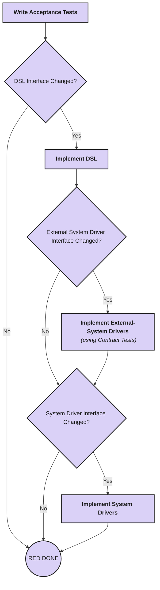
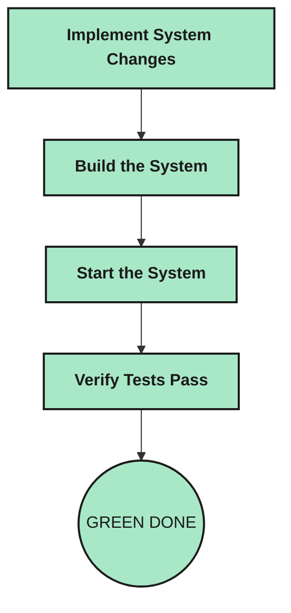
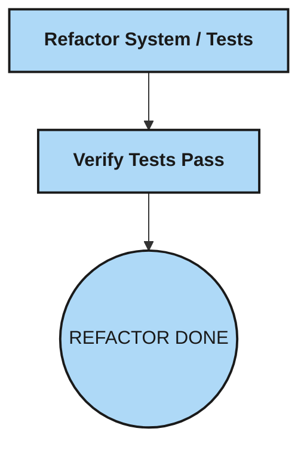

[](https://github.com/optivem/gh-optivem/actions/workflows/gh-commit-stage.yml)

# gh-optivem

`gh-optivem` is a command line tool that helps you implement software in a reliable way using ATDD & AI.

# Why gh-optivem

I originally hand-rolled this as a single AI agent that owned the entire ATDD process end to end. It decided for itself when to run each step — and would sometimes skip straight to writing implementation code without ever writing the acceptance test it was meant to be red against first. It also ran up about $1,000 in extra usage on top of my Claude Pro plan, because nothing stopped it from re-exploring the whole codebase at every step. gh-optivem exists to fix both problems.

### What you get

1. **Ship AI-generated code you can trust, faster.** A fixed, auditable process — not an agent's own judgment — drives every change, with a human reviewing and approving before anything merges. ATDD discipline catches defects early, and narrow per-step context stops rework loops that eat into velocity.
2. **Full traceability from ticket to commit.** Every acceptance criterion maps to a test, every step lands as its own reviewed commit, and the GitHub board status updates itself — you always know exactly what shipped and why.
3. **Token-cost-optimized by design, and fully visible.** Each step runs in a narrow, focused context instead of handing an agent the whole ticket at once, which keeps token usage down — and per-agent, per-run cost accounting shows exactly what AI work costs as it happens, not as a line item you have to explain after the fact.
4. **Scales across teams and stacks, on your existing GitHub workflow.** One CLI to install; everything it drives — repos, boards, PRs, CI — is what your org already uses. Slice a ticket across API/UI/mobile teams and mix languages per tier without asking anyone to change how they work.
5. **One methodology, centrally maintained.** Update how every project on your team does ATDD with a single command — no per-repo drift to chase down as your repo count grows.

# Setup

One-time, before your first project: install `gh`, `gh-optivem` itself and your local tooling (`environment setup` does the latter), then set your credentials. Full walkthrough: **[docs/setup.md](docs/setup.md)**.

```bash
gh extension install optivem/gh-optivem
gh optivem environment setup
gh optivem claude setup
```

# Create your project

## Generate your project

`gh optivem init` creates your GitHub repository, applies the project template, sets up the pipeline and waits for it to pass.

Run it with your project's values. Which language flags you pass depends on `--arch`.

**Multitier** — separate `backend/` and `frontend/` trees, each with its own language:

```bash
gh optivem init --owner <owner> --repo <repo> --system-name "<system-name>" --repo-strategy <repo-strategy> --arch multitier --backend-lang <backend-lang> --frontend-lang <frontend-lang> --test-lang <test-lang>
```

**Monolith** — a single `system/` tree in one language, so there is no separate frontend flag:

```bash
gh optivem init --owner <owner> --repo <repo> --system-name "<system-name>" --repo-strategy <repo-strategy> --arch monolith --monolith-lang <monolith-lang> --test-lang <test-lang>
```

Either way, `--test-lang` is independent of the system language(s), and `--repo-strategy` works with both architectures.

Run `gh optivem init --help` for the full, current flag list and defaults, or see [docs/cli-reference.md](docs/cli-reference.md#scaffolding-init) for flag details plus how they interact.

For example:

```bash
gh optivem init --owner valentinajemuovic --repo book-shop --system-name "Book Shop" --repo-strategy monorepo --arch multitier --backend-lang dotnet --frontend-lang typescript --test-lang java
```

**Already have the repository?** By default `init` refuses to touch an existing repo. Pass `--overwrite` to scaffold into it: new files are added, files that clash with the template are replaced, and existing remote resources (environments, labels, variables, project board, SonarCloud projects) are reused. `init` prints a preview of exactly what would change and asks for confirmation before writing; the scaffold is pushed straight to the default branch, which must be `main`. Run `gh optivem init --overwrite --dry-run ...` first to see the preview and exit without writing anything (add `--verbose` for full diffs). `--yes` skips the confirmation prompt only; it never implies `--overwrite`.

**Expect this to run for a long time** — `init` watches the generated pipelines on GitHub Actions until they go green, which takes tens of minutes, printing a heartbeat every 5 minutes. Leave it running until it reports success; interrupting it stops the watching, not the pipeline.

## Clone project repository

Clone your new repository to work on it locally:

```bash
gh repo clone valentinajemuovic/book-shop
cd book-shop
```

*With `--repo-strategy multirepo`, `init` creates several repositories — clone them all side by side in the same parent directory, so the cross-repo commands can find them.*

# Build your own product (kickoff)

`init` leaves a repo that runs green on the shop sample. If you are building your own product rather than adapting the sample, `gh optivem kickoff` takes you from an idea to the first stories before any code. The path is:

`init` → describe → prototype → use cases → stories

1. **Describe**: a few informal sentences about the product.
2. **Prototype**: an agent builds a clickable, throwaway HTML prototype; you review it and give feedback in plain language.
3. **Use cases**: from the approved prototype, a use case diagram and one narrative per use case with `UC-NNN.M` acceptance criteria.
4. **Stories**: one ticket per use case slice, in the format `gh optivem implement` expects, each naming the `UC-NNN.M` criteria it covers.

It is one command you re-run: it reads what is already done and continues at the next phase. Each approval step (prototype, use case diagram, use cases) is yours; `--auto` never approves for you.

```bash
gh optivem kickoff --description "A booking site for small yoga studios: studios publish classes, members book and cancel."
gh optivem kickoff             # resume at the next phase
gh optivem kickoff --approve   # approve the phase waiting at its checkpoint
gh optivem kickoff --status    # show progress
```

Then build the stories one at a time with `gh optivem implement <issue>`, or pass `--autopilot` to run them all unattended through the same ATDD flow.

**Status:** the shop-sample removal phase (deleting the shop code while keeping the test architecture) is not implemented yet and fails with an explicit error, so kickoff does not yet run end to end. The phases before it (description, prototype, use case diagram, use cases) work. Phases, flags and files are in [docs/cli-reference.md](docs/cli-reference.md#your-own-product-kickoff).

# ATDD AI Implementation

Setup and creating your project are one-offs. From here on, `gh optivem implement` is the day-to-day verb: it takes one GitHub issue — a User Story with Acceptance Criteria — and walks it through the ATDD pipeline, dispatching an AI agent at each step and running the real build, system, and test commands in between.

The pipeline follows the double-loop red-green-refactor cycle. Unless a step says otherwise, each step follows the same pattern: **AI writes · Human reviews · Commit**.

**RED** — write failing acceptance tests, DSL, and drivers:

Acceptance Tests are written at the product level — independent of UI/API/Mobile, and independent of teams.



**GREEN** — implement, build, start, and verify the system:



**REFACTOR** — refactor system and tests, then verify and commit:

AI and human decide together whether refactoring is needed; if so, AI refactors and human reviews.



The above is the short BPMN. The full BPMN is here: [docs/process-diagram.md](https://github.com/optivem/gh-optivem/blob/main/docs/process-diagram.md).

## Implement a ticket

First, create a ticket and add it to the project board `init` created: **[docs/create-ticket.md](docs/create-ticket.md)**.

Then, from your project's repo root — `56` is an example, use your actual issue number:

```bash
gh optivem implement 56
```

Every confirmation prompts by default. For an unattended run, opt into `--auto` and pick how much human approval to keep:

```bash
gh optivem --auto implement 56 --headless                           # truly autonomous: prompt only on human-tier sites (STOPs, fix-agents, release)
gh optivem --auto --confirm=system-commit implement 56 --headless   # narrower: still confirm every commit
gh optivem --auto --confirm=system-agent implement 56 --headless    # narrower still: also confirm every production-agent dispatch
gh optivem --auto --confirm=command implement 56 --headless         # narrowest: confirm everything except cheap build/test commands
```

`--confirm=<tier>` sets the auto-approve floor: that tier and everything above it still prompts, everything below auto-yeses. Tiers, low to high stakes:

| Tier | Covers |
|---|---|
| `command` | execute-command BPMN nodes (compile / build / start / test run). Cheap, no AI cost, no global state mutation. |
| `system-agent` | execute-agent for production code (`implement-*`, `update-*`, `refactor-system`). AI cost; produces reviewable diffs. |
| `test-agent` | execute-agent for tests (`write-*-tests`, `refactor-tests`). Tests-as-contract — ranked above `system-agent` because broken tests mask regressions. |
| `system-commit` | commit node after a production-agent phase. Persistent git write. |
| `test-commit` | commit node after a test-agent phase. Persistent git write of the test contract. |
| `human` | fix-`*` agents, `refine-acceptance-criteria`, BPMN STOP nodes, release. Top tier — always prompts, cannot be auto-yes'd at any reachable floor. |

Default when `--auto` is set and `--confirm` is omitted: `human`. See [Auto-approve](docs/cli-reference.md#auto-approve) for env-var overrides and more detail.

## Stories, use cases and the merge step

Two artifacts, two roles. The **use cases** (`docs/use-cases/`) are the current spec: a narrative plus `UC-NNN.M` acceptance criteria that always describe the system as it should behave now. A **story** is an increment: a change request with Gherkin scenarios, living on the ticket.

Before ATDD builds a story, `implement` runs a **merge** step that folds the story into the use cases. The merge is one-way and one-time: only the use cases are edited, never the story, and the acceptance tests are then written against the merged `UC-NNN.M` criteria. Bugs and tasks skip the merge.

- **Behaviour change**: the `use-case-merger` agent proposes the narrative edit and the new or changed `UC-NNN.M` lines, and you approve the diff. This approval is human-tier, so `--auto` still stops for it. A repo with no use cases yet gets its first `UC-NNN` file this way.
- **No-op merge**: if the story has at least one scenario and every scenario names an existing criterion, the merge is skipped with no agent and no approval. Name the criterion with a `@UC-001.4` tag on the scenario (a comment line above it, the title or the steps also work). Stories generated by `kickoff` carry their ids this way.
- **Consistency check**: the run fails if a scenario contradicts an existing criterion, a scenario maps to no criterion, or the merged use cases do not validate.

After the tests are green, `gh optivem spec record` stores a fingerprint of each verified criterion. If a criterion's text is edited later, it shows as **Changed** (not verified) until its test is re-checked; see the [spec-coverage gate](#spec-coverage-gate). Nothing runs `spec record` automatically yet.

# Spec-coverage gate

`gh optivem spec` turns use-case markdown (acceptance criteria with stable IDs like `UC-001.3`) and JUnit XML test results into a per-criterion lifecycle (Planned, In progress, Verified, Failing, Waived, Changed) and a "spec coverage" number, and can gate a pipeline on it. Tests link to criteria by tag (`@Tag("UC-001.3")`); the gate reads only the markdown and the XML. The convention is in [docs/spec-gate/convention.md](docs/spec-gate/convention.md).

```bash
gh optivem spec validate                      # check the use-case markdown only
gh optivem spec status                        # show states and coverage, never fails on the verdict
gh optivem spec check --mode lenient          # commit/acceptance stage: blocks on validation errors and Failing
gh optivem spec check --mode strict --threshold 95 --html spec-report.html   # release stage
gh optivem spec adopt                         # baseline today's unverified criteria so an existing repo can adopt the gate
gh optivem spec record                        # after green: fingerprint verified criteria so later text edits show as Changed
```

Exit codes: `0` pass, `1` gate failed, `2` usage or configuration error. Configuration lives in `spec.yaml`. See [docs/cli-reference.md](docs/cli-reference.md#spec-coverage-gate-spec) for flags.

# Reference

## Everything else

See the [full CLI reference](docs/cli-reference.md) — credentials, every `init` flag, the `implement` flags and team-handoff slices, the system and test runners, cross-repo ops, and cleanup.

## Upgrade

```bash
gh extension upgrade optivem
```

## Uninstall

```bash
gh extension remove optivem
```

## Support

Something went wrong? [Open an issue](https://github.com/optivem/gh-optivem/issues).

## Maintainer

Maintained by Valentina Jemuović at Optivem — [GitHub](https://github.com/valentinajemuovic) · [LinkedIn](https://www.linkedin.com/in/valentinajemuovic/).

## License

[AGPL-3.0](LICENSE) © Optivem

gh-optivem is free to use, including for commercial purposes. If you modify the source and distribute it, or run a modified version as a network service, AGPL-3.0 requires you to release the modified source under the same license. If you want to modify or embed gh-optivem in a proprietary product without that obligation, a commercial license is available — [open an issue](https://github.com/optivem/gh-optivem/issues) or contact Optivem to discuss.
