# ATDD Process Flow

> Generated from `internal/atdd/process/process-flow.yaml` by `internal/atdd/runtime/diagram`. Do not edit by hand — edit the YAML and regenerate via `gh optivem process show > docs/process-diagram.md`.

Each section corresponds to one named process in the YAML. `call-activity` nodes appear as boxes pointing at the linked sub-process's heading.

## Legend

Node **shape** encodes the BPMN type; **fill color** encodes the executor; **border color** (orthogonal) encodes the TDD stage where the author marked one.

- `(( ))` — start / end event (BPMN plain start or end; empty circle, descriptive name lives in the YAML). Start vs end is read from position in the flow — start has no incoming edge, end has no outgoing edge.
- `((⚡))` — error end event (BPMN exceptional exit; red border). Two flavors: **Unknown** (defensive guard — an unhandled gateway branch fired; should never happen at runtime) and **Rejected** (hard-abort — a runtime condition that intentionally halts the run, e.g. agent output rejected post-approve). The descriptive name is in the YAML source; the diagram keeps the icon small.
- `{diamond}` — gateway (decision)
- `[[subroutine]]` — service task — mechanical, automated step (white)
- `[rectangle]` — user task — LLM agent (dark blue) or human (yellow); `call_activity` rectangles are unfilled and link to a sub-process heading
- `[/skewed/]` — published outputs of a process (dashed border)
- **TDD-stage border** — red = RED (failing test), green = GREEN (test passes), blue = REFACTOR (improve without changing behaviour). Only applied where the call site explicitly plays that role.

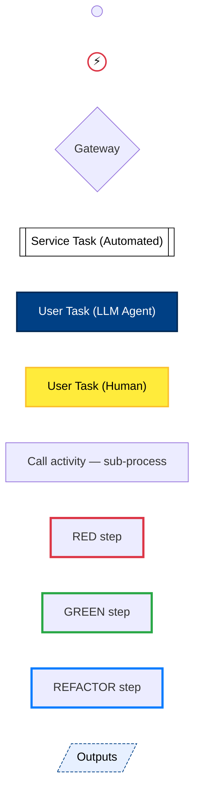

## Main

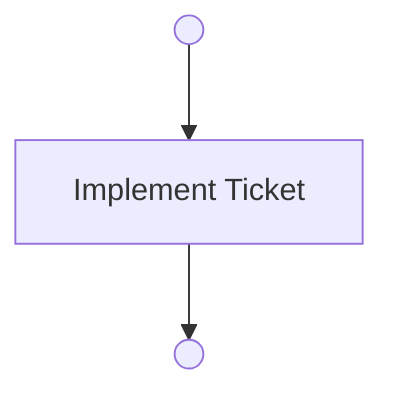

## Refine Ticket

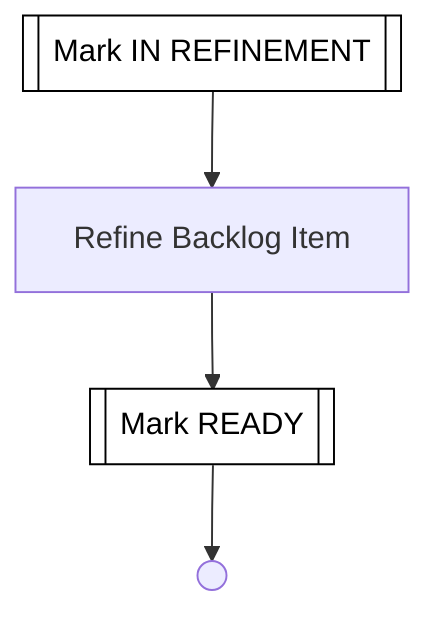

## Implement Ticket

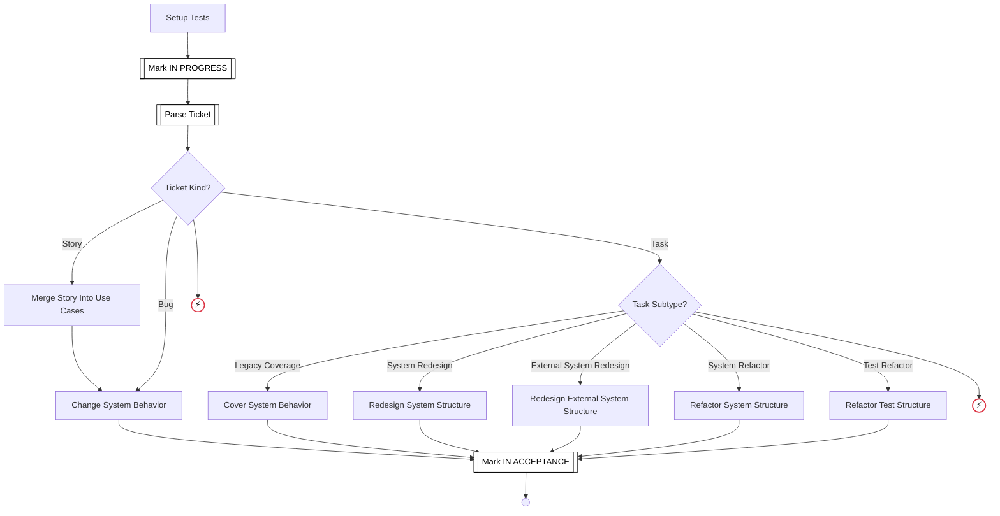

## Refactor

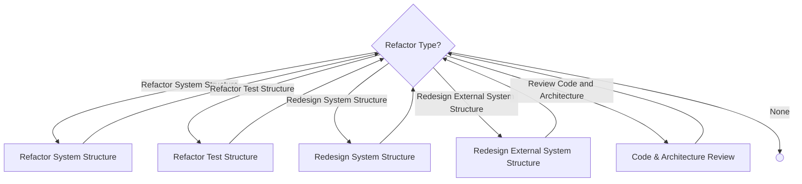

## Characterize Legacy System

```mermaid
flowchart TD
    RECORD_START_COMMITS[[Record System Start Commits]]
    START_SYSTEM[Start System Once — see § start-system]
    WRITE_USE_CASE_DIAGRAM[Write the Use Case and Dependency Diagrams — see § write-legacy-use-case-diagram]
    COMMIT_USE_CASE_DIAGRAM["Commit the Use Case Diagrams — see § commit<br/>category = test-commit<br/>layer = USE CASE DIAGRAM"]
    SAFETY_GATE_USE_CASE_DIAGRAM[Safety Gate — see § verify-system-unchanged]
    CONFIRM_USE_CASE_DIAGRAM["Confirm the Diagrams and the Most Important Use Case — see § approve<br/>ask-for-changes = true<br/>category = human"]
    GATE_USE_CASE_DIAGRAM_CONFIRMED{Approved?}
    ORDER_PILOT_USE_CASES[[Order the Pilot Use Cases]]
    PILOT["Pilot: the Use Case and Its Dependencies, Gated — see § characterize-use-cases<br/>gated = true"]
    ORDER_SCALING_USE_CASES[[Order the Remaining Use Cases]]
    SCALING["Scaling: the Remaining Use Cases, Unattended — see § characterize-use-cases<br/>gated = false"]
    FINAL_SAFETY_GATE[Final Safety Gate — see § verify-system-unchanged]
    STOP_SYSTEM[Stop System]
    CHARACTERIZE_END(( ))
    USE_CASE_DIAGRAM_CONFIRMATION_EXHAUSTED((⚡))

    RECORD_START_COMMITS --> START_SYSTEM
    START_SYSTEM --> WRITE_USE_CASE_DIAGRAM
    WRITE_USE_CASE_DIAGRAM --> COMMIT_USE_CASE_DIAGRAM
    COMMIT_USE_CASE_DIAGRAM --> SAFETY_GATE_USE_CASE_DIAGRAM
    SAFETY_GATE_USE_CASE_DIAGRAM --> CONFIRM_USE_CASE_DIAGRAM
    CONFIRM_USE_CASE_DIAGRAM --> GATE_USE_CASE_DIAGRAM_CONFIRMED
    GATE_USE_CASE_DIAGRAM_CONFIRMED -- Approved --> ORDER_PILOT_USE_CASES
    GATE_USE_CASE_DIAGRAM_CONFIRMED -- Rejected --> WRITE_USE_CASE_DIAGRAM
    ORDER_PILOT_USE_CASES --> PILOT
    PILOT --> ORDER_SCALING_USE_CASES
    ORDER_SCALING_USE_CASES --> SCALING
    SCALING --> FINAL_SAFETY_GATE
    FINAL_SAFETY_GATE --> STOP_SYSTEM
    STOP_SYSTEM --> CHARACTERIZE_END

    classDef serviceNode fill:#ffffff,stroke:#000000,stroke-width:1px,color:#000000
    class ORDER_PILOT_USE_CASES,ORDER_SCALING_USE_CASES,RECORD_START_COMMITS serviceNode

    classDef errorEndNode fill:#ffffff,stroke:#dc3545,stroke-width:2px,color:#000000
    class USE_CASE_DIAGRAM_CONFIRMATION_EXHAUSTED errorEndNode
```

## Refine Backlog Item

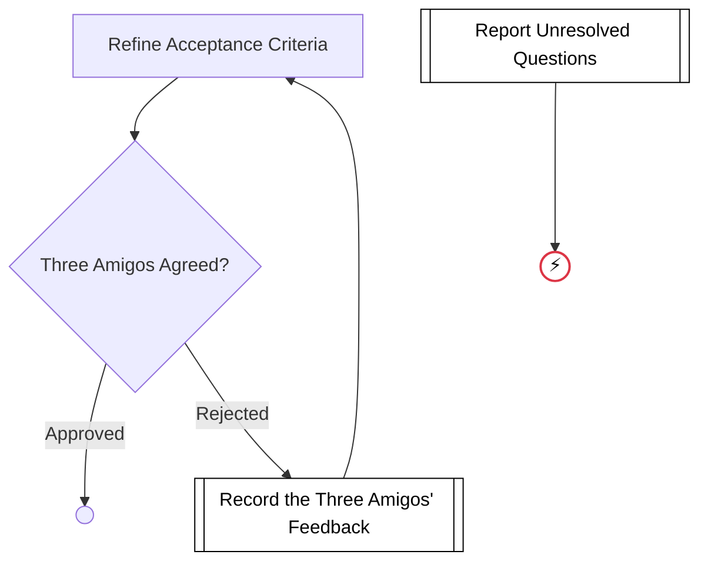

## Change System Behavior

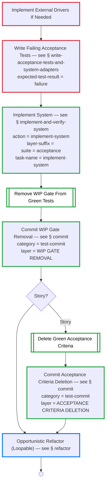

## Cover System Behavior

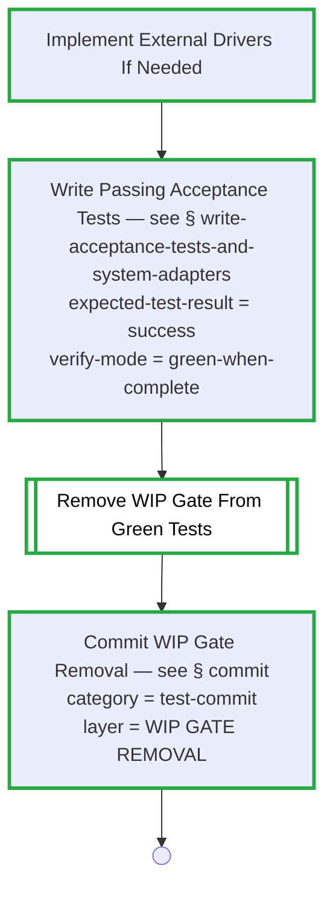

## Redesign System Structure

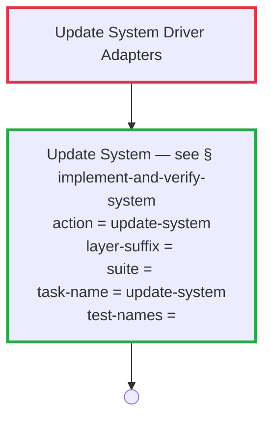

## Refactor System Structure

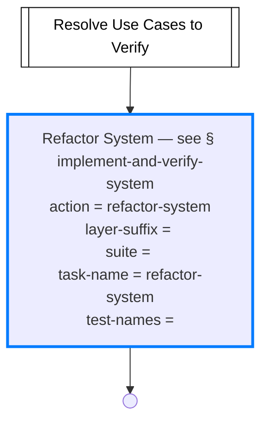

## Refactor Test Structure

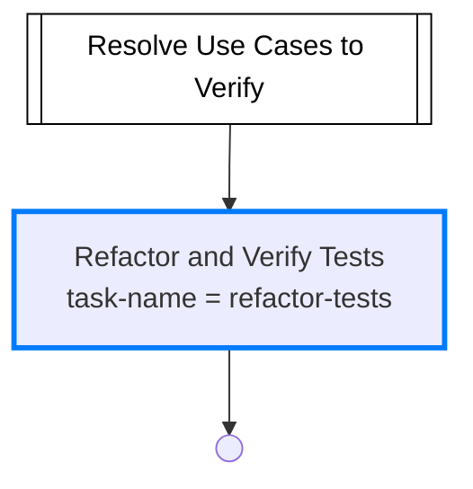

## Implement External Drivers If Needed

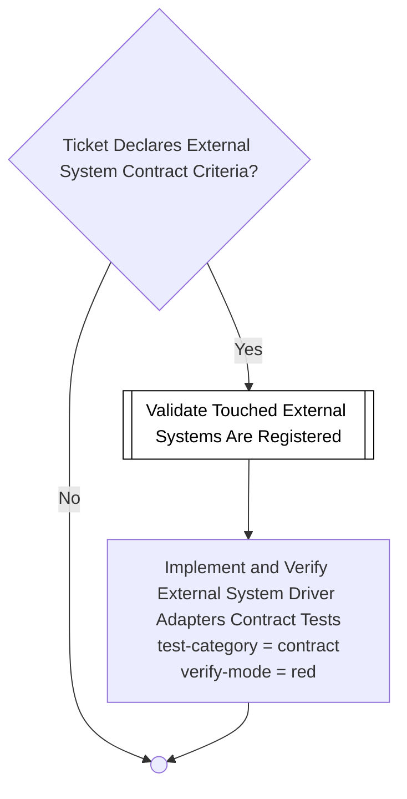

## Write and Verify Acceptance Tests

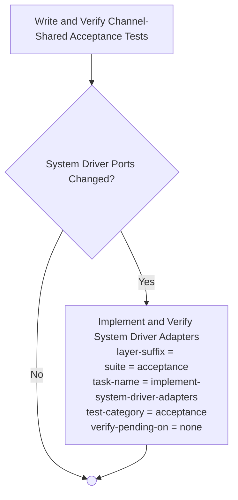

## Write and Verify Channel-Shared Acceptance Tests

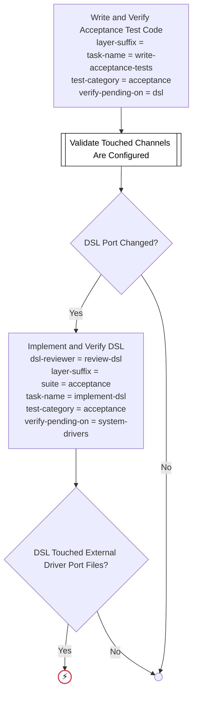

## Write and Verify Acceptance Test Code

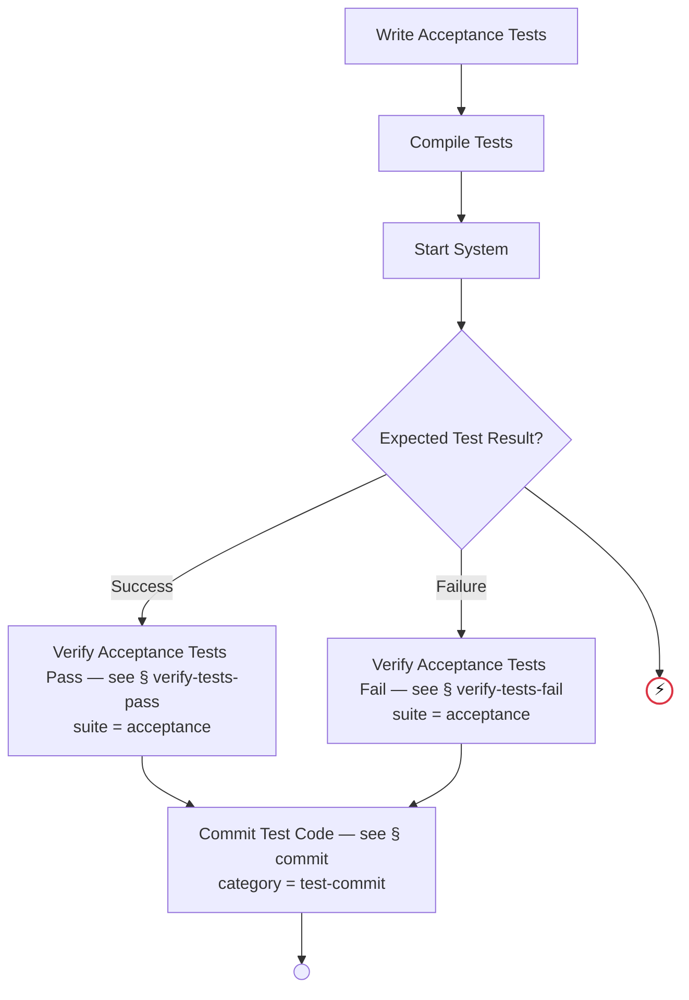

## Implement and Verify DSL

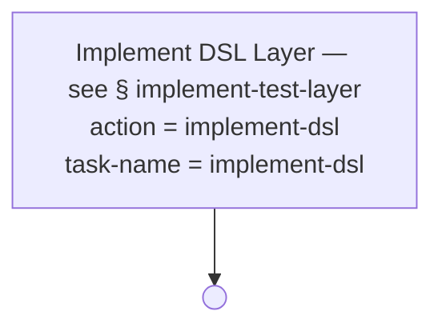

## Implement and Verify System Driver Adapters

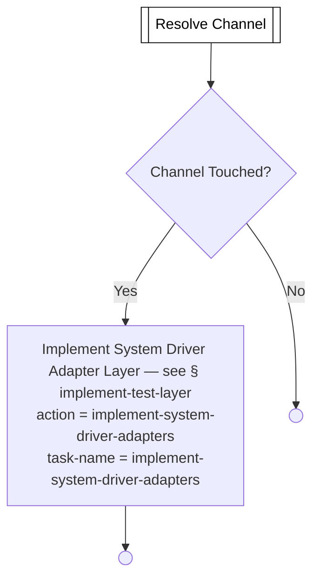

## Implement and Verify External System Driver Adapters Contract Tests

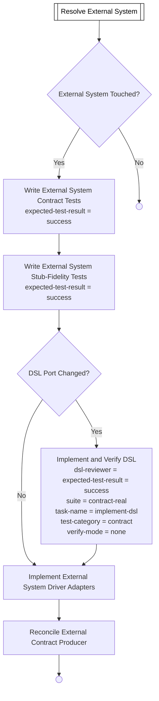

## Implement and Verify System

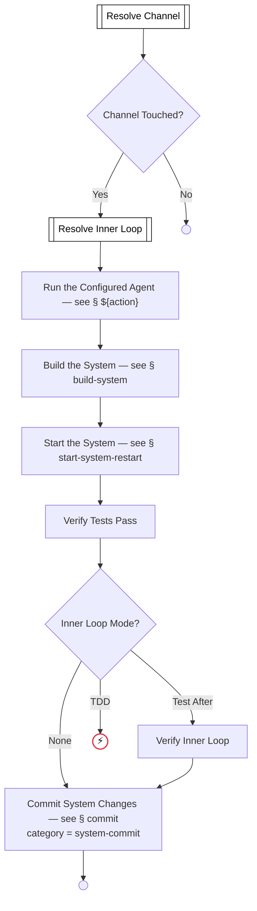

## Refactor and Verify Tests

```mermaid
flowchart TD
    REFACTOR_TESTS[Refactor Tests]
    COMPILE_TESTS[Compile Tests]
    START_SYSTEM[Start System]
    VERIFY_TESTS_PASS["Verify Tests Pass<br/>suite = <br/>test-names = "]
    COMMIT_TESTS["Commit Test Changes — see § commit<br/>category = test-commit<br/>layer = TESTS"]
    REFACTOR_AND_VERIFY_TESTS_END(( ))

    REFACTOR_TESTS --> COMPILE_TESTS
    COMPILE_TESTS --> START_SYSTEM
    START_SYSTEM --> VERIFY_TESTS_PASS
    VERIFY_TESTS_PASS --> COMMIT_TESTS
    COMMIT_TESTS --> REFACTOR_AND_VERIFY_TESTS_END
```

## Implement Test Layer

```mermaid
flowchart TD
    RUN_ACTION["Run the Configured Agent — see § ${action}"]
    COMPILE_TESTS[Compile Tests]
    START_SYSTEM[Start System]
    GATE_EXPECTED_TEST_RESULT{Expected Test Result?}
    VERIFY_TESTS_PASS_FILTERED[Verify Tests Pass]
    VERIFY_TESTS_FAIL_FILTERED[Verify Tests Fail]
    COMMIT_LAYER["Commit Layer Changes — see § commit<br/>category = test-commit"]
    UNKNOWN_EXPECTED_TEST_RESULT((⚡))
    IMPLEMENT_TEST_LAYER_END(( ))

    RUN_ACTION --> COMPILE_TESTS
    COMPILE_TESTS --> START_SYSTEM
    START_SYSTEM --> GATE_EXPECTED_TEST_RESULT
    GATE_EXPECTED_TEST_RESULT -- Success --> VERIFY_TESTS_PASS_FILTERED
    GATE_EXPECTED_TEST_RESULT -- Failure --> VERIFY_TESTS_FAIL_FILTERED
    GATE_EXPECTED_TEST_RESULT -- None --> COMMIT_LAYER
    GATE_EXPECTED_TEST_RESULT --> UNKNOWN_EXPECTED_TEST_RESULT
    VERIFY_TESTS_PASS_FILTERED --> COMMIT_LAYER
    VERIFY_TESTS_FAIL_FILTERED --> COMMIT_LAYER
    COMMIT_LAYER --> IMPLEMENT_TEST_LAYER_END

    classDef errorEndNode fill:#ffffff,stroke:#dc3545,stroke-width:2px,color:#000000
    class UNKNOWN_EXPECTED_TEST_RESULT errorEndNode
```

## Verify Tests Pass

```mermaid
flowchart TD
    RUN_TESTS[Run Tests]
    GATE_TESTS_OUTCOME{Test Outcome?}
    VERIFY_PASS_END(( ))
    CHECK_FIX_PROGRESS[[Check Fix-Loop Progress]]
    TESTS_INFRA_HALT((⚡))
    UNKNOWN_TESTS_OUTCOME((⚡))
    GATE_FIX_PROGRESSING{Fix Loop Progressing?}
    GATE_CHARACTERIZE{Characterizing?}
    FIX_LOOP_NO_PROGRESS_EXHAUSTED((⚡))
    FIX_UNEXPECTED_FAILING_TESTS[Fix Unexpected Test Failures — see § fix-unexpected-failing-tests]
    FIX_CHARACTERIZATION_FAILING_TESTS[Fix Failing Characterization Tests]
    GATE_FIX_FLOW_APPROVED{Fixer Dispatch Approved?}
    FIX_FLOW_NOT_APPROVED((⚡))
    FIX_LOOP_EXHAUSTED((⚡))

    RUN_TESTS --> GATE_TESTS_OUTCOME
    GATE_TESTS_OUTCOME -- Pass --> VERIFY_PASS_END
    GATE_TESTS_OUTCOME -- Fail --> CHECK_FIX_PROGRESS
    GATE_TESTS_OUTCOME -- Infra --> TESTS_INFRA_HALT
    GATE_TESTS_OUTCOME --> UNKNOWN_TESTS_OUTCOME
    CHECK_FIX_PROGRESS --> GATE_FIX_PROGRESSING
    GATE_FIX_PROGRESSING -- Yes --> GATE_CHARACTERIZE
    GATE_FIX_PROGRESSING -- No --> FIX_LOOP_NO_PROGRESS_EXHAUSTED
    GATE_CHARACTERIZE -- No --> FIX_UNEXPECTED_FAILING_TESTS
    GATE_CHARACTERIZE -- Yes --> FIX_CHARACTERIZATION_FAILING_TESTS
    FIX_UNEXPECTED_FAILING_TESTS --> GATE_FIX_FLOW_APPROVED
    FIX_CHARACTERIZATION_FAILING_TESTS --> GATE_FIX_FLOW_APPROVED
    GATE_FIX_FLOW_APPROVED -- Rejected --> FIX_FLOW_NOT_APPROVED
    GATE_FIX_FLOW_APPROVED --> RUN_TESTS

    classDef serviceNode fill:#ffffff,stroke:#000000,stroke-width:1px,color:#000000
    class CHECK_FIX_PROGRESS serviceNode

    classDef errorEndNode fill:#ffffff,stroke:#dc3545,stroke-width:2px,color:#000000
    class FIX_FLOW_NOT_APPROVED,FIX_LOOP_EXHAUSTED,FIX_LOOP_NO_PROGRESS_EXHAUSTED,TESTS_INFRA_HALT,UNKNOWN_TESTS_OUTCOME errorEndNode
```

## Verify Tests Fail

```mermaid
flowchart TD
    RUN_TESTS[Run Tests]
    GATE_TESTS_OUTCOME{Test Outcome?}
    GATE_CHARACTERIZE{Characterizing?}
    VERIFY_FAIL_END(( ))
    TESTS_INFRA_HALT((⚡))
    UNKNOWN_TESTS_OUTCOME((⚡))
    FIX_UNEXPECTED_PASSING_TESTS[Fix Unexpectedly Passing Tests — see § fix-unexpected-passing-tests]
    FIX_CHARACTERIZATION_PASSING_TESTS[Fix Passing Characterization Tests]
    GATE_FIX_FLOW_APPROVED{Fixer Dispatch Approved?}
    FIX_FLOW_NOT_APPROVED((⚡))
    FIX_LOOP_EXHAUSTED((⚡))

    RUN_TESTS --> GATE_TESTS_OUTCOME
    GATE_TESTS_OUTCOME -- Pass --> GATE_CHARACTERIZE
    GATE_TESTS_OUTCOME -- Fail --> VERIFY_FAIL_END
    GATE_TESTS_OUTCOME -- Infra --> TESTS_INFRA_HALT
    GATE_TESTS_OUTCOME --> UNKNOWN_TESTS_OUTCOME
    GATE_CHARACTERIZE -- No --> FIX_UNEXPECTED_PASSING_TESTS
    GATE_CHARACTERIZE -- Yes --> FIX_CHARACTERIZATION_PASSING_TESTS
    FIX_UNEXPECTED_PASSING_TESTS --> GATE_FIX_FLOW_APPROVED
    FIX_CHARACTERIZATION_PASSING_TESTS --> GATE_FIX_FLOW_APPROVED
    GATE_FIX_FLOW_APPROVED -- Rejected --> FIX_FLOW_NOT_APPROVED
    GATE_FIX_FLOW_APPROVED --> RUN_TESTS

    classDef errorEndNode fill:#ffffff,stroke:#dc3545,stroke-width:2px,color:#000000
    class FIX_FLOW_NOT_APPROVED,FIX_LOOP_EXHAUSTED,TESTS_INFRA_HALT,UNKNOWN_TESTS_OUTCOME errorEndNode
```

## Write Acceptance Tests

```mermaid
flowchart TD
    EXECUTE_AGENT["Dispatch the Agent — see § execute-agent<br/>agent = acceptance-test-writer<br/>approver-role = QA and/or Developers<br/>category = test-agent<br/>reviewer = review-acceptance-tests<br/>task-name = write-acceptance-tests"]
    WAT_END(( ))

    EXECUTE_AGENT --> WAT_END
    WRITE-ACCEPTANCE-TESTS_OUTPUTS[/"dsl-port-changed: bool<br/>test-names?: string-list<br/>scope-exception-files?: string-list<br/>scope-exception-reason?: string"/]
    WAT_END -. produces .-> WRITE-ACCEPTANCE-TESTS_OUTPUTS

    classDef outputNode fill:#e7f0ff,stroke:#004085,stroke-width:1px,stroke-dasharray:4 2,color:#000000
    class WRITE-ACCEPTANCE-TESTS_OUTPUTS outputNode
```

## Write External System Contract Tests

```mermaid
flowchart TD
    EXECUTE_AGENT["Dispatch the Agent — see § execute-agent<br/>agent = contract-test-writer<br/>category = test-agent<br/>task-name = write-contract-tests"]
    WCT_END(( ))

    EXECUTE_AGENT --> WCT_END
    WRITE-CONTRACT-TESTS_OUTPUTS[/"dsl-port-changed: bool<br/>test-names?: string-list<br/>scope-exception-files?: string-list<br/>scope-exception-reason?: string"/]
    WCT_END -. produces .-> WRITE-CONTRACT-TESTS_OUTPUTS

    classDef outputNode fill:#e7f0ff,stroke:#004085,stroke-width:1px,stroke-dasharray:4 2,color:#000000
    class WRITE-CONTRACT-TESTS_OUTPUTS outputNode
```

## Implement DSL

```mermaid
flowchart TD
    EXECUTE_AGENT["Dispatch the Agent — see § execute-agent<br/>agent = dsl-implementer<br/>approver-role = Developers<br/>category = system-agent<br/>task-name = implement-dsl"]
    IMPL_DSL_END(( ))

    EXECUTE_AGENT --> IMPL_DSL_END
    IMPLEMENT-DSL_OUTPUTS[/"system-driver-port-changed: bool<br/>external-driver-port-changed: bool<br/>scope-exception-files?: string-list<br/>scope-exception-reason?: string"/]
    IMPL_DSL_END -. produces .-> IMPLEMENT-DSL_OUTPUTS

    classDef outputNode fill:#e7f0ff,stroke:#004085,stroke-width:1px,stroke-dasharray:4 2,color:#000000
    class IMPLEMENT-DSL_OUTPUTS outputNode
```

## Implement System

```mermaid
flowchart TD
    EXECUTE_AGENT["Dispatch the Agent — see § execute-agent<br/>agent = system-implementer<br/>category = system-agent<br/>task-name = implement-system"]
    IMPL_SYS_END(( ))

    EXECUTE_AGENT --> IMPL_SYS_END
```

## Implement System Driver Adapters

```mermaid
flowchart TD
    EXECUTE_AGENT["Dispatch the Agent — see § execute-agent<br/>agent = system-driver-adapter-implementer<br/>approver-role = Developers<br/>category = system-agent<br/>reviewer = review-system-driver-adapters<br/>task-name = implement-system-driver-adapters"]
    IMPL_SYS_DA_END(( ))

    EXECUTE_AGENT --> IMPL_SYS_DA_END
```

## Implement External System Driver Adapters

```mermaid
flowchart TD
    EXECUTE_AGENT["Dispatch the Agent — see § execute-agent<br/>agent = external-system-driver-adapter-implementer<br/>category = system-agent<br/>task-name = implement-external-system-driver-adapters"]
    IMPL_EXT_DA_END(( ))

    EXECUTE_AGENT --> IMPL_EXT_DA_END
```

## Implement External System Stubs

```mermaid
flowchart TD
    EXECUTE_AGENT["Dispatch the Agent — see § execute-agent<br/>agent = external-system-stub-implementer<br/>category = system-agent<br/>task-name = implement-external-system-stubs"]
    IMPL_STUBS_END(( ))

    EXECUTE_AGENT --> IMPL_STUBS_END
```

## Fix Unexpected Passing Tests

```mermaid
flowchart TD
    EXECUTE_AGENT["Dispatch the Agent — see § execute-agent<br/>agent = unexpected-passing-tests-fixer<br/>category = human<br/>task-name = fix-unexpected-passing-tests"]
    FIX_PASS_END(( ))

    EXECUTE_AGENT --> FIX_PASS_END
```

## Fix Unexpected Failing Tests

```mermaid
flowchart TD
    EXECUTE_AGENT["Dispatch the Agent — see § execute-agent<br/>agent = unexpected-failing-tests-fixer<br/>category = human<br/>task-name = fix-unexpected-failing-tests"]
    FIX_FAIL_END(( ))

    EXECUTE_AGENT --> FIX_FAIL_END
```

## Refactor Tests

```mermaid
flowchart TD
    EXECUTE_AGENT["Dispatch the Agent — see § execute-agent<br/>agent = test-refactorer<br/>category = test-agent<br/>task-name = refactor-tests"]
    REFACTOR_TESTS_END(( ))

    EXECUTE_AGENT --> REFACTOR_TESTS_END
```

## Refactor System

```mermaid
flowchart TD
    EXECUTE_AGENT["Dispatch the Agent — see § execute-agent<br/>agent = system-refactorer<br/>category = system-agent<br/>task-name = refactor-system"]
    REFACTOR_SYS_END(( ))

    EXECUTE_AGENT --> REFACTOR_SYS_END
```

## Refine Acceptance Criteria

```mermaid
flowchart TD
    EXECUTE_AGENT["Dispatch the Agent — see § execute-agent<br/>agent = acceptance-criteria-refiner<br/>category = human<br/>return-on-post-rejection = true<br/>task-name = refine-acceptance-criteria"]
    REFINE_AC_END(( ))

    EXECUTE_AGENT --> REFINE_AC_END
    REFINE-ACCEPTANCE-CRITERIA_OUTPUTS[/open-questions?: string/]
    REFINE_AC_END -. produces .-> REFINE-ACCEPTANCE-CRITERIA_OUTPUTS

    classDef outputNode fill:#e7f0ff,stroke:#004085,stroke-width:1px,stroke-dasharray:4 2,color:#000000
    class REFINE-ACCEPTANCE-CRITERIA_OUTPUTS outputNode
```

## Compile Tests

```mermaid
flowchart TD
    EXECUTE_COMMAND["Dispatch the Command — see § execute-command<br/>category = command<br/>command = gh optivem system-test compile<br/>task-name = compile-tests"]
    COMPILE_TESTS_END(( ))

    EXECUTE_COMMAND --> COMPILE_TESTS_END
```

## Build System

```mermaid
flowchart TD
    EXECUTE_COMMAND["Dispatch the Command — see § execute-command<br/>category = command<br/>command = gh optivem system build<br/>task-name = build-system"]
    BUILD_SYS_END(( ))

    EXECUTE_COMMAND --> BUILD_SYS_END
```

## Start System

```mermaid
flowchart TD
    EXECUTE_COMMAND["Dispatch the Command — see § execute-command<br/>category = command<br/>command = gh optivem system start<br/>task-name = start-system"]
    START_SYS_END(( ))

    EXECUTE_COMMAND --> START_SYS_END
```

## Commit

```mermaid
flowchart TD
    EXECUTE_COMMAND["Dispatch the Command — see § execute-command<br/>command = gh optivem commit --yes --all --include-untracked<br/>task-name = commit"]
    COMMIT_MID_END(( ))

    EXECUTE_COMMAND --> COMMIT_MID_END
```

## Run Tests

```mermaid
flowchart TD
    EXECUTE_COMMAND["Dispatch the Command — see § execute-command<br/>category = command<br/>command = gh optivem system-test run<br/>fix-on-failure = false<br/>task-name = run-tests"]
    RUN_TESTS_END(( ))

    EXECUTE_COMMAND --> RUN_TESTS_END
```

## Approve

```mermaid
flowchart TD
    ASK_HUMAN["${question}"]
    GATE_APPROVED{Approval Outcome?}
    APPROVE_OK_END(( ))
    APPROVE_REJECT_END(( ))

    ASK_HUMAN --> GATE_APPROVED
    GATE_APPROVED -- Approved --> APPROVE_OK_END
    GATE_APPROVED -- Rejected --> APPROVE_REJECT_END

    classDef humanNode fill:#ffeb3b,stroke:#fbc02d,stroke-width:2px,color:#000000
    class ASK_HUMAN humanNode
```

## Execute Agent

```mermaid
flowchart TD
    APPROVE_PRE[Request Approval — see § approve]
    GATE_APPROVED_PRE{Approval Outcome?}
    SNAPSHOT_WORKING_TREE[["Snapshot working tree (per-phase baseline)"]]
    EXECUTE_AGENT_REJECTED_END(( ))
    RUN_AGENT["Run agent ${agent} (task: ${task-name})"]
    VALIDATE_OUTPUTS_AND_SCOPES[["Validate outputs & scopes"]]
    GATE_SCOPE_EXCEPTION_REQUESTED{Scope Exception Requested?}
    CATEGORIZE_SCOPE_EXCEPTION[[Categorize Scope Exception]]
    GATE_OUTPUTS_AND_SCOPES_VALID{Outputs and Scopes Valid?}
    GATE_SCOPE_EXCEPTION_NEEDS_ESCC{Scope Exception Kind?}
    GATE_REVIEWER_CONFIGURED{Reviewer Configured?}
    GATE_FIX_ON_FAILURE{Fix on Failure Enabled?}
    ESCC_UNDECLARED_HALT((⚡))
    CONTRADICTORY_TESTS_HALT((⚡))
    STOP_SCOPE_VIOLATION((⚡))
    RUN_REVIEWER["Review the Agent Output — see § ${reviewer}"]
    APPROVE_POST[Confirm Approval — see § approve]
    FIX[Fix the Failure — see § fix]
    GATE_REVIEW_FINDINGS{Blocking Review Findings?}
    GATE_APPROVED_POST{Approval Outcome?}
    REQUEST_REVISION[[Send Blocking Findings to the Agent]]
    SUMMARIZE_REVIEW[[Summarize Review Findings]]
    EXECUTE_AGENT_END(( ))
    GATE_RETURN_ON_POST_REJECTION{Caller Handles Rejection?}
    APPROVE_POST_REVIEWED["Confirm Approval (Reviewed) — see § approve"]
    EXECUTE_AGENT_OUTPUT_DECLINED_END(( ))
    EXECUTE_AGENT_OUTPUT_REJECTED_END((⚡))
    AGENT_FIX_EXHAUSTED((⚡))

    APPROVE_PRE --> GATE_APPROVED_PRE
    GATE_APPROVED_PRE -- Approved --> SNAPSHOT_WORKING_TREE
    GATE_APPROVED_PRE -- Rejected --> EXECUTE_AGENT_REJECTED_END
    SNAPSHOT_WORKING_TREE --> RUN_AGENT
    RUN_AGENT --> VALIDATE_OUTPUTS_AND_SCOPES
    VALIDATE_OUTPUTS_AND_SCOPES --> GATE_SCOPE_EXCEPTION_REQUESTED
    GATE_SCOPE_EXCEPTION_REQUESTED -- Yes --> CATEGORIZE_SCOPE_EXCEPTION
    GATE_SCOPE_EXCEPTION_REQUESTED -- No --> GATE_OUTPUTS_AND_SCOPES_VALID
    CATEGORIZE_SCOPE_EXCEPTION --> GATE_SCOPE_EXCEPTION_NEEDS_ESCC
    GATE_SCOPE_EXCEPTION_NEEDS_ESCC -- Escc Undeclared --> ESCC_UNDECLARED_HALT
    GATE_SCOPE_EXCEPTION_NEEDS_ESCC -- Contradictory Tests --> CONTRADICTORY_TESTS_HALT
    GATE_SCOPE_EXCEPTION_NEEDS_ESCC -- Other --> STOP_SCOPE_VIOLATION
    GATE_OUTPUTS_AND_SCOPES_VALID -- Yes --> GATE_REVIEWER_CONFIGURED
    GATE_OUTPUTS_AND_SCOPES_VALID -- No --> GATE_FIX_ON_FAILURE
    GATE_FIX_ON_FAILURE -- Yes --> FIX
    GATE_FIX_ON_FAILURE -- No --> APPROVE_POST
    FIX --> RUN_AGENT
    GATE_REVIEWER_CONFIGURED -- Yes --> RUN_REVIEWER
    GATE_REVIEWER_CONFIGURED -- No --> APPROVE_POST
    RUN_REVIEWER --> GATE_REVIEW_FINDINGS
    GATE_REVIEW_FINDINGS -- Yes --> REQUEST_REVISION
    GATE_REVIEW_FINDINGS -- No --> SUMMARIZE_REVIEW
    REQUEST_REVISION --> RUN_AGENT
    SUMMARIZE_REVIEW --> APPROVE_POST_REVIEWED
    APPROVE_POST --> GATE_APPROVED_POST
    APPROVE_POST_REVIEWED --> GATE_APPROVED_POST
    GATE_APPROVED_POST -- Approved --> EXECUTE_AGENT_END
    GATE_APPROVED_POST -- Rejected --> GATE_RETURN_ON_POST_REJECTION
    GATE_RETURN_ON_POST_REJECTION -- Yes --> EXECUTE_AGENT_OUTPUT_DECLINED_END
    GATE_RETURN_ON_POST_REJECTION -- No --> EXECUTE_AGENT_OUTPUT_REJECTED_END

    classDef serviceNode fill:#ffffff,stroke:#000000,stroke-width:1px,color:#000000
    class CATEGORIZE_SCOPE_EXCEPTION,REQUEST_REVISION,SNAPSHOT_WORKING_TREE,SUMMARIZE_REVIEW,VALIDATE_OUTPUTS_AND_SCOPES serviceNode

    classDef agentNode fill:#004085,stroke:#002752,stroke-width:2px,color:#ffffff
    class RUN_AGENT agentNode

    classDef errorEndNode fill:#ffffff,stroke:#dc3545,stroke-width:2px,color:#000000
    class AGENT_FIX_EXHAUSTED,CONTRADICTORY_TESTS_HALT,ESCC_UNDECLARED_HALT,EXECUTE_AGENT_OUTPUT_REJECTED_END,STOP_SCOPE_VIOLATION errorEndNode
```

## Execute Command

```mermaid
flowchart TD
    APPROVE_PRE[Request Approval — see § approve]
    GATE_APPROVED_PRE{Approval Outcome?}
    RUN_COMMAND[["Run command ${command}"]]
    EXECUTE_COMMAND_REJECTED_END(( ))
    GATE_COMMAND_SUCCEEDED{Command Succeeded?}
    EXECUTE_COMMAND_END(( ))
    GATE_FIX_ON_FAILURE{Fix on Failure Enabled?}
    FIX[Fix the Failure — see § fix]
    COMMAND_FIX_EXHAUSTED((⚡))

    APPROVE_PRE --> GATE_APPROVED_PRE
    GATE_APPROVED_PRE -- Approved --> RUN_COMMAND
    GATE_APPROVED_PRE -- Rejected --> EXECUTE_COMMAND_REJECTED_END
    RUN_COMMAND --> GATE_COMMAND_SUCCEEDED
    GATE_COMMAND_SUCCEEDED -- Yes --> EXECUTE_COMMAND_END
    GATE_COMMAND_SUCCEEDED -- No --> GATE_FIX_ON_FAILURE
    GATE_FIX_ON_FAILURE -- Yes --> FIX
    GATE_FIX_ON_FAILURE -- No --> EXECUTE_COMMAND_END
    FIX --> RUN_COMMAND

    classDef serviceNode fill:#ffffff,stroke:#000000,stroke-width:1px,color:#000000
    class RUN_COMMAND serviceNode

    classDef errorEndNode fill:#ffffff,stroke:#dc3545,stroke-width:2px,color:#000000
    class COMMAND_FIX_EXHAUSTED errorEndNode
```

## Fix

```mermaid
flowchart TD
    APPROVE_PRE["Request Approval — see § approve<br/>category = human"]
    GATE_APPROVED_PRE{Approval Outcome?}
    EXECUTE_AGENT["Dispatch the Agent — see § execute-agent<br/>category = human<br/>fix-on-failure = false<br/>return-on-post-rejection = false<br/>reviewer = "]
    FIX_REJECTED_END((⚡))
    FIX_END(( ))

    APPROVE_PRE --> GATE_APPROVED_PRE
    GATE_APPROVED_PRE -- Approved --> EXECUTE_AGENT
    GATE_APPROVED_PRE -- Rejected --> FIX_REJECTED_END
    EXECUTE_AGENT --> FIX_END

    classDef errorEndNode fill:#ffffff,stroke:#dc3545,stroke-width:2px,color:#000000
    class FIX_REJECTED_END errorEndNode
```

## Characterize System Driver Adapter Layer

```mermaid
flowchart TD
    GATE_SYSTEM_DRIVER_PORTS_CHANGED{System Driver Ports Changed?}
    IMPLEMENT_AND_VERIFY_SYSTEM_DRIVER_ADAPTERS["Implement and Verify System Driver Adapters<br/>expected-test-result = success<br/>suite = acceptance<br/>task-name = implement-system-driver-adapters<br/>test-category = acceptance<br/>verify-mode = green-when-complete<br/>verify-pending-on = none"]
    CHARACTERIZE_ADAPTER_LAYER_END(( ))

    GATE_SYSTEM_DRIVER_PORTS_CHANGED -- Yes --> IMPLEMENT_AND_VERIFY_SYSTEM_DRIVER_ADAPTERS
    GATE_SYSTEM_DRIVER_PORTS_CHANGED -- No --> CHARACTERIZE_ADAPTER_LAYER_END
    IMPLEMENT_AND_VERIFY_SYSTEM_DRIVER_ADAPTERS --> CHARACTERIZE_ADAPTER_LAYER_END
```

## Characterize Acceptance Test Layer

```mermaid
flowchart TD
    WRITE_AND_VERIFY_ACCEPTANCE_TEST_CODE["Write and Verify Acceptance Test Code<br/>expected-test-result = success<br/>task-name = write-acceptance-tests<br/>test-category = acceptance<br/>verify-mode = green-when-complete<br/>verify-pending-on = dsl"]
    VALIDATE_CHANNELS_REGISTERED[[Validate Touched Channels Are Configured]]
    CHARACTERIZE_AT_LAYER_END(( ))

    WRITE_AND_VERIFY_ACCEPTANCE_TEST_CODE --> VALIDATE_CHANNELS_REGISTERED
    VALIDATE_CHANNELS_REGISTERED --> CHARACTERIZE_AT_LAYER_END

    classDef serviceNode fill:#ffffff,stroke:#000000,stroke-width:1px,color:#000000
    class VALIDATE_CHANNELS_REGISTERED serviceNode
```

## Characterize DSL Layer

```mermaid
flowchart TD
    GATE_DSL_PORT_CHANGED{DSL Port Changed?}
    IMPLEMENT_AND_VERIFY_DSL["Implement and Verify DSL<br/>dsl-reviewer = review-dsl<br/>expected-test-result = success<br/>suite = acceptance<br/>task-name = implement-dsl<br/>test-category = acceptance<br/>verify-mode = green-when-complete<br/>verify-pending-on = drivers"]
    CHARACTERIZE_DSL_LAYER_END(( ))
    GATE_EXTERNAL_DRIVER_PORT_CHANGED{DSL Touched External Driver Port Files?}
    ADD_ESCC_FOR_DISCOVERED_SYSTEMS[Add ESCC for the Discovered Systems — see § write-use-case-criteria]
    RESTAMP_USE_CASE[[Re-stamp the ESCC Keys]]
    EXTERNAL_LAYER[External Layer for This Use Case — see § implement-external-drivers-if-needed]
    RESTAMP_USE_CASE_AFTER_EXTERNAL[[Re-stamp the Use Case Acceptance Tests]]
    VERIFY_TESTS_PASS_ACCEPTANCE["Verify Use Case Acceptance Tests Pass — see § verify-tests-pass<br/>suite = acceptance"]

    GATE_DSL_PORT_CHANGED -- Yes --> IMPLEMENT_AND_VERIFY_DSL
    GATE_DSL_PORT_CHANGED -- No --> CHARACTERIZE_DSL_LAYER_END
    IMPLEMENT_AND_VERIFY_DSL --> GATE_EXTERNAL_DRIVER_PORT_CHANGED
    GATE_EXTERNAL_DRIVER_PORT_CHANGED -- Yes --> ADD_ESCC_FOR_DISCOVERED_SYSTEMS
    GATE_EXTERNAL_DRIVER_PORT_CHANGED -- No --> CHARACTERIZE_DSL_LAYER_END
    ADD_ESCC_FOR_DISCOVERED_SYSTEMS --> RESTAMP_USE_CASE
    RESTAMP_USE_CASE --> EXTERNAL_LAYER
    EXTERNAL_LAYER --> RESTAMP_USE_CASE_AFTER_EXTERNAL
    RESTAMP_USE_CASE_AFTER_EXTERNAL --> VERIFY_TESTS_PASS_ACCEPTANCE
    VERIFY_TESTS_PASS_ACCEPTANCE --> CHARACTERIZE_DSL_LAYER_END

    classDef serviceNode fill:#ffffff,stroke:#000000,stroke-width:1px,color:#000000
    class RESTAMP_USE_CASE,RESTAMP_USE_CASE_AFTER_EXTERNAL serviceNode
```

## Characterize Test Layers

```mermaid
flowchart TD
    RESTAMP_BEFORE_EXTERNAL[[Re-stamp the Use Case]]
    EXTERNAL_LAYER[External Layer — see § implement-external-drivers-if-needed]
    COMMIT_EXTERNAL_SYSTEMS["Commit External Systems — see § commit<br/>category = test-commit"]
    SAFETY_GATE_EXTERNAL[Safety Gate — see § verify-system-unchanged]
    RESTAMP_BEFORE_ACCEPTANCE_TESTS[[Re-stamp the Use Case]]
    ACCEPTANCE_TEST_LAYER[Acceptance Test Layer — see § characterize-at-layer]
    SAFETY_GATE_ACCEPTANCE_TESTS[Safety Gate — see § verify-system-unchanged]
    RESTAMP_BEFORE_DSL[[Re-stamp the Use Case]]
    DSL_LAYER[DSL Layer — see § characterize-dsl-layer]
    SAFETY_GATE_DSL[Safety Gate — see § verify-system-unchanged]
    RESTAMP_BEFORE_SYSTEM_DRIVER_ADAPTERS[[Re-stamp the Use Case]]
    SYSTEM_DRIVER_ADAPTER_LAYER[System Driver Adapter Layer — see § characterize-adapter-layer]
    SAFETY_GATE_SYSTEM_DRIVER_ADAPTERS[Safety Gate — see § verify-system-unchanged]
    GATE_GATED{Gated?}
    APPROVE_TESTS["Approve the Tests — see § approve<br/>ask-for-changes = true<br/>category = human"]
    RESTAMP_FOR_WIP_GATE_REMOVAL[[Re-stamp the Use Case's Tests]]
    GATE_TESTS_APPROVED{Approved?}
    CHARACTERIZE_TEST_LAYERS_END(( ))
    TESTS_APPROVAL_EXHAUSTED((⚡))

    RESTAMP_BEFORE_EXTERNAL --> EXTERNAL_LAYER
    EXTERNAL_LAYER --> COMMIT_EXTERNAL_SYSTEMS
    COMMIT_EXTERNAL_SYSTEMS --> SAFETY_GATE_EXTERNAL
    SAFETY_GATE_EXTERNAL --> RESTAMP_BEFORE_ACCEPTANCE_TESTS
    RESTAMP_BEFORE_ACCEPTANCE_TESTS --> ACCEPTANCE_TEST_LAYER
    ACCEPTANCE_TEST_LAYER --> SAFETY_GATE_ACCEPTANCE_TESTS
    SAFETY_GATE_ACCEPTANCE_TESTS --> RESTAMP_BEFORE_DSL
    RESTAMP_BEFORE_DSL --> DSL_LAYER
    DSL_LAYER --> SAFETY_GATE_DSL
    SAFETY_GATE_DSL --> RESTAMP_BEFORE_SYSTEM_DRIVER_ADAPTERS
    RESTAMP_BEFORE_SYSTEM_DRIVER_ADAPTERS --> SYSTEM_DRIVER_ADAPTER_LAYER
    SYSTEM_DRIVER_ADAPTER_LAYER --> SAFETY_GATE_SYSTEM_DRIVER_ADAPTERS
    SAFETY_GATE_SYSTEM_DRIVER_ADAPTERS --> GATE_GATED
    GATE_GATED -- Yes --> APPROVE_TESTS
    GATE_GATED -- No --> RESTAMP_FOR_WIP_GATE_REMOVAL
    APPROVE_TESTS --> GATE_TESTS_APPROVED
    GATE_TESTS_APPROVED -- Approved --> RESTAMP_FOR_WIP_GATE_REMOVAL
    GATE_TESTS_APPROVED -- Rejected --> RESTAMP_BEFORE_EXTERNAL
    RESTAMP_FOR_WIP_GATE_REMOVAL --> CHARACTERIZE_TEST_LAYERS_END

    classDef serviceNode fill:#ffffff,stroke:#000000,stroke-width:1px,color:#000000
    class RESTAMP_BEFORE_ACCEPTANCE_TESTS,RESTAMP_BEFORE_DSL,RESTAMP_BEFORE_EXTERNAL,RESTAMP_BEFORE_SYSTEM_DRIVER_ADAPTERS,RESTAMP_FOR_WIP_GATE_REMOVAL serviceNode

    classDef errorEndNode fill:#ffffff,stroke:#dc3545,stroke-width:2px,color:#000000
    class TESTS_APPROVAL_EXHAUSTED errorEndNode
```

## Characterize Use Case

```mermaid
flowchart TD
    WRITE_NARRATIVE["Write the Use Case Narrative — see § write-legacy-use-case-narrative<br/>discovered-external-port-paths = "]
    COMMIT_NARRATIVE["Commit the Narrative — see § commit<br/>category = test-commit"]
    SAFETY_GATE_NARRATIVE[Safety Gate — see § verify-system-unchanged]
    GATE_GATED_NARRATIVE{Gated?}
    APPROVE_NARRATIVE["Approve the Narrative — see § approve<br/>ask-for-changes = true<br/>category = human"]
    REORDER_USE_CASES[[Re-order If a Dependency Is Not Done]]
    GATE_NARRATIVE_APPROVED{Approved?}
    GATE_USE_CASE_DEFERRED{Deferred Behind a Dependency?}
    USE_CASE_DEFERRED_END(( ))
    WRITE_CRITERIA["Write the Use Case Criteria — see § write-legacy-use-case-criteria<br/>discovered-external-port-paths = "]
    COMMIT_CRITERIA["Commit the Criteria — see § commit<br/>category = test-commit"]
    SAFETY_GATE_CRITERIA[Safety Gate — see § verify-system-unchanged]
    GATE_GATED_CRITERIA{Gated?}
    APPROVE_CRITERIA["Approve the Criteria — see § approve<br/>ask-for-changes = true<br/>category = human"]
    CHARACTERIZE_TEST_LAYERS[Characterize the Test Layers — see § characterize-test-layers]
    GATE_CRITERIA_APPROVED{Approved?}
    REMOVE_WIP_GATE[[Remove WIP Gate From This Use Case's Tests]]
    COMMIT_WIP_GATE_REMOVAL["Commit WIP Gate Removal — see § commit<br/>category = test-commit"]
    DELETE_USE_CASE_CRITERIA[[Delete This Use Case's Criteria]]
    COMMIT_CRITERIA_DELETION["Commit Criteria Deletion — see § commit<br/>category = test-commit"]
    CHARACTERIZE_USE_CASE_END(( ))
    CRITERIA_APPROVAL_EXHAUSTED((⚡))
    NARRATIVE_APPROVAL_EXHAUSTED((⚡))

    WRITE_NARRATIVE --> COMMIT_NARRATIVE
    COMMIT_NARRATIVE --> SAFETY_GATE_NARRATIVE
    SAFETY_GATE_NARRATIVE --> GATE_GATED_NARRATIVE
    GATE_GATED_NARRATIVE -- Yes --> APPROVE_NARRATIVE
    GATE_GATED_NARRATIVE -- No --> REORDER_USE_CASES
    APPROVE_NARRATIVE --> GATE_NARRATIVE_APPROVED
    GATE_NARRATIVE_APPROVED -- Approved --> REORDER_USE_CASES
    GATE_NARRATIVE_APPROVED -- Rejected --> WRITE_NARRATIVE
    REORDER_USE_CASES --> GATE_USE_CASE_DEFERRED
    GATE_USE_CASE_DEFERRED -- Yes --> USE_CASE_DEFERRED_END
    GATE_USE_CASE_DEFERRED -- No --> WRITE_CRITERIA
    WRITE_CRITERIA --> COMMIT_CRITERIA
    COMMIT_CRITERIA --> SAFETY_GATE_CRITERIA
    SAFETY_GATE_CRITERIA --> GATE_GATED_CRITERIA
    GATE_GATED_CRITERIA -- Yes --> APPROVE_CRITERIA
    GATE_GATED_CRITERIA -- No --> CHARACTERIZE_TEST_LAYERS
    APPROVE_CRITERIA --> GATE_CRITERIA_APPROVED
    GATE_CRITERIA_APPROVED -- Approved --> CHARACTERIZE_TEST_LAYERS
    GATE_CRITERIA_APPROVED -- Rejected --> WRITE_CRITERIA
    CHARACTERIZE_TEST_LAYERS --> REMOVE_WIP_GATE
    REMOVE_WIP_GATE --> COMMIT_WIP_GATE_REMOVAL
    COMMIT_WIP_GATE_REMOVAL --> DELETE_USE_CASE_CRITERIA
    DELETE_USE_CASE_CRITERIA --> COMMIT_CRITERIA_DELETION
    COMMIT_CRITERIA_DELETION --> CHARACTERIZE_USE_CASE_END

    classDef serviceNode fill:#ffffff,stroke:#000000,stroke-width:1px,color:#000000
    class DELETE_USE_CASE_CRITERIA,REMOVE_WIP_GATE,REORDER_USE_CASES serviceNode

    classDef errorEndNode fill:#ffffff,stroke:#dc3545,stroke-width:2px,color:#000000
    class CRITERIA_APPROVAL_EXHAUSTED,NARRATIVE_APPROVAL_EXHAUSTED errorEndNode
```

## Characterize Use Cases

```mermaid
flowchart TD
    NEXT_USE_CASE["Select the Next Use Case — see § select-next-use-case-in-order<br/>layer-process = characterize-use-case"]
    GATE_USE_CASE_LEFT{Use Case Left?}
    CHARACTERIZE_USE_CASE[Characterize This Use Case — see § characterize-use-case]
    CHARACTERIZE_USE_CASES_END(( ))

    NEXT_USE_CASE --> GATE_USE_CASE_LEFT
    GATE_USE_CASE_LEFT -- Yes --> CHARACTERIZE_USE_CASE
    GATE_USE_CASE_LEFT -- No --> CHARACTERIZE_USE_CASES_END
    CHARACTERIZE_USE_CASE --> NEXT_USE_CASE
```

## Fix Failing Characterization Tests

```mermaid
flowchart TD
    SNAPSHOT_STAND_INS[[Snapshot the Working Tree for the Stand-in Check]]
    EXECUTE_AGENT["Dispatch the Agent — see § execute-agent<br/>agent = characterization-test-fixer<br/>category = test-agent<br/>task-name = fix-characterization-failing-tests"]
    CHECK_STAND_INS_CHANGED[[Check Whether the Fixer Changed a Stand-in]]
    GATE_STAND_INS_CHANGED{Stand-ins Changed?}
    RESTART_EXTERNAL_SYSTEMS[Restart External Stand-ins Only — see § restart-external-systems]
    FIX_CHAR_FAIL_END(( ))

    SNAPSHOT_STAND_INS --> EXECUTE_AGENT
    EXECUTE_AGENT --> CHECK_STAND_INS_CHANGED
    CHECK_STAND_INS_CHANGED --> GATE_STAND_INS_CHANGED
    GATE_STAND_INS_CHANGED -- Yes --> RESTART_EXTERNAL_SYSTEMS
    GATE_STAND_INS_CHANGED -- No --> FIX_CHAR_FAIL_END
    RESTART_EXTERNAL_SYSTEMS --> FIX_CHAR_FAIL_END

    classDef serviceNode fill:#ffffff,stroke:#000000,stroke-width:1px,color:#000000
    class CHECK_STAND_INS_CHANGED,SNAPSHOT_STAND_INS serviceNode
```

## Fix Passing Characterization Tests

```mermaid
flowchart TD
    SNAPSHOT_STAND_INS[[Snapshot the Working Tree for the Stand-in Check]]
    EXECUTE_AGENT["Dispatch the Agent — see § execute-agent<br/>agent = characterization-test-fixer<br/>category = test-agent<br/>task-name = fix-characterization-passing-tests<br/>verify-failure-output = none: the tests passed"]
    CHECK_STAND_INS_CHANGED[[Check Whether the Fixer Changed a Stand-in]]
    GATE_STAND_INS_CHANGED{Stand-ins Changed?}
    RESTART_EXTERNAL_SYSTEMS[Restart External Stand-ins Only — see § restart-external-systems]
    FIX_CHAR_PASS_END(( ))

    SNAPSHOT_STAND_INS --> EXECUTE_AGENT
    EXECUTE_AGENT --> CHECK_STAND_INS_CHANGED
    CHECK_STAND_INS_CHANGED --> GATE_STAND_INS_CHANGED
    GATE_STAND_INS_CHANGED -- Yes --> RESTART_EXTERNAL_SYSTEMS
    GATE_STAND_INS_CHANGED -- No --> FIX_CHAR_PASS_END
    RESTART_EXTERNAL_SYSTEMS --> FIX_CHAR_PASS_END

    classDef serviceNode fill:#ffffff,stroke:#000000,stroke-width:1px,color:#000000
    class CHECK_STAND_INS_CHANGED,SNAPSHOT_STAND_INS serviceNode
```

## Implement External System Real Simulator

```mermaid
flowchart TD
    EXECUTE_AGENT["Dispatch the Agent — see § execute-agent<br/>agent = external-system-real-simulator-implementer<br/>category = system-agent<br/>task-name = implement-external-system-real-simulator"]
    IMPL_REAL_SIM_END(( ))

    EXECUTE_AGENT --> IMPL_REAL_SIM_END
```

## Merge Story Into Use Cases

```mermaid
flowchart TD
    CHECK_STORY_MERGE_NEEDED[[Story Needs Merge?]]
    GATE_STORY_MERGE_NEEDED{Merge Needed?}
    MERGE_USE_CASES[Merge Into Use Cases — see § merge-use-cases]
    MERGE_STORY_END(( ))
    VERIFY_STORY_MERGE[[Verify Story Merge]]
    LINK_STORY_CRITERIA[[Link Story to Use Case Criteria]]

    CHECK_STORY_MERGE_NEEDED --> GATE_STORY_MERGE_NEEDED
    GATE_STORY_MERGE_NEEDED -- Yes --> MERGE_USE_CASES
    GATE_STORY_MERGE_NEEDED -- No --> MERGE_STORY_END
    MERGE_USE_CASES --> VERIFY_STORY_MERGE
    VERIFY_STORY_MERGE --> LINK_STORY_CRITERIA
    LINK_STORY_CRITERIA --> MERGE_STORY_END

    classDef serviceNode fill:#ffffff,stroke:#000000,stroke-width:1px,color:#000000
    class CHECK_STORY_MERGE_NEEDED,LINK_STORY_CRITERIA,VERIFY_STORY_MERGE serviceNode
```

## Merge Use Cases

```mermaid
flowchart TD
    EXECUTE_AGENT["Dispatch the Agent — see § execute-agent<br/>agent = use-case-merger<br/>category = test-agent<br/>task-name = merge-use-cases"]
    MERGE_USE_CASES_END(( ))

    EXECUTE_AGENT --> MERGE_USE_CASES_END
    MERGE-USE-CASES_OUTPUTS[/"scenario-map: string-list<br/>contradictions?: string-list"/]
    MERGE_USE_CASES_END -. produces .-> MERGE-USE-CASES_OUTPUTS

    classDef outputNode fill:#e7f0ff,stroke:#004085,stroke-width:1px,stroke-dasharray:4 2,color:#000000
    class MERGE-USE-CASES_OUTPUTS outputNode
```

## Reconcile External Contract Producer

```mermaid
flowchart TD
    REFRESH_AFTER_DRIVER[Refresh External Producer]
    PROBE_CONTRACT_REAL["Probe External System Contract Tests Against the Real System — see § run-tests<br/>suite = contract-real"]
    GATE_CONTRACT_REAL_OUTCOME{Contract-Real Outcome?}
    START_SYSTEM_BEFORE_STUB_PROBE[Start System]
    GATE_CONTRACT_REAL_RED_KIND{Real Kind?}
    TESTS_INFRA_HALT((⚡))
    UNKNOWN_TESTS_OUTCOME((⚡))
    PROBE_CONTRACT_STUB["Probe External System Contract Tests Against the Stub — see § run-tests<br/>suite = contract-stub"]
    IMPLEMENT_EXTERNAL_SYSTEM_REAL_SIMULATOR[Implement External System Real Simulator]
    GATE_CHARACTERIZE{Characterizing?}
    GATE_CONTRACT_STUB_OUTCOME{Contract-Stub Outcome?}
    REFRESH_AFTER_SIMULATOR[Refresh External Producer]
    CONTRACT_REAL_UPSTREAM_GAP_HALT((⚡))
    VERIFY_TESTS_PASS_CONTRACT_REAL_TEST_INSTANCE["Verify External System Contract Tests Pass Against the Test Instance — see § verify-tests-pass<br/>suite = contract-real"]
    GATE_STUB_FIDELITY_PRESENT{Stub-Fidelity Tests Authored?}
    IMPLEMENT_EXTERNAL_SYSTEM_STUBS[Implement External System Stubs]
    VERIFY_TESTS_PASS_CONTRACT_REAL_AFTER_SIMULATOR["Verify External System Contract Tests Pass Against the Real Simulator — see § verify-tests-pass<br/>suite = contract-real"]
    PROBE_CONTRACT_STUB_ISOLATED["Probe Stub-Fidelity Tests Against the Stub — see § run-tests<br/>suite = contract-stub"]
    RECONCILE_PRODUCER_END(( ))
    REFRESH_AFTER_STUBS[Refresh External Producer]
    GATE_CONTRACT_STUB_ISOLATED_OUTCOME{Stub-Fidelity Outcome?}
    VERIFY_TESTS_PASS_CONTRACT_STUB["Verify External System Contract Tests Pass Against the Stub — see § verify-tests-pass<br/>suite = contract-stub"]
    IMPLEMENT_EXTERNAL_SYSTEM_STUBS_ISOLATED[Implement External System Stubs]
    REFRESH_AFTER_STUBS_ISOLATED[Refresh External Producer]
    VERIFY_TESTS_PASS_CONTRACT_STUB_ISOLATED["Verify Stub-Fidelity Tests Pass Against the Stub — see § verify-tests-pass<br/>suite = contract-stub"]

    REFRESH_AFTER_DRIVER --> PROBE_CONTRACT_REAL
    PROBE_CONTRACT_REAL --> GATE_CONTRACT_REAL_OUTCOME
    GATE_CONTRACT_REAL_OUTCOME -- Pass --> START_SYSTEM_BEFORE_STUB_PROBE
    GATE_CONTRACT_REAL_OUTCOME -- Fail --> GATE_CONTRACT_REAL_RED_KIND
    GATE_CONTRACT_REAL_OUTCOME -- Infra --> TESTS_INFRA_HALT
    GATE_CONTRACT_REAL_OUTCOME --> UNKNOWN_TESTS_OUTCOME
    GATE_CONTRACT_REAL_RED_KIND -- Simulator --> IMPLEMENT_EXTERNAL_SYSTEM_REAL_SIMULATOR
    GATE_CONTRACT_REAL_RED_KIND -- Test Instance --> GATE_CHARACTERIZE
    GATE_CHARACTERIZE -- No --> CONTRACT_REAL_UPSTREAM_GAP_HALT
    GATE_CHARACTERIZE -- Yes --> VERIFY_TESTS_PASS_CONTRACT_REAL_TEST_INSTANCE
    VERIFY_TESTS_PASS_CONTRACT_REAL_TEST_INSTANCE --> START_SYSTEM_BEFORE_STUB_PROBE
    IMPLEMENT_EXTERNAL_SYSTEM_REAL_SIMULATOR --> REFRESH_AFTER_SIMULATOR
    REFRESH_AFTER_SIMULATOR --> VERIFY_TESTS_PASS_CONTRACT_REAL_AFTER_SIMULATOR
    VERIFY_TESTS_PASS_CONTRACT_REAL_AFTER_SIMULATOR --> START_SYSTEM_BEFORE_STUB_PROBE
    START_SYSTEM_BEFORE_STUB_PROBE --> PROBE_CONTRACT_STUB
    PROBE_CONTRACT_STUB --> GATE_CONTRACT_STUB_OUTCOME
    GATE_CONTRACT_STUB_OUTCOME -- Pass --> GATE_STUB_FIDELITY_PRESENT
    GATE_CONTRACT_STUB_OUTCOME -- Fail --> IMPLEMENT_EXTERNAL_SYSTEM_STUBS
    GATE_CONTRACT_STUB_OUTCOME -- Infra --> TESTS_INFRA_HALT
    GATE_CONTRACT_STUB_OUTCOME --> UNKNOWN_TESTS_OUTCOME
    IMPLEMENT_EXTERNAL_SYSTEM_STUBS --> REFRESH_AFTER_STUBS
    REFRESH_AFTER_STUBS --> VERIFY_TESTS_PASS_CONTRACT_STUB
    VERIFY_TESTS_PASS_CONTRACT_STUB --> GATE_STUB_FIDELITY_PRESENT
    GATE_STUB_FIDELITY_PRESENT -- Yes --> PROBE_CONTRACT_STUB_ISOLATED
    GATE_STUB_FIDELITY_PRESENT -- No --> RECONCILE_PRODUCER_END
    PROBE_CONTRACT_STUB_ISOLATED --> GATE_CONTRACT_STUB_ISOLATED_OUTCOME
    GATE_CONTRACT_STUB_ISOLATED_OUTCOME -- Pass --> RECONCILE_PRODUCER_END
    GATE_CONTRACT_STUB_ISOLATED_OUTCOME -- Fail --> IMPLEMENT_EXTERNAL_SYSTEM_STUBS_ISOLATED
    GATE_CONTRACT_STUB_ISOLATED_OUTCOME -- Infra --> TESTS_INFRA_HALT
    GATE_CONTRACT_STUB_ISOLATED_OUTCOME --> UNKNOWN_TESTS_OUTCOME
    IMPLEMENT_EXTERNAL_SYSTEM_STUBS_ISOLATED --> REFRESH_AFTER_STUBS_ISOLATED
    REFRESH_AFTER_STUBS_ISOLATED --> VERIFY_TESTS_PASS_CONTRACT_STUB_ISOLATED
    VERIFY_TESTS_PASS_CONTRACT_STUB_ISOLATED --> RECONCILE_PRODUCER_END

    classDef errorEndNode fill:#ffffff,stroke:#dc3545,stroke-width:2px,color:#000000
    class CONTRACT_REAL_UPSTREAM_GAP_HALT,TESTS_INFRA_HALT,UNKNOWN_TESTS_OUTCOME errorEndNode
```

## Redesign External System (per system)

```mermaid
flowchart TD
    RESOLVE_EXTERNAL_SYSTEM[[Resolve External System]]
    GATE_EXTERNAL_SYSTEM_TOUCHED{External System Touched?}
    UPDATE_EXTERNAL_SYSTEM_DRIVER_ADAPTERS[Update External System Driver Adapters]
    EXTERNAL_SYSTEM_SKIPPED(( ))
    RECONCILE_EXTERNAL_CONTRACT_PRODUCER["Reconcile External Contract Producer<br/>test-names = "]
    REDESIGN_EXTERNAL_PER_SYSTEM_END(( ))

    RESOLVE_EXTERNAL_SYSTEM --> GATE_EXTERNAL_SYSTEM_TOUCHED
    GATE_EXTERNAL_SYSTEM_TOUCHED -- Yes --> UPDATE_EXTERNAL_SYSTEM_DRIVER_ADAPTERS
    GATE_EXTERNAL_SYSTEM_TOUCHED -- No --> EXTERNAL_SYSTEM_SKIPPED
    UPDATE_EXTERNAL_SYSTEM_DRIVER_ADAPTERS --> RECONCILE_EXTERNAL_CONTRACT_PRODUCER
    RECONCILE_EXTERNAL_CONTRACT_PRODUCER --> REDESIGN_EXTERNAL_PER_SYSTEM_END

    classDef serviceNode fill:#ffffff,stroke:#000000,stroke-width:1px,color:#000000
    class RESOLVE_EXTERNAL_SYSTEM serviceNode

    classDef tddRedNode stroke:#dc3545,stroke-width:3px
    class UPDATE_EXTERNAL_SYSTEM_DRIVER_ADAPTERS tddRedNode
```

## Redesign External System Structure

```mermaid
flowchart TD
    VALIDATE_REDESIGN_EXTERNAL_REQUIRES_ESCC[[Validate Redesign-External Declares ESCC]]
    VALIDATE_EXTERNAL_SYSTEMS_REGISTERED[[Validate External Systems Registered]]
    REDESIGN_EXTERNAL_SYSTEM[Redesign External System — see § redesign-external-system-per-system]
    IMPLEMENT_AND_VERIFY_SYSTEM["Update System — see § implement-and-verify-system<br/>action = update-system<br/>layer-suffix = <br/>suite = <br/>task-name = update-system<br/>test-names = "]
    REDESIGN_EXTERNAL_END(( ))

    VALIDATE_REDESIGN_EXTERNAL_REQUIRES_ESCC --> VALIDATE_EXTERNAL_SYSTEMS_REGISTERED
    VALIDATE_EXTERNAL_SYSTEMS_REGISTERED --> REDESIGN_EXTERNAL_SYSTEM
    REDESIGN_EXTERNAL_SYSTEM --> IMPLEMENT_AND_VERIFY_SYSTEM
    IMPLEMENT_AND_VERIFY_SYSTEM --> REDESIGN_EXTERNAL_END

    classDef serviceNode fill:#ffffff,stroke:#000000,stroke-width:1px,color:#000000
    class VALIDATE_EXTERNAL_SYSTEMS_REGISTERED,VALIDATE_REDESIGN_EXTERNAL_REQUIRES_ESCC serviceNode

    classDef tddRedNode stroke:#dc3545,stroke-width:3px
    class REDESIGN_EXTERNAL_SYSTEM tddRedNode

    classDef tddGreenNode stroke:#28a745,stroke-width:3px
    class IMPLEMENT_AND_VERIFY_SYSTEM tddGreenNode
```

## Refresh External Producer

```mermaid
flowchart TD
    GATE_CHARACTERIZE{Characterizing?}
    BUILD_SYSTEM[Build System]
    RESTART_EXTERNAL_SYSTEMS[Restart External Stand-ins Only — see § restart-external-systems]
    START_SYSTEM[Start System — see § start-system-restart]
    REFRESH_EXTERNAL_PRODUCER_END(( ))

    GATE_CHARACTERIZE -- No --> BUILD_SYSTEM
    GATE_CHARACTERIZE -- Yes --> RESTART_EXTERNAL_SYSTEMS
    BUILD_SYSTEM --> START_SYSTEM
    START_SYSTEM --> REFRESH_EXTERNAL_PRODUCER_END
    RESTART_EXTERNAL_SYSTEMS --> REFRESH_EXTERNAL_PRODUCER_END
```

## Restart External Systems

```mermaid
flowchart TD
    EXECUTE_COMMAND["Dispatch the Command — see § execute-command<br/>category = command<br/>command = gh optivem system start --restart --external-only<br/>task-name = restart-external-systems"]
    RESTART_EXTERNAL_SYSTEMS_END(( ))

    EXECUTE_COMMAND --> RESTART_EXTERNAL_SYSTEMS_END
```

## Review Acceptance Tests

```mermaid
flowchart TD
    EXECUTE_AGENT["Dispatch the Agent — see § execute-agent<br/>agent = acceptance-test-reviewer<br/>category = command<br/>reviewer = <br/>task-name = review-acceptance-tests"]
    REVIEW_AT_END(( ))

    EXECUTE_AGENT --> REVIEW_AT_END
    REVIEW-ACCEPTANCE-TESTS_OUTPUTS[/"review-has-blocking-findings: bool<br/>blocking-findings?: string<br/>non-blocking-findings?: string"/]
    REVIEW_AT_END -. produces .-> REVIEW-ACCEPTANCE-TESTS_OUTPUTS

    classDef outputNode fill:#e7f0ff,stroke:#004085,stroke-width:1px,stroke-dasharray:4 2,color:#000000
    class REVIEW-ACCEPTANCE-TESTS_OUTPUTS outputNode
```

## Code & Architecture Review

```mermaid
flowchart TD
    RESET_CODE_REVIEW[[Reset Review State]]
    RUN_REVIEWER["Review Code & Architecture"]
    SUMMARIZE_REFACTORING_PLAN[[Summarize the Refactoring Plan]]
    GATE_REFACTORING_NEEDED{Refactoring Needed?}
    APPROVE_PLAN["Approve the Refactoring Plan — see § approve<br/>category = human"]
    HUMAN_REVIEW[[Human Review]]
    GATE_PLAN_APPROVED{Plan Approved?}
    GATE_HUMAN_ISSUES{Issues Found?}
    GATE_SYSTEM_PLAN_PRESENT{System Refactoring Planned?}
    REFACTORING_PLAN_DECLINED_END(( ))
    UPDATE_GUIDELINES[Fix Issues and Update Guidelines — see § update-guidelines]
    REVIEW_CODE_AND_ARCHITECTURE_END(( ))
    EXECUTE_SYSTEM_PLAN[Execute the System Refactoring Plan — see § refactor-system-structure]
    GATE_TEST_PLAN_PRESENT{Test Refactoring Planned?}
    COMPILE_TESTS["Compile Tests<br/>task-name = update-guidelines"]
    EXECUTE_TEST_PLAN[Execute the Test Refactoring Plan — see § refactor-test-structure]
    BUILD_SYSTEM[Build the System — see § build-system]
    START_SYSTEM[Start the System — see § start-system-restart]
    VERIFY_TESTS_PASS["Verify Tests Pass<br/>suite = <br/>test-names = <br/>test-use-cases = "]
    COMMIT_GUIDELINES["Commit Fixes and Guidelines — see § commit<br/>category = system-commit<br/>layer = GUIDELINES"]
    GUIDELINES_LOOP_EXHAUSTED((⚡))

    RESET_CODE_REVIEW --> RUN_REVIEWER
    RUN_REVIEWER --> SUMMARIZE_REFACTORING_PLAN
    SUMMARIZE_REFACTORING_PLAN --> GATE_REFACTORING_NEEDED
    GATE_REFACTORING_NEEDED -- Yes --> APPROVE_PLAN
    GATE_REFACTORING_NEEDED -- No --> HUMAN_REVIEW
    APPROVE_PLAN --> GATE_PLAN_APPROVED
    GATE_PLAN_APPROVED -- Approved --> GATE_SYSTEM_PLAN_PRESENT
    GATE_PLAN_APPROVED -- Rejected --> REFACTORING_PLAN_DECLINED_END
    GATE_SYSTEM_PLAN_PRESENT -- Yes --> EXECUTE_SYSTEM_PLAN
    GATE_SYSTEM_PLAN_PRESENT -- No --> GATE_TEST_PLAN_PRESENT
    EXECUTE_SYSTEM_PLAN --> GATE_TEST_PLAN_PRESENT
    GATE_TEST_PLAN_PRESENT -- Yes --> EXECUTE_TEST_PLAN
    GATE_TEST_PLAN_PRESENT -- No --> HUMAN_REVIEW
    EXECUTE_TEST_PLAN --> HUMAN_REVIEW
    HUMAN_REVIEW --> GATE_HUMAN_ISSUES
    GATE_HUMAN_ISSUES -- Yes --> UPDATE_GUIDELINES
    GATE_HUMAN_ISSUES -- No --> REVIEW_CODE_AND_ARCHITECTURE_END
    UPDATE_GUIDELINES --> COMPILE_TESTS
    COMPILE_TESTS --> BUILD_SYSTEM
    BUILD_SYSTEM --> START_SYSTEM
    START_SYSTEM --> VERIFY_TESTS_PASS
    VERIFY_TESTS_PASS --> COMMIT_GUIDELINES
    COMMIT_GUIDELINES --> HUMAN_REVIEW

    classDef serviceNode fill:#ffffff,stroke:#000000,stroke-width:1px,color:#000000
    class HUMAN_REVIEW,RESET_CODE_REVIEW,SUMMARIZE_REFACTORING_PLAN serviceNode

    classDef errorEndNode fill:#ffffff,stroke:#dc3545,stroke-width:2px,color:#000000
    class GUIDELINES_LOOP_EXHAUSTED errorEndNode
```

## Review Code & Architecture

```mermaid
flowchart TD
    EXECUTE_AGENT["Dispatch the Agent — see § execute-agent<br/>agent = code-architecture-reviewer<br/>category = command<br/>reviewer = <br/>task-name = review-code-architecture"]
    REVIEW_CODE_ARCHITECTURE_END(( ))

    EXECUTE_AGENT --> REVIEW_CODE_ARCHITECTURE_END
    REVIEW-CODE-ARCHITECTURE_OUTPUTS[/"refactoring-needed: bool<br/>system-refactoring-plan?: string<br/>test-refactoring-plan?: string<br/>findings?: string<br/>refactor-use-case-ids?: string-list"/]
    REVIEW_CODE_ARCHITECTURE_END -. produces .-> REVIEW-CODE-ARCHITECTURE_OUTPUTS

    classDef outputNode fill:#e7f0ff,stroke:#004085,stroke-width:1px,stroke-dasharray:4 2,color:#000000
    class REVIEW-CODE-ARCHITECTURE_OUTPUTS outputNode
```

## Review DSL

```mermaid
flowchart TD
    EXECUTE_AGENT["Dispatch the Agent — see § execute-agent<br/>agent = dsl-reviewer<br/>category = command<br/>reviewer = <br/>task-name = review-dsl"]
    REVIEW_DSL_END(( ))

    EXECUTE_AGENT --> REVIEW_DSL_END
    REVIEW-DSL_OUTPUTS[/"review-has-blocking-findings: bool<br/>blocking-findings?: string<br/>non-blocking-findings?: string"/]
    REVIEW_DSL_END -. produces .-> REVIEW-DSL_OUTPUTS

    classDef outputNode fill:#e7f0ff,stroke:#004085,stroke-width:1px,stroke-dasharray:4 2,color:#000000
    class REVIEW-DSL_OUTPUTS outputNode
```

## Review System Driver Adapters

```mermaid
flowchart TD
    EXECUTE_AGENT["Dispatch the Agent — see § execute-agent<br/>agent = system-driver-adapter-reviewer<br/>category = command<br/>reviewer = <br/>task-name = review-system-driver-adapters"]
    REVIEW_SYS_DA_END(( ))

    EXECUTE_AGENT --> REVIEW_SYS_DA_END
    REVIEW-SYSTEM-DRIVER-ADAPTERS_OUTPUTS[/"review-has-blocking-findings: bool<br/>blocking-findings?: string<br/>non-blocking-findings?: string"/]
    REVIEW_SYS_DA_END -. produces .-> REVIEW-SYSTEM-DRIVER-ADAPTERS_OUTPUTS

    classDef outputNode fill:#e7f0ff,stroke:#004085,stroke-width:1px,stroke-dasharray:4 2,color:#000000
    class REVIEW-SYSTEM-DRIVER-ADAPTERS_OUTPUTS outputNode
```

## Select the Next Use Case in Order

```mermaid
flowchart TD
    SELECT_NEXT_USE_CASE[[Select the Next Use Case]]
    SELECT_NEXT_USE_CASE_END(( ))

    SELECT_NEXT_USE_CASE --> SELECT_NEXT_USE_CASE_END

    classDef serviceNode fill:#ffffff,stroke:#000000,stroke-width:1px,color:#000000
    class SELECT_NEXT_USE_CASE serviceNode
```

## Setup Tests

```mermaid
flowchart TD
    EXECUTE_COMMAND["Dispatch the Command — see § execute-command<br/>category = command<br/>command = gh optivem system-test setup<br/>task-name = setup-tests"]
    SETUP_TESTS_END(( ))

    EXECUTE_COMMAND --> SETUP_TESTS_END
```

## Start System (Restart)

```mermaid
flowchart TD
    EXECUTE_COMMAND["Dispatch the Command — see § execute-command<br/>category = command<br/>command = gh optivem system start --restart<br/>task-name = start-system-restart"]
    START_SYS_RESTART_END(( ))

    EXECUTE_COMMAND --> START_SYS_RESTART_END
```

## Stop System

```mermaid
flowchart TD
    EXECUTE_COMMAND["Dispatch the Command — see § execute-command<br/>category = command<br/>command = gh optivem system stop<br/>task-name = stop-system"]
    SYSTEM_STOPPED_END(( ))

    EXECUTE_COMMAND --> SYSTEM_STOPPED_END
```

## Update External System Driver Adapters

```mermaid
flowchart TD
    EXECUTE_AGENT["Dispatch the Agent — see § execute-agent<br/>agent = external-system-driver-adapter-updater<br/>category = system-agent<br/>task-name = update-external-system-driver-adapters"]
    UPDATE_EXT_DA_END(( ))

    EXECUTE_AGENT --> UPDATE_EXT_DA_END
```

## Update Guidelines

```mermaid
flowchart TD
    EXECUTE_AGENT["Dispatch the Agent — see § execute-agent<br/>agent = guidelines-updater<br/>category = system-agent<br/>task-name = update-guidelines"]
    UPDATE_GUIDELINES_END(( ))

    EXECUTE_AGENT --> UPDATE_GUIDELINES_END
```

## Update System

```mermaid
flowchart TD
    EXECUTE_AGENT["Dispatch the Agent — see § execute-agent<br/>agent = system-updater<br/>category = system-agent<br/>task-name = update-system"]
    UPDATE_SYS_END(( ))

    EXECUTE_AGENT --> UPDATE_SYS_END
```

## Update System Driver Adapters

```mermaid
flowchart TD
    EXECUTE_AGENT["Dispatch the Agent — see § execute-agent<br/>agent = system-driver-adapter-updater<br/>category = system-agent<br/>task-name = update-system-driver-adapters"]
    UPDATE_SYS_DA_END(( ))

    EXECUTE_AGENT --> UPDATE_SYS_DA_END
```

## Verify Inner Loop

```mermaid
flowchart TD
    RUN_COMPONENT_TESTS["Run Component Tests — see § execute-command<br/>category = command<br/>scope-task-name = implement-system<br/>task-name = verify-inner-loop"]
    RUN_MUTATION_GATE["Run Mutation Gate — see § execute-command<br/>category = command<br/>scope-task-name = implement-system<br/>task-name = verify-inner-loop"]
    VERIFY_INNER_LOOP_END(( ))

    RUN_COMPONENT_TESTS --> RUN_MUTATION_GATE
    RUN_MUTATION_GATE --> VERIFY_INNER_LOOP_END
```

## Verify System Unchanged

```mermaid
flowchart TD
    CHECK_SYSTEM_UNCHANGED[[Diff the System Code Against the Start Commit]]
    GATE_SYSTEM_UNCHANGED{System Code Unchanged?}
    CHECK_NO_ASSERTION_REMOVED[[Check No Assertion Was Removed]]
    SYSTEM_CHANGED_HALT((⚡))
    GATE_NO_ASSERTION_REMOVED{No Assertion Removed?}
    VERIFY_SYSTEM_UNCHANGED_END(( ))
    ASSERTION_REMOVED_HALT((⚡))

    CHECK_SYSTEM_UNCHANGED --> GATE_SYSTEM_UNCHANGED
    GATE_SYSTEM_UNCHANGED -- Yes --> CHECK_NO_ASSERTION_REMOVED
    GATE_SYSTEM_UNCHANGED -- No --> SYSTEM_CHANGED_HALT
    CHECK_NO_ASSERTION_REMOVED --> GATE_NO_ASSERTION_REMOVED
    GATE_NO_ASSERTION_REMOVED -- Yes --> VERIFY_SYSTEM_UNCHANGED_END
    GATE_NO_ASSERTION_REMOVED -- No --> ASSERTION_REMOVED_HALT

    classDef serviceNode fill:#ffffff,stroke:#000000,stroke-width:1px,color:#000000
    class CHECK_NO_ASSERTION_REMOVED,CHECK_SYSTEM_UNCHANGED serviceNode

    classDef errorEndNode fill:#ffffff,stroke:#dc3545,stroke-width:2px,color:#000000
    class ASSERTION_REMOVED_HALT,SYSTEM_CHANGED_HALT errorEndNode
```

## Write Legacy Use Case Criteria

```mermaid
flowchart TD
    EXECUTE_AGENT["Dispatch the Agent — see § execute-agent<br/>agent = legacy-use-case-criteria-writer<br/>category = test-agent<br/>task-name = write-legacy-use-case-criteria"]
    WRITE_LEGACY_USE_CASE_CRITERIA_END(( ))

    EXECUTE_AGENT --> WRITE_LEGACY_USE_CASE_CRITERIA_END
```

## Write Legacy Use Case Diagram

```mermaid
flowchart TD
    EXECUTE_AGENT["Dispatch the Agent — see § execute-agent<br/>agent = legacy-use-case-diagram-writer<br/>category = test-agent<br/>task-name = write-legacy-use-case-diagram"]
    WRITE_LEGACY_USE_CASE_DIAGRAM_END(( ))

    EXECUTE_AGENT --> WRITE_LEGACY_USE_CASE_DIAGRAM_END
    WRITE-LEGACY-USE-CASE-DIAGRAM_OUTPUTS[/"proposed-use-case: string<br/>proposed-use-case-reasons: string"/]
    WRITE_LEGACY_USE_CASE_DIAGRAM_END -. produces .-> WRITE-LEGACY-USE-CASE-DIAGRAM_OUTPUTS

    classDef outputNode fill:#e7f0ff,stroke:#004085,stroke-width:1px,stroke-dasharray:4 2,color:#000000
    class WRITE-LEGACY-USE-CASE-DIAGRAM_OUTPUTS outputNode
```

## Write Legacy Use Case Narrative

```mermaid
flowchart TD
    EXECUTE_AGENT["Dispatch the Agent — see § execute-agent<br/>agent = legacy-use-case-narrative-writer<br/>category = test-agent<br/>task-name = write-legacy-use-case-narrative"]
    WRITE_LEGACY_USE_CASE_NARRATIVE_END(( ))

    EXECUTE_AGENT --> WRITE_LEGACY_USE_CASE_NARRATIVE_END
```

## Write External System Stub-Fidelity Tests

```mermaid
flowchart TD
    EXECUTE_AGENT["Dispatch the Agent — see § execute-agent<br/>agent = stub-fidelity-test-writer<br/>category = test-agent<br/>task-name = write-stub-fidelity-tests"]
    WSFT_END(( ))

    EXECUTE_AGENT --> WSFT_END
    WRITE-STUB-FIDELITY-TESTS_OUTPUTS[/"isolated-test-names?: string-list<br/>scope-exception-files?: string-list<br/>scope-exception-reason?: string"/]
    WSFT_END -. produces .-> WRITE-STUB-FIDELITY-TESTS_OUTPUTS

    classDef outputNode fill:#e7f0ff,stroke:#004085,stroke-width:1px,stroke-dasharray:4 2,color:#000000
    class WRITE-STUB-FIDELITY-TESTS_OUTPUTS outputNode
```

## Write Use Case Criteria

```mermaid
flowchart TD
    WRITE_LEGACY_USE_CASE_NARRATIVE[Write the Use Case Narrative — see § write-legacy-use-case-narrative]
    WRITE_LEGACY_USE_CASE_CRITERIA[Write the Use Case Criteria — see § write-legacy-use-case-criteria]
    COMMIT_USE_CASE["Commit the Use Case — see § commit<br/>category = test-commit"]
    WRITE_USE_CASE_CRITERIA_END(( ))

    WRITE_LEGACY_USE_CASE_NARRATIVE --> WRITE_LEGACY_USE_CASE_CRITERIA
    WRITE_LEGACY_USE_CASE_CRITERIA --> COMMIT_USE_CASE
    COMMIT_USE_CASE --> WRITE_USE_CASE_CRITERIA_END
```

