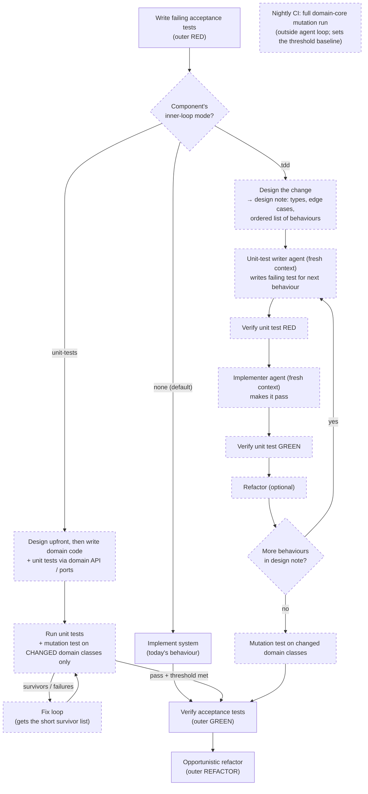

# 2026-10-23 09:59 CEST — Optional inner TDD loop, decided per component

## TL;DR

**Why:** Today the ATDD flow is outer-loop only: acceptance tests are the sole
gate on `IMPLEMENT_AND_VERIFY_SYSTEM`. For components with a real domain core
(e.g. shop `backend-clean-java`), that leaves design quality and unit-level
regression protection unmeasured. Böckeler's experiment ("TDD in the agent
loop", martinfowler.com) is the reason this is opt-in rather than default:
agent-internal TDD there cost 3–8.5× more tokens, with no measurable quality or
mutation-score gain on small greenfield tasks. It also tended to lock the design
into whatever shape the first test set. She did not test legacy or long-lived
code.

**End result:** Each component (tier) of a `kind: system` project declares an
inner-loop mode: `none` (default, today's behaviour), `unit-tests`, or `tdd`.
`backend-clean-java` runs the `unit-tests` mode end-to-end. In that mode,
domain code is written with unit tests, and green is gated on a mutation-score
threshold over the domain core. A `tdd` mode, with a separate unit-test-writer
agent, exists for teaching.

## Outcomes

- A component can opt in to an inner loop without affecting any other component
  in the same system. Thin backends and `frontend-react` stay `none` at zero
  extra cost.
- In `unit-tests` mode, "green" means more than "the acceptance test passes". It
  also means:
  - unit tests on the domain core pass;
  - a mutation-score threshold holds (PIT for Java).
  This turns test quality into an outcome sensor rather than a process ritual.
- In `tdd` mode, the red step is confirmed by a *different* agent from the one
  writing production code, mirroring the existing AT-writer / implementer split.
  It is a demonstrable double loop for course material.
- Inner-loop writes are confined to the domain core by a pinned `${...}`
  placeholder in `phase-scopes.yaml`. Adapters stay covered by AT/CT only.
- The shop pilot (`system/multitier/backend-clean-java`) gives a first data
  point on Böckeler's open question: does the inner loop pay back on long-lived
  code?

## Workflow (proposed)

The existing outer loop is unchanged. The inner loop runs inside "Implement
System", and the component's mode picks which branch runs. Dashed boxes are new.



## Modes compared: `unit-tests` vs `tdd`

Both modes produce unit tests on the domain core and pass the same mutation
gate. What differs is **order and step size**: when the tests are written
relative to the code, and how much code is written between test runs.

| | `unit-tests` | `tdd` |
|---|---|---|
| Order | Design → write code **and** tests together → run | Design note → for each behaviour: test first → see it fail → code → see it pass → refactor |
| Step size | One large change for the whole ticket | One behaviour at a time (~10 lines) |
| Who writes the tests | The implementer, alongside the code | A separate unit-test-writer agent; the implementer only makes them pass |
| Is the red proven? | No; tests are never seen failing | Yes; each test is verified red before the code exists, by an independent agent |
| How test quality is checked | Mutation score only | Mutation score + the verified red |
| When it catches bugs | After the whole change, as one test run | Right after the ~10 lines that caused it |
| Main benefit | Regression net for **later** tickets | Regression net + help within the **current** ticket on complex logic |
| Token cost | Modestly above `none` | Several times `none` (3–8.5× measured for a single agent) |
| Best for | Normal opt-in for domain cores | Rule-heavy logic; teaching and demos of the double loop |

Despite its name, `unit-tests` is a mode, not a level: both modes can run at
either level (`level: component` or `level: unit`). In restructuring tickets
(`redesign-*` / `refactor-*`), both modes reduce to "the existing inner tests
must pass": no test-first, no mutation check.

In one line: `unit-tests` checks the **result** (good tests exist, measured by
mutation testing). `tdd` also enforces the **process** (test first, in small
verified steps).

## End result: proposed configuration

### Tier config (`kind: system`, multitier)

Each tier gets an optional `inner-loop:` block. If the block is absent, the
mode is `none`, and existing configs keep working unchanged. This first example
is the **final state after Slice 3** (unit level on clean-java). Slices 1–2 use
the simpler component-level shape in the next example, which has no `level` key.

```yaml
kind: system
system:
    architecture: multitier
    config: docker/java/multitier/systems.yaml
    backend:
        path: system/multitier/backend-clean-java
        repo: optivem/shop
        lang: java
        sonar-project: optivem_shop-multitier-backend-clean-java
        inner-loop:                       # NEW: optional; absent = none
            mode: unit-tests              # none | unit-tests | tdd
            level: unit                   # component | unit (unit requires hexagonal/clean)
            mutation-threshold: 80        # % killed, applies to changed domain classes;
                                          # starting value set from the nightly baseline
        paths:                            # NEW on backend/frontend tiers (today: system-test only)
                                          # level: unit needs these four
            domain: system/multitier/backend-clean-java/src/main/java/com/mycompany/myshop/backend/domain
            use-cases: system/multitier/backend-clean-java/src/main/java/com/mycompany/myshop/backend/usecases
            domain-test: system/multitier/backend-clean-java/src/test/java/com/mycompany/myshop/backend/domain
            use-cases-test: system/multitier/backend-clean-java/src/test/java/com/mycompany/myshop/backend/usecases
    frontend:
        path: system/multitier/frontend-react
        repo: optivem/shop
        lang: typescript
        sonar-project: optivem_shop-multitier-frontend-react
        # no inner-loop block → none (thin UI; acceptance tests cover it)
```

### Slice 1 pilot: component level on a layered backend (works today)

```yaml
    backend:
        path: system/multitier/backend-java
        repo: optivem/shop
        lang: java
        sonar-project: optivem_shop-multitier-backend-java
        inner-loop:
            mode: unit-tests              # component level implied until Slice 3 adds `level`
            mutation-threshold: 70        # any architecture; tests drive the backend via its API/ports
        paths:
            component-test: system/multitier/backend-java/src/componentTest/java/com/mycompany/myshop/backend
```

### The same block on other shapes

```yaml
# monolith: sibling of System.path (open question 1)
system:
    architecture: monolith
    path: system/monolith/java
    inner-loop: { mode: unit-tests }

# microservices: per service, because each service is a TierSpec
system:
    backend-services:
        orders:  { path: ..., inner-loop: { mode: tdd } }       # rule-heavy
        catalog: { path: ... }                                   # CRUD → none

# kind: component: same block, used once the contract-driven outer loop lands
# (plans/20260818-1658)
component:
    name: backend-clean-java
    inner-loop: { mode: unit-tests }
```

### Schema and validation changes this implies

- **New `InnerLoop` struct** with three fields:
  - `Mode`: enum, default `none`;
  - `Level`: `component|unit`, required when the mode is not `none`;
  - `MutationThreshold`: 0–100, optional. The struct is added to `TierSpec`,
  `System` (monolith only) and `Component`. Both fields earn their slot: the
  flow gateway branches on `Mode`, and the mutation gate reads
  `MutationThreshold`.
- **`Validate` rules:**
  - `mode` must be in the enum.
  - `mutation-threshold` requires a mode other than `none`, and must be 0–100.
  - `level: component` requires a `component-test` path.
  - `level: unit` requires at least one core key (`domain` or `use-cases`) plus
    its matching `-test` key.
  - The existing rule that rejects `paths:` on backend/frontend tiers is relaxed
    to allow exactly these five keys. All other keys stay rejected there.
- **New path placeholders:**
  - `${component-test}`, `${domain}`, `${use-cases}`, `${domain-test}`,
    `${use-cases-test}`;
  - each is pinned in `phase-scopes.yaml` for the inner-loop phases only.

  They are deterministically constructed per language by `gh optivem init`, from
  the shop template, with no guessing ladder. Plain names, no ATDD jargon: they
  appear in configs students read.
- **Prompts:** `gh optivem init` / `config` prompts ask for the mode per tier.
  They default to `none` and run the same validator as the flag.

## ▶ Next executable step (resume here)

All design questions are resolved (see Decisions) except the mode name
(open question below). Start Step 1 (component level only, Decision 8): add the
`InnerLoop` struct to the schema with two fields:
- `Mode`: `none|unit-tests|tdd`, default `none`;
- `MutationThreshold`: 0–100.

There is no `Level` field yet. Add the struct to `TierSpec`, `System`
(monolith) and `Component`, in
`internal/kernel/projectconfig/config.go`. Add the Validate rules listed under
"Schema and validation changes", and their tests. Stop when the schema and
validation tests pass with `-p 2`. This unblocks Step 2 (path placeholders).

## Steps

### Slice 1 — component level, `unit-tests` mode, Java only, pilot on backend-java (FIRST PRIORITY)

Slice 1 pilots **component level only**, with no unit tests at all, on
`backend-java` (`gh-optivem-multitier-java.yaml`). It uses that backend's
existing `componentTest` source set, so any architecture works and no shop
prerequisite is needed. Slices 1–2 are component level only. In their steps,
"domain core" means the component's main source, and the inner tests are the
component tests.

- [ ] Step 1: Add the inner-loop mode field to `TierSpec`
  (`internal/kernel/projectconfig/config.go`). Use an enum `none|unit-tests|tdd`,
  default `none`. Add Validate rules and init/config prompts that run the same
  validator as the flag.
- [ ] Step 2: Add a Family B path placeholder for the component's domain core and
  its unit-test path. Pin it in `phase-scopes.yaml` for the new inner-loop phase.
  Paths must be constructed deterministically (pinned against the shop
  template), with no fallback ladder.
- [ ] Step 3: In `implement-and-verify-system`, add a gateway on the component's
  mode. For `unit-tests`, the implementer prompt gains a "design upfront, then
  domain code + unit tests through the domain API/ports, no mocking inside the
  domain" section. A new verify step runs the unit suite plus mutation testing,
  scoped to the domain core. The mutation gate runs **once per ticket, at inner
  green**, never on every edit (the edit-run cycles use only the fast unit
  tests), and it mutates **only the domain classes changed by this ticket**.
  Only the surviving mutants (a short list, not the full report) go back to the
  fix loop.
- [ ] Step 4: Wire PIT into shop `backend-clean-java` (domain-core target only).
  Add a `gh optivem` runner command/suite for it that local users run the same
  way CI does. Use PIT's changed-code mode (`scmMutationCoverage`, or an
  explicit `targetClasses` list) for the inner gate. Run the full domain core
  nightly in CI, outside the agent loop. That run catches the cross-class decline
  the changed-only gate misses, and supplies the baseline for the threshold.
  Verify the exact flag names against the current PIT version; the same applies
  later to Stryker.NET `--since` and StrykerJS `--incremental`.
- [ ] Step 4b: Tag each run's `summary.jsonl` with the component's inner-loop
  mode and the ticket id. Add an aggregation command or script that compares
  modes across runs: tokens split into fresh vs cached, cost, fix-loop attempts,
  and elapsed time. These are the prerequisites for the experiments.
- [ ] Step 5: Tests:
  - statemachine/transition tests for the new gateway (audit loopback edges for
    the deadlock hazard first);
  - render-matrix coverage for the new placeholder.

### Slice 2 — `tdd` mode

- [ ] Step 6: Add a unit-test-writer agent and a red → green (→ refactor) inner
  sequence in BPMN, with `tdd-stage` styling. Reuse
  `expected-test-result: failure` for the unit-level red.

### Slice 3 — unit level (hexagonal/clean only)

- [ ] Step 6b: Add `Level` (`component|unit`, default `component`) to
  `InnerLoop`. Add the `domain`/`use-cases`/`-test` path keys, their Validate
  rules, and phase-scope pins. Pilot on `backend-clean-java`, once the shop
  plan has made it a `kind: system` backend (Decision 7).

### Slice 4 — other languages and tiers

- [ ] Step 7: Stryker.NET for `backend-dotnet` and StrykerJS for
  `backend-typescript` / `frontend-react`, if any tier there opts in.
- [ ] Step 8: Docs. Update `docs/atdd/process/**` for the double loop as an
  optional inner loop, and explain when to choose each mode (domain core vs
  CRUD/plumbing).

## Background and rationale

### Source

Birgitta Böckeler, *TDD inside the agent loop – theater or actual value?*,
martinfowler.com:
https://martinfowler.com/articles/exploring-gen-ai/tdd-in-the-agent-loop.html

### What the article found

- Sonnet ran the tasks with and without TDD instructions, and Opus judged the
  results blind. There was no clearly discernible quality difference. The
  non-TDD runs sometimes ranked slightly higher on design and test quality.
  Mutation scores showed no meaningful difference.
- TDD runs used roughly 8.5× (small task), 3× (medium) and 4.9× (large) more
  tokens. Cheap cache reads were counted the same as fresh tokens, so the
  dollar cost is likely overstated, but the direction is clear.
- Non-TDD runs designed upfront: data types, edge cases, contracts. TDD runs
  grew the design from many locally minimal decisions, rarely revisited it, and
  locked into whatever shape the first test set. Behaviour nobody thought to
  test simply didn't get implemented.
- A red test only proves something if someone checks *why* it is red. When the
  same agent writes the test and confirms the failure, it only proves the agent
  saw a failure.
- Her suggested alternatives:
  - **Approved Scenarios:** functional scenarios that a human confirms and
    freezes, and that must be re-approved whenever they are violated. This is
    close kin to ATDD.
  - **Outcome sensors rather than process instructions:** mutation testing,
    static analysis and modularity reviews.

### Where the article leaves room

- The tasks were small, greenfield and pure business logic, with a very small
  sample. Legacy and long-lived code were not tested. That is exactly the
  "feature 50, not feature 1" question.
- She tested agent-internal TDD only, with the agent writing both the tests and
  the code. The mode where a human owns the scenarios and the agent implements
  them (= our ATDD outer loop) is not argued against; the article supports it.
- The "quality" judgement came mostly from an LLM judge, which is a proxy rather
  than ground truth.

### Our position (Claude + Valentina, 2026-10-23)

- **ATDD stays the human-owned outer loop.** The article strengthens this: it is
  the checkpoint that agent-internal TDD lacks.
- **The inner loop is opt-in per component, not the default.** The fixed token
  cost only pays back where there is decision-heavy logic (a domain core).
  CRUD, adapters and glue stay `none`, because there the acceptance test
  already pinpoints the typical wiring failures.
- **Prefer outcome sensors over policing the ritual.** That is why the
  `unit-tests` mode gates on mutation score instead of enforcing red-green
  ordering.
- **Where we keep real TDD (`tdd` mode), make the red independent.** A separate
  unit-test-writer agent writes the failing test, mirroring the existing
  AT-writer / implementer split. This answers the "agent confirms its own red"
  critique, though it is still not a human checkpoint.
- **Earlier claims we downgraded after reading the article:**
  - "TDD gives design pressure": that holds for humans, but agents don't feel
    the friction that creates it.
  - "TDD pays back through fewer debugging loops": this is a hypothesis
    reasoned from human TDD, not evidence about agents.
- **What the pilot is meant to test:** does the inner loop pay back on
  long-lived code (backend-clean-java over many tickets)? Track three numbers:
  - tokens per ticket;
  - fix-loop iterations;
  - files touched per change over time.

### Token cost by mode (why TDD costs more)

TDD costs more mainly because:
- it takes more turns (about 3 per behaviour: red, green, refactor);
- in a long session, every turn re-reads the whole growing context;
- test output is read back 2–3 times per behaviour.

Prompt caching lowers the dollar cost but not the token count. Expected
ranking, cheapest first (only the 3–8.5× figure is measured; the others are
estimates):

1. `none`: baseline.
2. `unit-tests`: modestly more. Tests are written alongside the code in a few
   large edits, plus usually one round of feedback on surviving mutants.
3. `tdd` as fresh agents per behaviour (see below): likely at or below the next
   row, if handoffs stay small.
4. `tdd` inside one long agent session: 3–8.5× (Böckeler).

### `tdd` mode design: fresh context per step, with a design note

gh-optivem already starts a fresh agent at every BPMN node. Fresh contexts turn
the growing-context cost into a cost that grows in a straight line with the
number of steps. They add two risks:
- **Cold start:** each agent re-reads its prompt and files.
- **Lost design intent:** each step makes an even more local decision. This
  would make Böckeler's design lock-in finding worse.

The mitigations below become requirements of `tdd` mode:

- A **"design the change" step opens the inner loop.** It writes a short design
  note: domain types, edge cases, and the ordered list of behaviours to drive.
  Every later writer and implementer step receives the note. This keeps the
  upfront design that Böckeler's non-TDD runs did well.
- **Small explicit handoffs.** Each step gets the design note, the current test,
  and the target file(s) only, within the pinned domain-core scope.
- **A stable prompt prefix.** The agent prompt and scope rules are identical
  across dispatches, so prompt caching applies and only the per-step tail is
  paid at full price.

This makes per-behaviour BPMN steps the leaning answer to Q4. It is still clearly
more expensive than `unit-tests` mode.

### Where TDD might save tokens (the hypothesis)

TDD can only pay back by preventing **debugging spirals**. In gh-optivem a
spiral shows up as the fix loop: repeated fresh dispatches, possibly running out
of the retry budget. Böckeler's tasks made spirals unlikely:
- the code was small and fit in context;
- the agent had just written it;
- it was pure logic with no layers.

Spirals become likely when:
- the relevant code isn't in context;
- the failure shows up far from its cause;
- rules interact;
- the code is legacy;
- feedback is slow.

Long-lived systems have all of these.

TDD prevents spirals through two separate mechanisms:
- **Pinpointing:** a red unit test names the broken rule. `unit-tests` mode
  gives this too.
- **Small steps from a known green:** the bug is in the last ~10 lines. Only
  `tdd` mode gives this.

So `unit-tests` mode is expected to capture most of the long-term regression
benefit. `tdd` adds a benefit within the current ticket that matters only for
complex logic.

TDD pays back only if (how often spirals happen × what a spiral costs) is
greater than the fixed extra cost per ticket.

Evidence so far: the fix-loop exhaustions seen in rehearsals (e.g. the
"no X persisted" absence assertions) were DSL/scope problems, not domain logic
bugs. TDD would not have prevented them.

## Testing the theory (experiment design)

**Measurement is mostly there already.** Every run writes
`.gh-optivem/runs/<run-ts>/summary.jsonl`, with one row per dispatch recording:
- the agent, model and effort;
- elapsed time;
- token usage, including cache reads;
- cost;
- the attempt number out of the attempt maximum.

What's missing is tagging each run with the component's inner-loop mode and the
ticket, plus a script that aggregates across runs.

### Experiments, cheapest first

1. **Same ticket, every mode (A/B/C).** Start from one pinned commit of
   `backend-clean-java`. Run the same ticket in `none`, `unit-tests` and `tdd`,
   3–5 times per mode, because LLM runs vary. Use a mix of tickets:
   - CRUD-shaped (expect `none` to win);
   - rule-heavy (pricing, discounts, state transitions), where TDD should have
     its best case.

   This answers the question "what does each mode cost per ticket?"
2. **Seeded-spiral test.** Give each mode a ticket deliberately designed to
   cause interacting rules: a new rule that breaks an existing rule only in one
   combination. Measure:
   - fix-loop iterations;
   - tokens spent in the fix loop versus the implement step;
   - edits to files outside the eventual fix (the "fixed the wrong layer"
     signal).

   This answers the question "does the inner loop prevent spirals?"
3. **Fault-injection on aged code.** Build three codebases, one per mode, then
   inject known faults into domain classes written several tickets earlier.
   Measure:
   - which faults the unit tests catch;
   - which only the acceptance tests catch;
   - which escape both.

   This answers the question "does the regression net work?" It is also cheap
   to run, because no AI is needed beyond building the codebases.
4. **Aging curve ("feature 50").** Replay the same sequence of ~15–20 tickets
   from one starting commit, separately in each mode, producing three diverging
   codebases. Plot per ticket:
   - tokens;
   - fix-loop iterations;
   - files touched per change;
   - full-domain mutation score;
   - Sonar complexity/duplication.

   If `none` grows more expensive over time while `unit-tests`/`tdd` stay flat,
   that confirms the long-lived-code argument. This is the most expensive
   experiment, so run it last and only if experiments 1–3 point that way.

### Quality measures (shared by all experiments)

- Full-domain mutation score (the nightly run).
- Sonar metrics, already wired in CI.
- Files touched per change.
- Regression rate: earlier acceptance tests broken by a later ticket.
- A blind human review of a sample. This avoids relying only on an LLM judge,
  which was a weakness of Böckeler's setup.

### Controls

- Same model, effort and prompt versions across modes.
- Same starting commit.
- Multiple runs per cell, reporting the median and spread.
- Report tokens split into fresh vs cached, as well as dollars.

### What would change the plan

- **`unit-tests` captures most of `tdd`'s savings at a fraction of the cost:**
  confirms the design (`unit-tests` = normal opt-in, `tdd` = teaching).
- **`tdd` wins on rule-heavy or aged code:** promote `tdd` to the recommended
  mode for domain cores.
- **Neither mode beats `none` on any measure:** keep the feature for teaching
  only, and say so publicly. That would extend Böckeler's finding to long-lived
  code, a result worth publishing either way.

## Related

- `plans/20260818-1658-contract-driven-outer-loop-for-kind-component.md`: that
  plan covers `kind: component` projects, where `implement` is refused today.
  This plan covers components *inside* a `kind: system` (tiers). The two plans
  are kept separate on purpose. If that plan lands, its flow could reuse this
  inner-loop mode as-is.

## Decisions (resolved 2026-10-23)

1. **Monolith:** the `inner-loop` block is a sibling field on `System`
   (`system.inner-loop`), with the same shape as the tier block.
2. **Redesign/refactor tickets:** TDD applies only to behaviour changes. In
   `redesign-*` and `refactor-*` cycles, the component's existing inner tests
   must still pass, and that is the only check:
   - no test-first;
   - no mutation check (there is no new behaviour, so no new tests to grade).

   We assume the architecture is hexagonal/clean.
3. **Mutation threshold:** set per component. It hard-fails into the existing
   fix loop, which receives the list of surviving mutants. The starting value
   comes from the nightly full baseline.
4. **`tdd` shape:** BPMN steps with fresh agents. The steps are:
   - a design-note step;
   - then, per behaviour: writer → verify red → implementer → verify green →
     refactor.

   Handoffs stay small, and the prompt prefix is kept stable so caching applies.
5. **No `implement --target` unit-test slice.** The same person owns the inner
   tests and the code that makes them pass. In `tdd` mode the writer/implementer
   agents are an internal split *within* one slice, not a team handoff.
6. **The field name is `inner-loop`.**
7. **Level is a second setting: `level: component | unit`.**
   - **Component level** drives the whole component through its edges (API or
     ports), with test doubles for the database and external systems. It works
     with any architecture. Tests go in the `componentTest` source set, which
     both Java backends already have.
   - **Unit level** drives domain and use-case classes directly. It requires a
     hexagonal/clean architecture and the `domain`/`use-cases` paths.

   This settles the pilot:
   - component level on `backend-java` now (a `kind: system` backend);
   - unit level on `backend-clean-java` once shop makes it a system backend
     (a separate shop plan; it is `kind: component` today, which `implement`
     refuses).
8. **Priority: component level first, with no unit tests at all.** Get the
   inner loop working end-to-end at component level before any unit-level work.
   This applies to any component, regardless of architecture.
   - **No `level` field until unit level is built.** Slice 1–2 configs carry
     only `mode` and `mutation-threshold`, and component level is implied. The
     `level` field is added in Slice 3 with default `component`, so existing
     configs stay valid. This follows "schema fields must earn their slot":
     nothing branches on `level` before then.

## Open questions

1. **Rename the `unit-tests` mode?** With component level first, a mode called
   `unit-tests` would write *component* tests, which is misleading for students.
   Lean: rename it to **`test-after`** (`none | test-after | tdd`). It names the
   real difference from `tdd` (when the tests are written) and doesn't depend
   on the level. Once decided, apply the name throughout this plan.
2. **Is mutation testing affordable at component level?** If the component tests
   boot the Spring context, every mutant pays that startup cost. Checking only
   the changed classes helps, but Step 4 should measure a changed-only PIT run on
   `backend-java` first. If it is too slow, fall back to "component tests pass +
   coverage of changed lines" for Slice 1, and record the result here.

## Superseded open questions (kept for history)

1. **Where does the monolith's setting live?** Monoliths use System-level
   `path/repo/lang`, not `TierSpec`. Options:
   - a sibling field on `System`;
   - a per-path list (domain-core dirs, each with a mode).
   Lean: a sibling field on `System`, mirroring the TierSpec field.
2. **Do the `redesign-*` cycles get the inner loop?** They reuse
   `IMPLEMENT_AND_VERIFY_SYSTEM`. Lean: yes in `unit-tests` mode, since the
   mutation gate is cheap and protects the redesign. Unclear in `tdd` mode.
3. **Mutation threshold: what value, and is it a hard failure?** Lean: the
   threshold is configured per component, and the gate fails hard (it routes
   into the existing fix loop). Starting value to be set from a baseline run on
   backend-clean-java.
4. **Shape of the `tdd` mode:** per-behaviour BPMN iteration (writer → verify
   red → implementer → verify green, looped), or a single agent-internal loop?
   The BPMN loop gives a real independent red at 3–8× the token cost. The
   agent-internal loop is cheaper but becomes the "theater" Böckeler criticises.
5. **Does `implement --target` gain a `unit-test` slice** for team handoff?
   Lean: no in Slice 1.
7. **BLOCKER for the pilot target: `backend-clean-java` is `kind: component`
   in shop today.** `shop/gh-optivem-multitier-clean-java.yaml` declares it as a
   component, because it has no compose stack and no acceptance suite driving
   it. `implement` refuses that kind. Options:
   - **(a)** Promote clean-java to the backend tier of a `kind: system`
     multitier config. This needs a compose stack, and the backend must serve
     the API the Java system tests drive. It is the most work, and gives the
     pilot you want.
   - **(b)** Run Slice 1 on `backend-java` in `gh-optivem-multitier-java.yaml`,
     which is `kind: system` today. Point its `domain` path at its `core/`
     package. This works now, but the domain is thinner, so it is a weaker test
     of the theory.
   - **(c)** Wait for the contract-driven outer loop for `kind: component`
     (`plans/20260818-1658`). That plan is still unresolved design, so this
     blocks indefinitely.

   Lean: **(b) to prove the mechanism, then (a) for the experiments.** The
   experiments need a real domain core, and (a) is a prerequisite that belongs
   in shop, as its own plan.
6. **Is the field name `inner-loop`?** It must avoid "ATDD"/internal jargon,
   because the name leaks into configs that students read.
