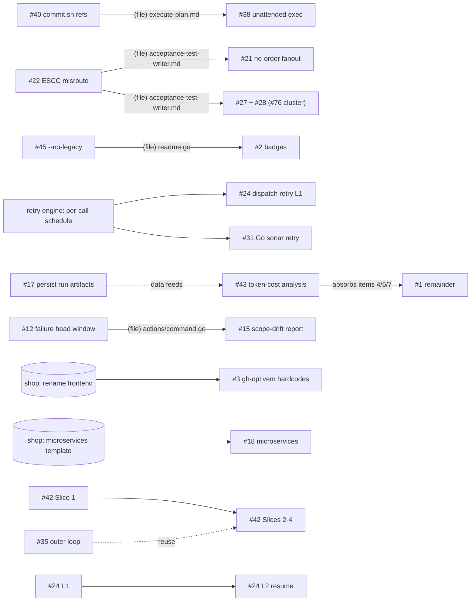

# 2026-10-29 20:42 UTC — Plan coordination meta-plan: backlog consolidation

## TL;DR

**Why:** 46 plans were spread across `backlog/`, `deferred/`, `deferred2/` and `meta/`. Some were done or obsolete, there was no priority order, and the cross-plan file conflicts weren't recorded anywhere, so it was unclear what to run next or what could safely run in parallel.
**End result:** Dead plans are deleted and the rest sit in `plans/backlog/{p1..p4,parked}/`. Every user decision is resolved, and the execution units run in waves with no file conflicts. This file is deleted once every unit has shipped or been handed to its own plan.

## ▶ Next executable step (resume here)

**Group 5 — Items 18, 22, 23, 24** (Item 19 shipped): decisions confirmed, so they are ready to dispatch one per session (start with Item 18, 22 or 23). Item 15's code shipped locally (shop `32e90dcb`, gh-optivem `15b30e6c`, unpushed); its remainder, Item 13's leftovers and Item 7's #76 check are all deferred and need an attended session (shop push OK + rehearsal). Run `/sync` to push gh-optivem (and shop, with OK).

## How to execute this meta-plan

Run `/execute-plan` on this file. Each item below is one execution unit. To execute an item:

1. **Dispatch one subagent per item.** Default isolation only, never a worktree. Give the subagent the child plan path(s), the decision(s) the item cites from **Decisions (resolved)**, and the item's file list. The subagent then runs that child plan end to end with `/execute-plan` Autonomous-mode rules:
   - delete each step as it ships, and commit each step surgically to its own repo with raw `git` (never a workspace sweep);
   - run Go tests only with `scripts/test.sh` or `-p 2`;
   - write the cited decision into the child plan's open questions before starting;
   - delete the child plan when it's empty.
2. **Run items in parallel only inside the group marked parallel.** Groups run in order. Never start a group until every item in the previous group has finished or is recorded as blocked.
3. **Rehearsal lock:** at most one running subagent may run a shop rehearsal or `gh optivem system start`, because they share fixed docker ports. Items tagged `[rehearsal]` take the lock, so run them one at a time even inside a parallel group.
4. **Shop pushes:** items tagged `[shop-push]` stop and ask the user before pushing to shop `main`, while the shop cloud-deploy plan is active (see Pre-execute checks 4).
5. **When an item finishes**, delete it here, update the ▶ Next block, and remove its unit from **Execution units** / **Execution waves**. **When an item is blocked**, write the blocker under it, keep the item, and move on.
6. **Session budget:** one group per session. At the end of a group, hand back with the `/clear` + `/execute-plan` block so the next group starts with a fresh context.

## Items

### Group 2 — Wave 1B (parallel)
- [ ] **Item 7 — U3 #27 then #28** `[rehearsal]` — ⏳ Deferred: code shipped (#27 `dd5883ea`, #28 `10c2546c`/`6d553b95`; #28 plan deleted). Only the #76 rehearsal verification remains, in `plans/backlog/p1-correctness/20260627-2149-channel-touched-skipped-tests-noop-dispatch.md`; it needs an attended rehearsal.

### Group 3 — Wave 2 (parallel)
- [ ] **Item 13 — U14 #12 then #15** (Q-6) `[rehearsal]` — ⏳ Deferred: code shipped (#12 `59450e7d`, #15 `416a761f`). Remaining, in the child plans `plans/backlog/p2-atdd-quality/20260608-2109-failure-capture-head-window.md` and `plans/backlog/p3-tooling-cost/20260616-0922-scope-drift-guard-fix-loop.md`: #12 step 6 (Gradle `--warning-mode none`, a shop edit in `system-test/java/tests*.yaml` + shop push, needs OK) and the attended rehearsal checks for both.

### Group 4 — Wave 2 (serial)
- [ ] **Item 15 — U15 #21** (Q-7, place/cancel only) `[rehearsal]` `[shop-push]` — ⏳ Deferred: code shipped locally (shop `32e90dcb`, gh-optivem `15b30e6c`; both unpushed, compile-checked only). Remaining, in `plans/backlog/p2-atdd-quality/20260620-0806-no-order-persisted-fanout-prevention.md`: push shop `main` (needs OK), attended runtime check of `cannotPlaceOrderWithNonExistentCoupon` on monolith + multitier ×3 languages, rehearsal check of the `scope-task-name` fixer change, then Step 6 (restore #68's criterion).

### Group 5 — Wave 3 (stop and ask user first)
"Later" decisions confirmed 2026-11-03 (user: use the recommendation for all). Copy each into its own plan's open questions when that item starts. Run one item per session.
- [ ] **Item 18 — #6** (`p2-atdd-quality/20260525-1753-…pre-refine-check…`): refine signal = board status past "In refinement"; drop Idea 2 (post-run refactor offer).
- **Items 20 (#13) and 21 (#16)** and the shop parts of Items 13 and 15 moved to the shop plan `shop/plans/20261103-1049-gh-optivem-driven-shop-changes.md`. Decisions: #13 Option A (Java only); #16 `/users` customer directory in all configs, rehearsed on monolith-java only, refine deferred. Nothing to do here except the gh-optivem side of their rehearsals.
- [ ] **Item 22 — #20** (`p2-atdd-quality/20260812-1705-environment-setup-command`): the plan's own recommendations; Step 8 (collapse duplication) only after a green clean-room VM run.
- [ ] **Item 23 — #42 Slice 1** (`p2-atdd-quality/20261023-0959-optional-inner-tdd-loop-per-component`): rename `unit-tests` to `test-after`; measure changed-only PIT run before relying on mutation gate.
- [ ] **Item 24 — #25** (`p4-maintenance/20260625-0944-sonar-deferred`): re-pull the SonarCloud issue list first, then fix.

Read-only analysis of every plan under `plans/backlog/`, `plans/deferred/`, `plans/deferred2/` and `plans/meta/`. No plan was edited. Each plan was read in full and its premise spot-checked against the current code (grep/ls/git log). Modelled on shop's consolidation (shop commit 7ecc8277 + `shop/plans/20261029-1256-meta-backlog-execution.md`).

**Plans analysed:** 46 + 1 stale meta-plan. Referenced-only: shop's `plans/20261029-1316-deploy-shop-cloud-run.md` (active, "Picked up by agent") and shop `plans/backlog/*`.

**Common staleness:** most plans written before the package reorg still cite old paths. Re-anchor before executing:
- `internal/atdd/runtime/{actions,gates,clauderun,statemachine}` → `internal/atdd/process/...`
- `internal/steps` → `internal/scaffolding/steps`
- `internal/projectconfig` → `internal/kernel/projectconfig`
- shop `.claude/agents/atdd/` → `internal/atdd/assets/runtime/agents/atdd/`

## Per-plan status snapshot

Legend:
- **Verdict:** DONE / OBSOLETE / PARTIAL / VALID.
- **Shop:** `—` none · `verify` = a rehearsal on shop is used only for verification · `read` = needs a synced local shop clone (reads the template layout) · `edits` = the plan itself edits shop · `shop-first` = shop must change and merge before the gh-optivem work.
- **Auto:** A = autonomous-ready · D = needs a user decision (see Decisions) · M = manual.

| # | Plan | Verdict | Done | Pri | Shop | Auto | Note |
|---|---|---|---|---|---|---|---|
| 1 | backlog/p3-tooling-cost/20260430-150508-minimize-tokens-and-latency-in-clauderun-dispatch | PARTIAL | 3/7 | P3 | — | A (item 3), D (4/5/7) | item 3 = add `--no-update-check` in `claudeTuningArgs` (clauderun.go:2023) |
| 2 | backlog/p4-maintenance/20260502-103000-fix-unfiltered-workflow-badges-academy-wide | VALID | 0/3 | P4 | — | A | stale pickup marker; also edits actions, optivem-testing, hub READMEs |
| 3 | backlog/p4-maintenance/20260511-1702-shop-frontend-react-to-typescript-rename | VALID | 0 | P4 | **shop-first** | A | shop renames `frontend-react` (~64 files), then gh-optivem drops hardcoded `"react"` |
| 4 | backlog/20260515-0950-ticket-type-feature-rename-and-config | VALID | 0 | PARKED | — | D | decision record; delete if the alias is kept permanently |
| 5 | backlog/20260518-1530-smoke-test-family-b-key | VALID | 0/5 | PARKED | read | D | no BPMN phase consumes a smoke key → delete candidate |
| 6 | backlog/p2-atdd-quality/20260525-1753-implement-pre-refine-check-and-post-refactor-offer | VALID (drifted) | 0/4 | P2 | verify | D | no `refine`/`refactor` command exists; signal = board status |
| 7 | backlog/parked/20260526-1746-rebuild-onboard-external-system | VALID (archive) | 0 | PARKED | — | D | stash spec, not work |
| 8 | backlog/parked/20260526-1754-rebuild-checklist-progress-tracking | VALID (archive) | 0 | PARKED | — | D | stash spec, sibling of #7 |
| 9 | backlog/p3-tooling-cost/20260528-1302-suppress-subprocess-stderr-non-verbose | VALID | 0 | P3 | verify | D | deps.go:138 still has the old wiring |
| 10 | backlog/parked/20260620-0644-human-control-over-ai-authored-contract-semantics | VALID (record) | rung 1 shipped | PARKED | verify | D | revisit only if a rehearsal halts on it again |
| 11 | deferred/20260526-1237-setup-claude-code-web | VALID (personal) | 0/7 | — | — | M | personal setup, not repo work → delete candidate |
| 12 | backlog/p2-atdd-quality/20260608-2109-failure-capture-head-window | VALID | 0/6 | P2 | verify | D | `formatVerifyFailureOutput` now at actions/command.go:205 |
| 13 | backlog/p2-atdd-quality/20260613-1950-view-product-list-erp-list-gap | VALID | 0/6 | P2 | **edits** (all items) | D | shop has no `getProducts`/`ProductApiController`; plan uses an old absolute path root |
| 14 | deferred/20260615-0840-gh-optivem-claude-settings-sync-command | **OBSOLETE** | — | — | — | — | superseded by `gh optivem claude install/setup` (0b14d362); source repo emptied |
| 15 | backlog/p3-tooling-cost/20260616-0922-scope-drift-guard-fix-loop | VALID | 0/4 | P3 | verify | D | |
| 16 | backlog/p3-tooling-cost/20260617-1001-rehearsal-corpus-testinstance-and-refine | VALID | 0/10 | P3 | **edits** (configs + new issue) | D | covers the real-kind==test-instance gap |
| 17 | backlog/p3-tooling-cost/20260617-1017-persist-run-artifacts-beyond-worktree-teardown | VALID | 0/6 | P3 | — | A (accept recs A–D) | line anchors drifted (driver.go 418→440 etc.) |
| 18 | backlog/parked/20260618-1046-microservices-scaffold-pipeline | VALID | 0/6 | PARKED | **shop-first** (needs shop `system/microservices/` template) | D | |
| 19 | deferred/20260618-1601-clock-driving-scenario-isolated-gate | **OBSOLETE** | — | — | — | — | #24 says "Supersedes … delete the deferred file" |
| 20 | backlog/p2-atdd-quality/20260812-1705-environment-setup-command | VALID | 0/8 | P2 | — | D | Step 8 gated on a green clean-room VM run |
| 21 | backlog/p2-atdd-quality/20260620-0806-no-order-persisted-fanout-prevention | VALID | 2/6 | P2 | **edits** (DSL ×3 langs, shop#68) | D | "DECISION NEEDED" banner |
| 22 | backlog/p1-correctness/20260622-2002-escc-misroute-and-dsl-authoring-rules | VALID | 0/7 | **P1** | verify | **A** | false ESCC halt (scope_exception.go:32-35) |
| 23 | backlog/parked/20260623-1516-clock-isolated-static-gate-hardfail | VALID | 0/6 | PARKED | edits/read (option-dependent) | D | "ON HOLD, direction undecided" |
| 24 | backlog/p2-atdd-quality/20260623-2125-atdd-dispatch-retry-budget-and-resume | VALID | 0/6 | P2 (L1) / P3 (L2) | — | D | shares the retry-engine change with #31 |
| 25 | backlog/p4-maintenance/20260625-0944-sonar-deferred | PARTIAL | 16/84 | P4 | — | A (after refresh) | stale pickup marker (2026-07-01); line numbers stale, re-pull from SonarCloud |
| 26 | deferred2/20260627-1346-verify-push-paths-untracked-fix | **DONE** | code done | — | — | M | verify.go:420 uses `--cached --others`; exercised by many runs since |
| 27 | backlog/p1-correctness/20260627-2149-channel-touched-skipped-tests-noop-dispatch | VALID | 0/5 | **P1** | verify | A (Option A) | wasted 27-min dispatch, then a halt |
| 28 | backlog/p1-correctness/20260629-1728-isolated-tests-validate-channels-registered | VALID | 0/3 | **P1** | verify | D | hard halt on any ticket that yields `@isolated` tests |
| 29 | backlog/p3-tooling-cost/20260701-0602-schedule-orphan-repo-cleanup | VALID | 0/5 | P3 | — | A | |
| 30 | backlog/p4-maintenance/20260701-0928-document-env-file-in-manual-test-contributing | VALID | 0/4 | P4 | — | A | |
| 31 | backlog/p2-atdd-quality/20260811-1603-sonar-scan-transient-retry | PARTIAL | bash/CI side done (actions cd0432c) | P2 | — | D | Go local scan (verify.go:860) still has no retry |
| 32 | backlog/p1-correctness/20260811-2246-pin-playwright-browser-install-legacy-workflows | VALID | 0/5 | **P1** | **edits** (shop only; 4 `*-legacy.yml`) | A | unpinned `npx playwright install` (CDN drift) |
| 33 | backlog/p4-maintenance/20260812-1024-actionlint-latest-canary | VALID | 0/5 | P4 | — | A | |
| 34 | deferred2/20260813-1028-init-checking-progress-output | **DONE** | 6cb68776 | — | — | M | only a visual check left |
| 35 | backlog/parked/20260818-1658-contract-driven-outer-loop-for-kind-component | VALID (design) | Q1–Q7 open | PARKED | verify (shop `backend-clean-java`) | D | shop broker plan is parked, so it does not block this |
| 36 | backlog/p1-correctness/20260820-1345-component-test-sample-filter-and-suite-group-defaults | VALID | 0 | **P1** | read/verify | D (Problem 2) | `--sample`/`--test` no-op still reports PASSED (componenttest/run.go:121) |
| 37 | deferred2/20260917-1958-fix-ts-migrations-path-rewrite | **DONE** | 5/5 (e220eed9) | — | verify | M | shipped in v1.6.101+ |
| 38 | backlog/p3-tooling-cost/20261002-0817-unattended-plan-execution | PARTIAL | default mode exists | P3 | — | D | |
| 39 | backlog/p2-atdd-quality/20261002-0900-green-touch-list-before-editing | VALID | 0/6 | P2 | — | D (accept recs → A) | |
| 40 | backlog/p1-correctness/20261012-1042-replace-stale-commit-sh-in-claude-commands | VALID | 0/6 | **P1** | — | **A** | shipped `/execute-plan` etc. point every user at a missing script |
| 41 | backlog/parked/20261015-2108-spec-driven-positioning-and-branding | VALID | 0/7 | PARKED | read | D (name) | stale pickup marker (2026-10-15) |
| 42 | backlog/p2-atdd-quality/20261023-0959-optional-inner-tdd-loop-per-component | VALID | 0/10 | P2 (Slice 1) / PARKED | verify (Slice 1) → **edits** (Step 4) → **shop-first** (Slice 3) | D (OQ1) | |
| 43 | backlog/p3-tooling-cost/20261028-1456-atdd-workflow-token-cost-analysis | VALID | 0/6 | P3 | verify (uses existing rehearsal logs) | A (accept recs) | overlaps #1 |
| 44 | backlog/p3-tooling-cost/20261028-1643-spec-gate-real-run-on-shop | PARTIAL | 5/6 | P3 | **edits** (shop workflows) | A (lenient step) | **unblocked**: `spec` is in v1.6.101/102; the plan's "▶ Next" note is out of date |
| 45 | backlog/p2-atdd-quality/20261029-1200-no-legacy-omits-legacy-artifacts | VALID | 0/9 | P2 | **read** (shop template layout) | A | |
| 46 | meta/20260604-1024-backlog-conflict-triage-vs-1725-scoped-implement | **OBSOLETE** | — | — | — | — | coordinates gone plans and pre-reorg paths; replaced by this file |

## Deletion candidates

**Confirmed (delete now; no remaining agent work):**
- `plans/deferred/20260615-0840-gh-optivem-claude-settings-sync-command.md` — superseded by `gh optivem claude setup`.
- `plans/deferred/20260618-1601-clock-driving-scenario-isolated-gate.md` — superseded by #24, which says to delete it.
- `plans/meta/20260604-1024-backlog-conflict-triage-vs-1725-scoped-implement.md` — stale meta-plan.
- `plans/deferred2/20260813-1028-init-checking-progress-output.md` — shipped (6cb68776).
- `plans/deferred2/20260917-1958-fix-ts-migrations-path-rewrite.md` — shipped (e220eed9).
- `plans/deferred2/20260627-1346-verify-push-paths-untracked-fix.md` — shipped.

The last three only have operator-verification bullets left. Per [[feedback_plans_contain_agent_work_only]], those bullets don't keep a plan alive.

**Soft (delete if you agree; see Q-1):**
- `backlog/20260518-1530-smoke-test-family-b-key` — no consumer.
- `backlog/20260515-0950-ticket-type-feature-rename-and-config` — keep the `story`→`feature` alias permanently.
- `deferred/20260526-1237-setup-claude-code-web` — personal to-do, not repo work.

## Shop dependency summary

| Kind | Plans | What has to happen in shop |
|---|---|---|
| **shop-first** (blocked until shop changes merge) | #3, #18, #42 Slice 3 | #3: shop renames `frontend-react` → `frontend-typescript`. #18: a shop `system/microservices/` template must exist. #42 Slice 3: a shop plan promotes `backend-clean-java` to `kind: system` (no such plan yet). |
| **edits shop** (the plan writes to shop) | #13, #16, #21, #32, #44, #42 Step 4 | Commit via `--repo shop`. Pushes to shop `main` change the images the active shop cloud plan deploys; get an OK first while its Step 8 is in progress. #32 touches the same `*-legacy.yml` files as shop's `after-cloud-deploy/20260825-1426-acceptance-gate-pinned-sha-no-silent-skip`, so run #32 first; the shop plan is blocked anyway. |
| **needs a synced local shop clone** (reads the template) | #45, #36, #5, #41 | `gh optivem sync` (or a pull of `../shop`) before starting. |
| **verify on shop only** (rehearsal) | #6, #9, #10, #12, #15, #22, #27, #28, #35, #43 | Nothing to change in shop. The rehearsal needs a synced shop and a free docker stack (one session at a time). |

## Dependency graph

Edges come from the plans' own ordering language, plus conservative same-file edges marked `(file)`.

No cycles.

## Conflicts

| ID | Class | File(s) | Plans | Resolution |
|---|---|---|---|---|
| C1 | soft | `internal/scaffolding/steps/readme.go` (badge list) | #45, #2 | #45 first, then #2 |
| C2 | soft | `internal/claude/assets/commands/execute-plan.md` | #40, #38 | #40 first |
| C3 | soft | `agents/atdd/acceptance-test-writer.md` | #22, #28 (item C), #21 | #22 → #28 → #21 |
| C4 | soft (adjacent code) | `internal/atdd/process/actions/channel.go`, `internal/build/runner/{testnames,tests}.go` | #27, #28 | one session (CS3) |
| C5 | hard (same engine change) | `internal/kernel/shell/{retry,retrycore}.go` (`RetryWithPolicy` per-call schedule) | #24, #31 | one session, engine first (CS4) |
| C6 | soft | `internal/atdd/process/clauderun/clauderun.go` | #1 item 3, #24, #43 | serialise; #1 item 3 is a one-liner, do it first |
| C7 | soft | `internal/atdd/process/process-flow.yaml` | #28, #24, #15, #21, #6, #42, #35 | never two in parallel; rebase between them |
| C8 | soft | `internal/atdd/process/actions/command.go` | #12, #15 | #12 first |
| C9 | soft | implementer prompts (`system-`, `dsl-implementer.md` …) | #39, #22, #27 | #22 and #27 before #39 |
| C10 | soft | `internal/atdd/runtime/driver/driver.go` | #17, #24 | serialise |
| C11 | soft | `internal/scaffolding/steps/apply_template.go` | #45, #3, #18 | #45 first; #3 and #18 are blocked on shop anyway |
| C12 | soft (cross-repo) | shop `*-acceptance-stage-legacy.yml` | #32 vs shop `after-cloud-deploy/20260825-1426` | #32 first |

Shared-resource rule (not a file conflict): `gh optivem system start` and rehearsals bind fixed docker ports. Only one session at a time may run a shop rehearsal.

## Consolidation findings (decided)

| ID | Finding | Decision |
|---|---|---|
| CS1 | 6 plans done or obsolete (see Deletion candidates) | **Delete** (recommended: nothing in them is agent work) |
| CS2 | #7 and #8 are sibling archive stashes; #10 is a decision record | **Move to `parked/`, no merge** (recommended: merging archives is churn with no execution value) |
| CS3 | #27 and #28 come from the same #76 rehearsal and touch adjacent channel/report code | **Atomic single session**, #27 Option A first, then #28 A+B+C (recommended: one rehearsal verifies both) |
| CS4 | #24 Layer 1 and #31 each need `RetryWithPolicy` to take a per-call schedule | **Atomic single session**: engine change, then #31 Go port, then #24 L1. #24 Layer 2 stays separate (recommended: avoids building the engine change twice) |
| CS5 | #1 (items 4/5/7) and #43 overlap on ATDD token cost | **Re-order**: run #1 item 3 now; #43 measures and ranks; #1's remaining items are then judged by #43's results and #1 is deleted (recommended: measure before optimising) |
| CS6 | #22 and #21 both edit the acceptance-test-writer prompt for the #68 rehearsal | **Re-order**: #22 first (ready, P1); #21 after its go/no-go |
| CS7 | #40 and #38 both edit `execute-plan.md` | **Re-order**: #40 first |
| CS8 | Stale pickup markers on #2, #25, #41 | Remove the markers when each plan is next touched; not live claims (no activity for 2 weeks to 4 months) |

## Proposed folder layout

Mirrors shop's `plans/backlog/` structure. Apply this as one rename-only commit once you approve it.

| Folder | Plans |
|---|---|
| `backlog/p1-correctness/` | #22, #27, #28, #32, #36, #40 |
| `backlog/p2-atdd-quality/` | #6, #12, #13, #20, #21, #24, #31, #39, #42, #45 |
| `backlog/p3-tooling-cost/` | #1, #9, #15, #16, #17, #29, #38, #43, #44 |
| `backlog/p4-maintenance/` | #2, #3, #25, #30, #33 |
| `backlog/parked/` | #4, #5, #7, #8, #10, #18, #23, #35, #41 (+ #11 if kept) |
| (deleted) | #14, #19, #26, #34, #37, #46 |

`plans/deferred/` and `plans/deferred2/` end up empty and are removed. A `backlog/README.md` (shop-style table: folder, theme, notes) records the order. The shop column above lives in the README rather than in a separate folder, because shop dependency cuts across priorities.

## Execution units

| Unit | Plans / items | Type | Primary files | Auto |
|---|---|---|---|---|
| U3 | #27 + #28 | atomic (CS3) | `runner/testnames.go`, `runner/tests.go`, `actions/channel.go`, `process-flow.yaml`, `acceptance-test-writer.md` | A for #27; #28 needs Q-3 |
| U6 | #36 | standalone | `build/componenttest/{run,config}.go`, `build/runner/tests.go` | needs Q-4 |
| U10 | #2 | standalone (after U4) | `README.md`, `scaffolding/steps/readme.go`, sibling-repo READMEs | A |
| U11 | #44 Step 6 (lenient) | standalone, shop repo | shop `monolith-java-acceptance-stage.yml` | A |
| U12 | #24 L1 + #31 | atomic (CS4) | `kernel/shell/retry*.go`, `clauderun.go`, `scaffolding/steps/verify.go` | Q-5 |
| U13 | #43 | standalone (after U7, U8) | analysis script, `clauderun.go` | A |
| U14 | #12 then #15 | serial | `actions/command.go`, fixer prompts, `process-flow.yaml` | Q-6 |
| U15 | #21 | standalone (after U2, U3), edits shop | shop DSL ×3, `acceptance-test-writer.md` | Q-7 |
| U16 | #39 | standalone (after U2, U3) | implementer prompts + new shared chunk | Q-8 |
| U17 | #38 | standalone (after U1) | `execute-plan.md`, `create-plan.md`, settings | Q-9 |
| U18 | #9, #6, #13, #16, #20, #42, #25 | individual, later | see table | decisions |

## Execution waves

Rules for every batch:
- Run the pre-execute checks first.
- At most one session at a time may run a shop rehearsal or `system start`.
- Commit only with your per-action approval ([[feedback_no_commit_without_approval]]).
- On Windows, run Go tests with `scripts/test.sh` or `-p 2`.

### Wave 1 — Batch 1A shipped 2026-11-02 (U1, U2, U4, U5, U7, U9; U8 blocked, see Item 12)

**Batch 1B (after 1A lands):**
- U3 #27 + #28: after U2, because both edit `acceptance-test-writer.md`. Holds the docker lock for the #76 rehearsal.
- U10 #2 badges: after U4, because both edit `readme.go`.
- U11 #44 Step 6: shop workflow; parallel with U3 and U10 (disjoint repo).
- U6 #36: once Q-4 is answered. Disjoint from the others, so it can run in parallel.

### Wave 2 — after Wave 1 and the decisions it needs
- **Parallel:**
  - U12 retry cluster (Q-5)
  - U13 token-cost analysis
  - U14 #12 then #15 (Q-6)
  - U17 #38 (Q-9)
- **Serial:** U15 #21 and U16 #39, after U2 and U3 (shared prompts), not parallel with each other (both edit agent prompts and #21 holds the rehearsal lock).

### Wave 3 — decision-gated remainder
- #9, #6, #13 (shop), #16 (shop), #20 (after a green clean-room VM run), #42 Slice 1, #25 (re-pull the Sonar list first).
- #1 remainder is judged by U13's results.
- Shop-first items: #3 once shop renames its frontend; #18 when microservices reaches the roadmap.

## Decisions (resolved 2026-11-02, answered one by one by the user)

Wave 0 shipped: the CS1 and Q-1 deletions, the folder layout, `backlog/README.md` and the CS8 marker removal. Copy each decision below into its own plan when that unit starts.

- **Q-1:** Deleted #4, #5 and #11 (soft deletes).
- **Q-2:** Applied the folder layout. `deferred/`, `deferred2/` and `meta/` are gone.
- **Q-3 (#28):** Do A+B+C. RED verify also runs the isolated suite.
- **Q-4 (#36 Problem 2):** Option (a). A bare `run` resolves `suiteGroups.all` when the config declares it.
- **Q-5 (U12):** Build #24 Layer 1 only (Layer 2 resume stays separate). Port bash's message-line classification and force-retry list to Go for #31.
- **Q-6 (U14):** #12 uses option C (head+tail capture plus Gradle `--warning-mode none`). #15 is report-only.
- **Q-7 (#21):** Go, scoped to place/cancel order only.
- **Q-8 (#39):** Take its own recommendations: a shared chunk, prose only, read by the fixer.
- **Q-9 (#38):** Option A (an orchestrator plus one subagent per item), with B (headless loop) as the escape hatch.
- **Later, not blocking Wave 1–2** (proposed, not yet confirmed):
  - #6: refine signal = board status past "In refinement"; drop Idea 2.
  - #9: Option 2.
  - #13: option A.
  - #16: `/users` customer directory; defer refine.
  - #20: the plan's own answers.
  - #42 OQ1: rename `unit-tests` → `test-after`.
  - #23, #35, #41, #18: stay parked.

## Pre-execute checks

1. `grep -l "PICKUP\|in-flight\|claimed by\|Picked up by agent" plans/*.md plans/*/*.md plans/*/*/*.md`. The stale markers on #2, #25 and #41 were removed on 2026-11-02. A hit from this file's own check text is expected; any other hit means a live agent, so stop and ask.
2. `git status` in gh-optivem and `../shop`: both must be clean on the files the batch owns.
3. Sync shop before U4, U5, U11 and any rehearsal: `gh optivem sync` (via `/sync`).
4. The shop cloud plan (`shop/plans/20261029-1316-deploy-shop-cloud-run.md`) is active. Don't touch its footprint (`*-cloud.yml`, `terraform/`, Keycloak cloud files), and get an OK before pushing to shop `main` while its Step 8 runs.
5. Re-anchor stale paths in the plan before executing it (see the list at the top).

## Out of scope

- Content correctness of individual plans (use `/review-plan` or `/refine-plan`).
- shop's own backlog (`shop/plans/backlog/*`), except where cross-repo files collide (C12).
- Executing, editing, moving or committing any plan.
