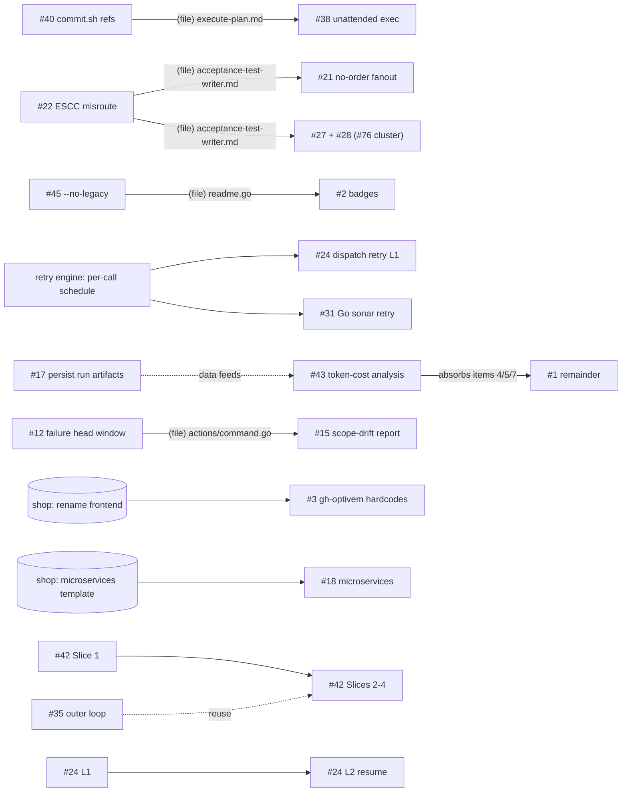

# 2026-10-29 20:42 UTC — Plan coordination meta-plan: backlog consolidation

Read-only analysis of every plan under `plans/backlog/`, `plans/deferred/`, `plans/deferred2/` and `plans/meta/`. No plan was edited. Each plan was read in full and its premise spot-checked against the current code (grep/ls/git log). Modelled on shop's consolidation (shop commit 7ecc8277 + `shop/plans/20261029-1256-meta-backlog-execution.md`).

**Plans analysed:** 46 + 1 stale meta-plan. Referenced-only: shop's `plans/20261029-1316-deploy-shop-cloud-run.md` (active, "Picked up by agent") and shop `plans/backlog/*`.

**Common staleness:** most plans written before the package reorg still cite old paths. Re-anchor before executing:
- `internal/atdd/runtime/{actions,gates,clauderun,statemachine}` → `internal/atdd/process/...`
- `internal/steps` → `internal/scaffolding/steps`
- `internal/projectconfig` → `internal/kernel/projectconfig`
- shop `.claude/agents/atdd/` → `internal/atdd/assets/runtime/agents/atdd/`

## Per-plan status snapshot

Legend:
- **Verdict:** DONE / OBSOLETE / PARTIAL / VALID.
- **Shop:** `—` none · `verify` = a rehearsal on shop is used only for verification · `read` = needs a synced local shop clone (reads the template layout) · `edits` = the plan itself edits shop · `shop-first` = shop must change and merge before the gh-optivem work.
- **Auto:** A = autonomous-ready · D = needs a user decision (see Blocked on user) · M = manual.

| # | Plan | Verdict | Done | Pri | Shop | Auto | Note |
|---|---|---|---|---|---|---|---|
| 1 | backlog/20260430-150508-minimize-tokens-and-latency-in-clauderun-dispatch | PARTIAL | 3/7 | P3 | — | A (item 3), D (4/5/7) | item 3 = add `--no-update-check` in `claudeTuningArgs` (clauderun.go:2023) |
| 2 | backlog/20260502-103000-fix-unfiltered-workflow-badges-academy-wide | VALID | 0/3 | P4 | — | A | stale pickup marker; also edits actions, optivem-testing, hub READMEs |
| 3 | backlog/20260511-1702-shop-frontend-react-to-typescript-rename | VALID | 0 | P4 | **shop-first** | A | shop renames `frontend-react` (~64 files), then gh-optivem drops hardcoded `"react"` |
| 4 | backlog/20260515-0950-ticket-type-feature-rename-and-config | VALID | 0 | PARKED | — | D | decision record; delete if the alias is kept permanently |
| 5 | backlog/20260518-1530-smoke-test-family-b-key | VALID | 0/5 | PARKED | read | D | no BPMN phase consumes a smoke key → delete candidate |
| 6 | backlog/20260525-1753-implement-pre-refine-check-and-post-refactor-offer | VALID (drifted) | 0/4 | P2 | verify | D | no `refine`/`refactor` command exists; signal = board status |
| 7 | backlog/20260526-1746-rebuild-onboard-external-system | VALID (archive) | 0 | PARKED | — | D | stash spec, not work |
| 8 | backlog/20260526-1754-rebuild-checklist-progress-tracking | VALID (archive) | 0 | PARKED | — | D | stash spec, sibling of #7 |
| 9 | backlog/20260528-1302-suppress-subprocess-stderr-non-verbose | VALID | 0 | P3 | verify | D | deps.go:138 still has the old wiring |
| 10 | backlog/20260620-0644-human-control-over-ai-authored-contract-semantics | VALID (record) | rung 1 shipped | PARKED | verify | D | revisit only if a rehearsal halts on it again |
| 11 | deferred/20260526-1237-setup-claude-code-web | VALID (personal) | 0/7 | — | — | M | personal setup, not repo work → delete candidate |
| 12 | deferred/20260608-2109-failure-capture-head-window | VALID | 0/6 | P2 | verify | D | `formatVerifyFailureOutput` now at actions/command.go:205 |
| 13 | deferred/20260613-1950-view-product-list-erp-list-gap | VALID | 0/6 | P2 | **edits** (all items) | D | shop has no `getProducts`/`ProductApiController`; plan uses an old absolute path root |
| 14 | deferred/20260615-0840-gh-optivem-claude-settings-sync-command | **OBSOLETE** | — | — | — | — | superseded by `gh optivem claude install/setup` (0b14d362); source repo emptied |
| 15 | deferred/20260616-0922-scope-drift-guard-fix-loop | VALID | 0/4 | P3 | verify | D | |
| 16 | deferred/20260617-1001-rehearsal-corpus-testinstance-and-refine | VALID | 0/10 | P3 | **edits** (configs + new issue) | D | covers the real-kind==test-instance gap |
| 17 | deferred/20260617-1017-persist-run-artifacts-beyond-worktree-teardown | VALID | 0/6 | P3 | — | A (accept recs A–D) | line anchors drifted (driver.go 418→440 etc.) |
| 18 | deferred/20260618-1046-microservices-scaffold-pipeline | VALID | 0/6 | PARKED | **shop-first** (needs shop `system/microservices/` template) | D | |
| 19 | deferred/20260618-1601-clock-driving-scenario-isolated-gate | **OBSOLETE** | — | — | — | — | #24 says "Supersedes … delete the deferred file" |
| 20 | deferred/20260812-1705-environment-setup-command | VALID | 0/8 | P2 | — | D | Step 8 gated on a green clean-room VM run |
| 21 | deferred2/20260620-0806-no-order-persisted-fanout-prevention | VALID | 2/6 | P2 | **edits** (DSL ×3 langs, shop#68) | D | "DECISION NEEDED" banner |
| 22 | deferred2/20260622-2002-escc-misroute-and-dsl-authoring-rules | VALID | 0/7 | **P1** | verify | **A** | false ESCC halt (scope_exception.go:32-35) |
| 23 | deferred2/20260623-1516-clock-isolated-static-gate-hardfail | VALID | 0/6 | PARKED | edits/read (option-dependent) | D | "ON HOLD, direction undecided" |
| 24 | deferred2/20260623-2125-atdd-dispatch-retry-budget-and-resume | VALID | 0/6 | P2 (L1) / P3 (L2) | — | D | shares the retry-engine change with #31 |
| 25 | deferred2/20260625-0944-sonar-deferred | PARTIAL | 16/84 | P4 | — | A (after refresh) | stale pickup marker (2026-07-01); line numbers stale, re-pull from SonarCloud |
| 26 | deferred2/20260627-1346-verify-push-paths-untracked-fix | **DONE** | code done | — | — | M | verify.go:420 uses `--cached --others`; exercised by many runs since |
| 27 | deferred2/20260627-2149-channel-touched-skipped-tests-noop-dispatch | VALID | 0/5 | **P1** | verify | A (Option A) | wasted 27-min dispatch, then a halt |
| 28 | deferred2/20260629-1728-isolated-tests-validate-channels-registered | VALID | 0/3 | **P1** | verify | D | hard halt on any ticket that yields `@isolated` tests |
| 29 | deferred2/20260701-0602-schedule-orphan-repo-cleanup | VALID | 0/5 | P3 | — | A | |
| 30 | deferred2/20260701-0928-document-env-file-in-manual-test-contributing | VALID | 0/4 | P4 | — | A | |
| 31 | deferred2/20260811-1603-sonar-scan-transient-retry | PARTIAL | bash/CI side done (actions cd0432c) | P2 | — | D | Go local scan (verify.go:860) still has no retry |
| 32 | deferred2/20260811-2246-pin-playwright-browser-install-legacy-workflows | VALID | 0/5 | **P1** | **edits** (shop only; 4 `*-legacy.yml`) | A | unpinned `npx playwright install` (CDN drift) |
| 33 | deferred2/20260812-1024-actionlint-latest-canary | VALID | 0/5 | P4 | — | A | |
| 34 | deferred2/20260813-1028-init-checking-progress-output | **DONE** | 6cb68776 | — | — | M | only a visual check left |
| 35 | deferred2/20260818-1658-contract-driven-outer-loop-for-kind-component | VALID (design) | Q1–Q7 open | PARKED | verify (shop `backend-clean-java`) | D | shop broker plan is parked, so it does not block this |
| 36 | deferred2/20260820-1345-component-test-sample-filter-and-suite-group-defaults | VALID | 0 | **P1** | read/verify | D (Problem 2) | `--sample`/`--test` no-op still reports PASSED (componenttest/run.go:121) |
| 37 | deferred2/20260917-1958-fix-ts-migrations-path-rewrite | **DONE** | 5/5 (e220eed9) | — | verify | M | shipped in v1.6.101+ |
| 38 | deferred2/20261002-0817-unattended-plan-execution | PARTIAL | default mode exists | P3 | — | D | |
| 39 | deferred2/20261002-0900-green-touch-list-before-editing | VALID | 0/6 | P2 | — | D (accept recs → A) | |
| 40 | deferred2/20261012-1042-replace-stale-commit-sh-in-claude-commands | VALID | 0/6 | **P1** | — | **A** | shipped `/execute-plan` etc. point every user at a missing script |
| 41 | deferred2/20261015-2108-spec-driven-positioning-and-branding | VALID | 0/7 | PARKED | read | D (name) | stale pickup marker (2026-10-15) |
| 42 | deferred2/20261023-0959-optional-inner-tdd-loop-per-component | VALID | 0/10 | P2 (Slice 1) / PARKED | verify (Slice 1) → **edits** (Step 4) → **shop-first** (Slice 3) | D (OQ1) | |
| 43 | deferred2/20261028-1456-atdd-workflow-token-cost-analysis | VALID | 0/6 | P3 | verify (uses existing rehearsal logs) | A (accept recs) | overlaps #1 |
| 44 | deferred2/20261028-1643-spec-gate-real-run-on-shop | PARTIAL | 5/6 | P3 | **edits** (shop workflows) | A (lenient step) | **unblocked**: `spec` is in v1.6.101/102; the plan's "▶ Next" note is out of date |
| 45 | deferred2/20261029-1200-no-legacy-omits-legacy-artifacts | VALID | 0/9 | P2 | **read** (shop template layout) | A | |
| 46 | meta/20260604-1024-backlog-conflict-triage-vs-1725-scoped-implement | **OBSOLETE** | — | — | — | — | coordinates gone plans and pre-reorg paths; replaced by this file |

## Deletion candidates

**Confirmed (delete now; no remaining agent work):**
- `plans/deferred/20260615-0840-gh-optivem-claude-settings-sync-command.md` — superseded by `gh optivem claude setup`.
- `plans/deferred/20260618-1601-clock-driving-scenario-isolated-gate.md` — superseded by #24, which says to delete it.
- `plans/meta/20260604-1024-backlog-conflict-triage-vs-1725-scoped-implement.md` — stale meta-plan.
- `plans/deferred2/20260813-1028-init-checking-progress-output.md` — shipped (6cb68776).
- `plans/deferred2/20260917-1958-fix-ts-migrations-path-rewrite.md` — shipped (e220eed9).
- `plans/deferred2/20260627-1346-verify-push-paths-untracked-fix.md` — shipped.

The last three only have operator-verification bullets left. Per [[feedback_plans_contain_agent_work_only]], those bullets don't keep a plan alive.

**Soft (delete if you agree; see Q-1):**
- `backlog/20260518-1530-smoke-test-family-b-key` — no consumer.
- `backlog/20260515-0950-ticket-type-feature-rename-and-config` — keep the `story`→`feature` alias permanently.
- `deferred/20260526-1237-setup-claude-code-web` — personal to-do, not repo work.

## Shop dependency summary

| Kind | Plans | What has to happen in shop |
|---|---|---|
| **shop-first** (blocked until shop changes merge) | #3, #18, #42 Slice 3 | #3: shop renames `frontend-react` → `frontend-typescript`. #18: a shop `system/microservices/` template must exist. #42 Slice 3: a shop plan promotes `backend-clean-java` to `kind: system` (no such plan yet). |
| **edits shop** (the plan writes to shop) | #13, #16, #21, #32, #44, #42 Step 4 | Commit via `--repo shop`. Pushes to shop `main` change the images the active shop cloud plan deploys; get an OK first while its Step 8 is in progress. #32 touches the same `*-legacy.yml` files as shop's `after-cloud-deploy/20260825-1426-acceptance-gate-pinned-sha-no-silent-skip`, so run #32 first; the shop plan is blocked anyway. |
| **needs a synced local shop clone** (reads the template) | #45, #36, #5, #41 | `gh optivem sync` (or a pull of `../shop`) before starting. |
| **verify on shop only** (rehearsal) | #6, #9, #10, #12, #15, #22, #27, #28, #35, #43 | Nothing to change in shop. The rehearsal needs a synced shop and a free docker stack (one session at a time). |

## Dependency graph

Edges come from the plans' own ordering language, plus conservative same-file edges marked `(file)`.

No cycles.

## Conflicts

| ID | Class | File(s) | Plans | Resolution |
|---|---|---|---|---|
| C1 | soft | `internal/scaffolding/steps/readme.go` (badge list) | #45, #2 | #45 first, then #2 |
| C2 | soft | `internal/claude/assets/commands/execute-plan.md` | #40, #38 | #40 first |
| C3 | soft | `agents/atdd/acceptance-test-writer.md` | #22, #28 (item C), #21 | #22 → #28 → #21 |
| C4 | soft (adjacent code) | `internal/atdd/process/actions/channel.go`, `internal/build/runner/{testnames,tests}.go` | #27, #28 | one session (CS3) |
| C5 | hard (same engine change) | `internal/kernel/shell/{retry,retrycore}.go` (`RetryWithPolicy` per-call schedule) | #24, #31 | one session, engine first (CS4) |
| C6 | soft | `internal/atdd/process/clauderun/clauderun.go` | #1 item 3, #24, #43 | serialise; #1 item 3 is a one-liner, do it first |
| C7 | soft | `internal/atdd/process/process-flow.yaml` | #28, #24, #15, #21, #6, #42, #35 | never two in parallel; rebase between them |
| C8 | soft | `internal/atdd/process/actions/command.go` | #12, #15 | #12 first |
| C9 | soft | implementer prompts (`system-`, `dsl-implementer.md` …) | #39, #22, #27 | #22 and #27 before #39 |
| C10 | soft | `internal/atdd/runtime/driver/driver.go` | #17, #24 | serialise |
| C11 | soft | `internal/scaffolding/steps/apply_template.go` | #45, #3, #18 | #45 first; #3 and #18 are blocked on shop anyway |
| C12 | soft (cross-repo) | shop `*-acceptance-stage-legacy.yml` | #32 vs shop `after-cloud-deploy/20260825-1426` | #32 first |

Shared-resource rule (not a file conflict): `gh optivem system start` and rehearsals bind fixed docker ports. Only one session at a time may run a shop rehearsal.

## Consolidation findings (decided)

| ID | Finding | Decision |
|---|---|---|
| CS1 | 6 plans done or obsolete (see Deletion candidates) | **Delete** (recommended: nothing in them is agent work) |
| CS2 | #7 and #8 are sibling archive stashes; #10 is a decision record | **Move to `parked/`, no merge** (recommended: merging archives is churn with no execution value) |
| CS3 | #27 and #28 come from the same #76 rehearsal and touch adjacent channel/report code | **Atomic single session**, #27 Option A first, then #28 A+B+C (recommended: one rehearsal verifies both) |
| CS4 | #24 Layer 1 and #31 each need `RetryWithPolicy` to take a per-call schedule | **Atomic single session**: engine change, then #31 Go port, then #24 L1. #24 Layer 2 stays separate (recommended: avoids building the engine change twice) |
| CS5 | #1 (items 4/5/7) and #43 overlap on ATDD token cost | **Re-order**: run #1 item 3 now; #43 measures and ranks; #1's remaining items are then judged by #43's results and #1 is deleted (recommended: measure before optimising) |
| CS6 | #22 and #21 both edit the acceptance-test-writer prompt for the #68 rehearsal | **Re-order**: #22 first (ready, P1); #21 after its go/no-go |
| CS7 | #40 and #38 both edit `execute-plan.md` | **Re-order**: #40 first |
| CS8 | Stale pickup markers on #2, #25, #41 | Remove the markers when each plan is next touched; not live claims (no activity for 2 weeks to 4 months) |

## Proposed folder layout

Mirrors shop's `plans/backlog/` structure. Apply this as one rename-only commit once you approve it.

| Folder | Plans |
|---|---|
| `backlog/p1-correctness/` | #22, #27, #28, #32, #36, #40 |
| `backlog/p2-atdd-quality/` | #6, #12, #13, #20, #21, #24, #31, #39, #42, #45 |
| `backlog/p3-tooling-cost/` | #1, #9, #15, #16, #17, #29, #38, #43, #44 |
| `backlog/p4-maintenance/` | #2, #3, #25, #30, #33 |
| `backlog/parked/` | #4, #5, #7, #8, #10, #18, #23, #35, #41 (+ #11 if kept) |
| (deleted) | #14, #19, #26, #34, #37, #46 |

`plans/deferred/` and `plans/deferred2/` end up empty and are removed. A `backlog/README.md` (shop-style table: folder, theme, notes) records the order. The shop column above lives in the README rather than in a separate folder, because shop dependency cuts across priorities.

## Execution units

| Unit | Plans / items | Type | Primary files | Auto |
|---|---|---|---|---|
| U1 | #40 | standalone | `internal/claude/assets/commands/*.md`, `cross_repo_commands.go`, `workspace.go`, `docs/gh-monitoring-process.md` | A |
| U2 | #22 | standalone | `actions/scope_exception.go`, `bindings_test.go`, `dsl-implementer.md`, `acceptance-test-writer.md` | A |
| U3 | #27 + #28 | atomic (CS3) | `runner/testnames.go`, `runner/tests.go`, `actions/channel.go`, `process-flow.yaml`, `acceptance-test-writer.md` | A for #27; #28 needs Q-3 |
| U4 | #45 | standalone (needs synced shop) | `scaffolding/steps/{apply_template,optivem_yaml,readme}.go`, `docs/cli-reference.md` | A |
| U5 | #32 | standalone, shop repo | shop `.github/workflows/*-acceptance-stage-legacy.yml` | A |
| U6 | #36 | standalone | `build/componenttest/{run,config}.go`, `build/runner/tests.go` | needs Q-4 |
| U7 | #17 | standalone | `runtime/driver/driver.go`, `step_summary.go`, `summary_sidecar.go` | A |
| U8 | #1 item 3 | standalone | `clauderun/clauderun.go` (one line) | A |
| U9 | #29, #33, #30 | three tiny independent plans | `.github/workflows/gh-cleanup-orphans.yml`; new canary workflow + pin sites; `CONTRIBUTING.md` | A |
| U10 | #2 | standalone (after U4) | `README.md`, `scaffolding/steps/readme.go`, sibling-repo READMEs | A |
| U11 | #44 Step 6 (lenient) | standalone, shop repo | shop `monolith-java-acceptance-stage.yml` | A |
| U12 | #24 L1 + #31 | atomic (CS4) | `kernel/shell/retry*.go`, `clauderun.go`, `scaffolding/steps/verify.go` | Q-5 |
| U13 | #43 | standalone (after U7, U8) | analysis script, `clauderun.go` | A |
| U14 | #12 then #15 | serial | `actions/command.go`, fixer prompts, `process-flow.yaml` | Q-6 |
| U15 | #21 | standalone (after U2, U3), edits shop | shop DSL ×3, `acceptance-test-writer.md` | Q-7 |
| U16 | #39 | standalone (after U2, U3) | implementer prompts + new shared chunk | Q-8 |
| U17 | #38 | standalone (after U1) | `execute-plan.md`, `create-plan.md`, settings | Q-9 |
| U18 | #9, #6, #13, #16, #20, #42, #25 | individual, later | see table | decisions |

## Execution waves

Rules for every batch:
- Run the pre-execute checks first.
- At most one session at a time may run a shop rehearsal or `system start`.
- Commit only with your per-action approval ([[feedback_no_commit_without_approval]]).
- On Windows, run Go tests with `scripts/test.sh` or `-p 2`.

### Wave 0 — housekeeping (one session, rename/delete only)
- Apply CS1 deletions and the folder layout; write `backlog/README.md`.
- Remove the stale pickup markers (CS8).
- Then all plan paths change. Run waves from the new paths.

### Wave 1 — can start now

**Batch 1A (parallel-safe, 6 sessions; disjoint files):**

| Session | Unit | Files owned |
|---|---|---|
| 1 | U1 #40 commit.sh references | assets/commands, cross_repo_commands.go, workspace.go |
| 2 | U2 #22 ESCC misroute | scope_exception.go, dsl-implementer.md, acceptance-test-writer.md |
| 3 | U4 #45 --no-legacy | scaffolding/steps/* (sync shop first) |
| 4 | U5 #32 Playwright pin | shop legacy workflows only (check shop cloud plan state before pushing) |
| 5 | U7 #17 persist run artifacts + U8 #1 item 3 | driver.go, step_summary.go, summary_sidecar.go, clauderun.go (one line) |
| 6 | U9 #29 + #33 + #30 | gh-cleanup-orphans.yml, actionlint canary + pin sites, CONTRIBUTING.md |

**Batch 1B (after 1A lands):**
- U3 #27 + #28: after U2, because both edit `acceptance-test-writer.md`. Holds the docker lock for the #76 rehearsal.
- U10 #2 badges: after U4, because both edit `readme.go`.
- U11 #44 Step 6: shop workflow; parallel with U3 and U10 (disjoint repo).
- U6 #36: once Q-4 is answered. Disjoint from the others, so it can run in parallel.

### Wave 2 — after Wave 1 and the decisions it needs
- **Parallel:**
  - U12 retry cluster (Q-5)
  - U13 token-cost analysis
  - U14 #12 then #15 (Q-6)
  - U17 #38 (Q-9)
- **Serial:** U15 #21 and U16 #39, after U2 and U3 (shared prompts), not parallel with each other (both edit agent prompts and #21 holds the rehearsal lock).

### Wave 3 — decision-gated remainder
- #9, #6, #13 (shop), #16 (shop), #20 (after a green clean-room VM run), #42 Slice 1, #25 (re-pull the Sonar list first).
- #1 remainder is judged by U13's results.
- Shop-first items: #3 once shop renames its frontend; #18 when microservices reaches the roadmap.

## Blocked on user

Answering "accept all recommendations" unblocks this whole section.

- **Q-1 Soft deletes.** Delete #5 (smoke key), #4 (keep alias permanently), #11 (personal setup)? **Recommended: yes to all three**, because none has a consumer or repo work.
- **Q-2 Folder layout.** Apply the proposed layout and Wave 0? **Recommended: yes**. This is the same structure shop uses, so the two backlogs read alike.
- **Q-3 #28.** May RED verify also run the isolated suite (Fix B)? **Recommended: yes, do A+B+C**, because otherwise isolated tests are never verified RED.
- **Q-4 #36 Problem 2.** Should a bare `run` resolve `suiteGroups.all` when the config declares it? **Recommended: (a) yes**, as the plan says, because it removes the silent "everything" default.
- **Q-5 Retry cluster.** Build #24 Layer 1 only (Layer 2 resume later), and port bash's message-line classification and force-retry list to Go for #31? **Recommended: yes**, because Layer 2 is partly covered by `--target` already.
- **Q-6 #12 / #15.** Use #12 option C (head+tail capture, plus Gradle `--warning-mode none`) and #15 report-only? **Recommended: yes**, because both are additive and carry no false-halt risk.
- **Q-7 #21.** Go, scoped to place/cancel order only? **Recommended: go**, because absence criteria still crash ATDD deterministically.
- **Q-8 #39.** Accept its own recommendations (shared chunk, prose only, fixer reads it)? **Recommended: yes.**
- **Q-9 #38.** Orchestration option? **Recommended: A (orchestrator plus subagent per item), with B (headless loop) as the escape hatch.**
- **Later, not blocking Wave 1–2:**
  - #6: refine signal = board status past "In refinement"; drop Idea 2.
  - #9: Option 2.
  - #13: option A.
  - #16: `/users` customer directory; defer refine.
  - #20: the plan's own answers.
  - #42 OQ1: rename `unit-tests` → `test-after`.
  - #23, #35, #41, #18: stay parked.

## Pre-execute checks

1. `grep -l "PICKUP\|in-flight\|claimed by\|Picked up by agent" plans/*.md plans/*/*.md plans/*/*/*.md`. On 2026-10-29 this matched #2, #25 and #41; all are stale (CS8). Any new hit means a live agent; stop and ask.
2. `git status` in gh-optivem and `../shop`: both must be clean on the files the batch owns.
3. Sync shop before U4, U5, U11 and any rehearsal: `gh optivem sync` (via `/sync`).
4. The shop cloud plan (`shop/plans/20261029-1316-deploy-shop-cloud-run.md`) is active. Don't touch its footprint (`*-cloud.yml`, `terraform/`, Keycloak cloud files), and get an OK before pushing to shop `main` while its Step 8 runs.
5. Re-anchor stale paths in the plan before executing it (see the list at the top).

## Out of scope

- Content correctness of individual plans (use `/review-plan` or `/refine-plan`).
- shop's own backlog (`shop/plans/backlog/*`), except where cross-repo files collide (C12).
- Executing, editing, moving or committing any plan.
