# 2026-11-09 11:19:28 UTC — Improved ATDD process flow

## TL;DR

**Why:** Since early November the process has been described publicly in four places:
- the SDD-for-QA talk (`substack/meetups/2026-11-05-spec-driven-development-for-qa.html`)
- the 2026-11-06 article batch (`substack/articles/{drafts/next,published}/2026-11-06-*`)
- the Circle session of 2026-10-30 (`substack/circle/2026-10-30/`)

Together they describe a sharper process than `internal/atdd/process/process-flow.yaml` runs today. The biggest differences:
- **Roles per step.** The articles split every step into executor, reviewer and approver. The BPMN only has agents plus approve gates.
- **Reviewer agents.** The articles have an adversarial reviewer in Red and review-first in Refactor. The BPMN has neither.
- **Align.** The articles describe an Align loop that checks the story against the use cases.
- **Acceptance criteria after green.** The articles delete the acceptance criteria once their tests pass. The BPMN keeps them and fingerprints them.
- **Refactor verification.** The articles run only the acceptance tests for the touched use case locally and leave the full suite to the pipeline.

**End result:** `gh optivem` runs one coherent flow, **Align → Update Use Case → Red → Green → Refactor & Review → Done**, with an explicit executor/reviewer/approver at every step. Students who read the articles or saw the talk recognise the same process when they run the tool.

## Outcomes

- **The target flow is written down once.** A single design section (below, then promoted to docs) is the reference for the BPMN, the agents and the articles.
- **Every step names its executor, reviewer and approver**, following the articles' rule: put human approval where nothing else can check the work.
- **Red is reviewed by an adversarial agent before the human approves.** It covers the Acceptance Test, the DSL and the drivers.
- **Green runs without review or approval.** The Acceptance Tests are the check.
- **Refactor is review-first.** The reviewer produces findings and a plan, a human approves, then the agent executes. Issues a human finds feed back into the guidelines.
- **Acceptance criteria don't drift from the tests.** Policy is set by Q4.
- **A story's status follows its tests.** A story is done when the tests tagged with its criterion IDs pass in the pipeline.

## Proposed process flow

### How to read these diagrams

Each diagram below is an **existing process from `docs/process-diagram.md`**, redrawn with the **same node IDs** and the proposed changes on top. Processes not shown are unchanged. Examples: `verify-tests-pass`, `verify-tests-fail`, the external-system / contract-test cascade, `redesign-*`, `cover-system-behavior`, `commit`, `approve`.

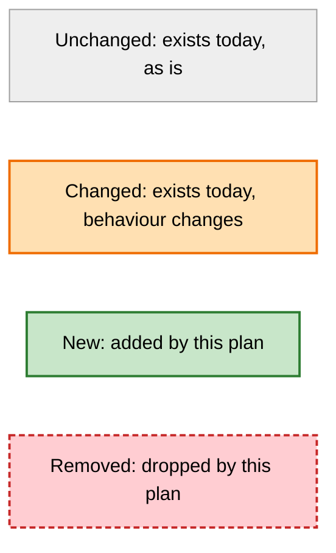

### Overview: where the changes land

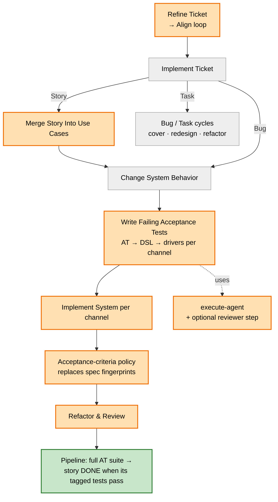

### Refine Backlog Item (Align): single pass → loop until the PO agrees

Today: `REFINE_ACCEPTANCE_CRITERIA` runs the `acceptance-criteria-refiner` once (human tier), then ends.

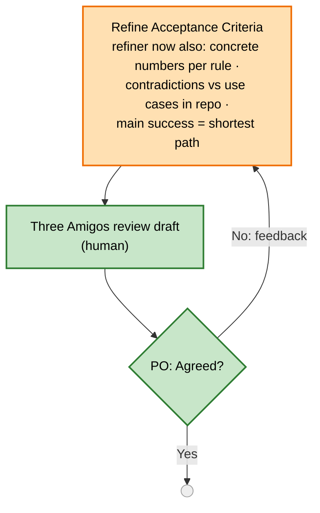

`Refine Ticket` (`MARK_IN_REFINEMENT → REFINE_BACKLOG_ITEM → MARK_READY`) is unchanged around it.

### Merge Story Into Use Cases: richer use case format + story ↔ criterion link

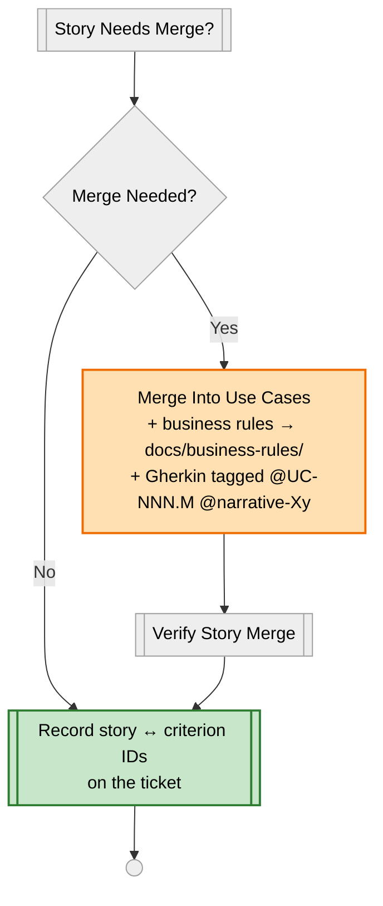

### Change System Behavior: spec fingerprints → acceptance-criteria policy; refactor → Refactor & Review

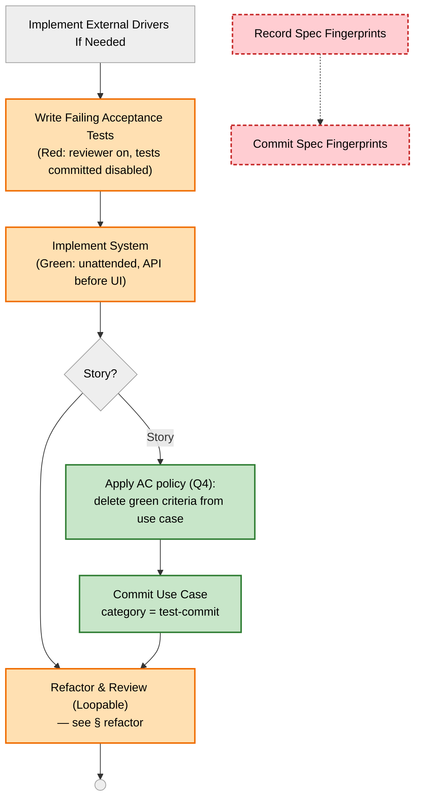

If Q4 resolves to "keep fingerprints", the two red nodes stay and the two green ones drop.

### Execute Agent: optional adversarial reviewer before the human approval

This is the single place the Red reviewer plugs in. The new `reviewer` param is set only at the Red call sites (`write-acceptance-tests`, `implement-dsl`, `implement-system-driver-adapters`), so every other agent dispatch behaves as today.

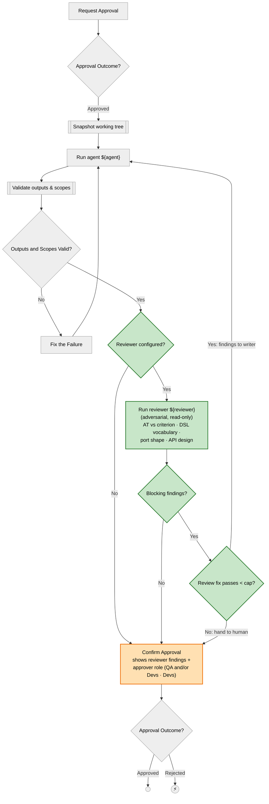

The scope-exception branch (`GATE_SCOPE_EXCEPTION_REQUESTED` → ESCC / contradictory-tests / scope-violation halts) and the PRE-rejected end are omitted for readability and are unchanged.

### Write and Verify Acceptance Test Code: Red tests committed disabled with a ticket marker (Q7)

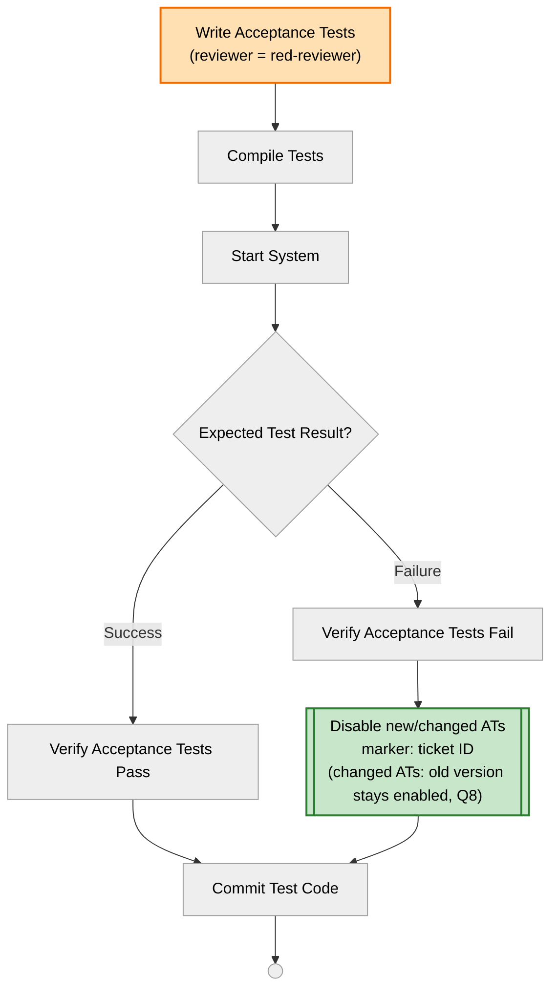

`implement-test-layer` (DSL, system driver adapters) gets the same change: its `RUN_ACTION` passes `reviewer = red-reviewer`, and its Failure branch disables the tests before `COMMIT_LAYER`. Open point: whether the verify steps run disabled tests explicitly by marker.

### Implement and Verify System (Green): re-enable by marker, API before UI, unattended

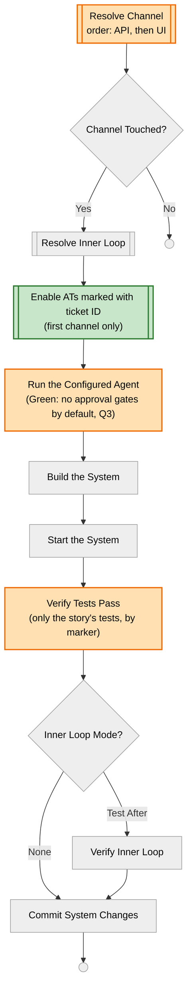

The `TDD → INNER_LOOP_TDD_UNSUPPORTED` halt is omitted and unchanged.

### Refactor (Refactor & Review): two new review-first options

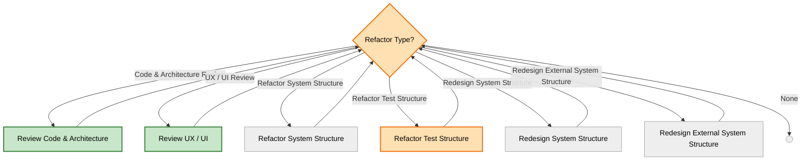

`REFACTOR_TEST_STRUCTURE` changes because its `VERIFY_TESTS_PASS` (`suite = ""`, i.e. the whole suite today) narrows to the touched use case's ATs (Q5). `refactor-system-structure` gets the same narrowing.

### Review Code & Architecture (new process)

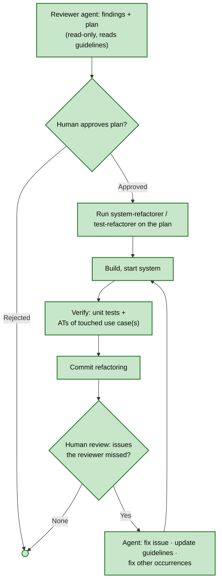

### Review UX / UI (new process; may be deferred, Q6)

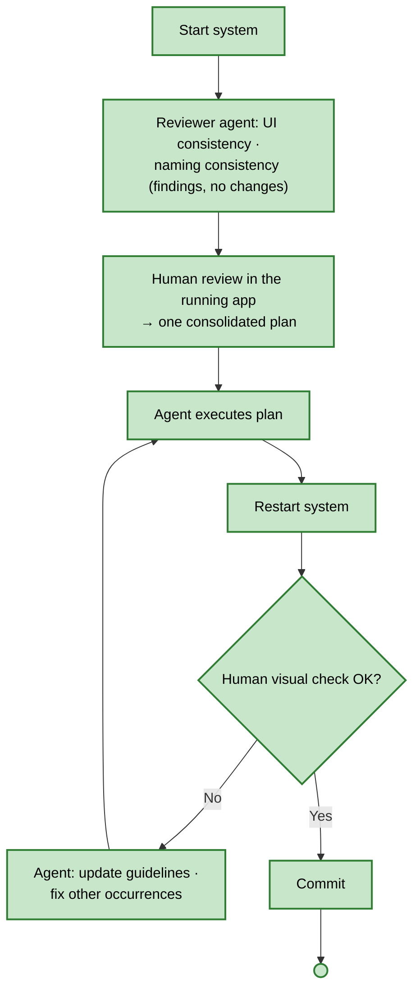

### Implement Ticket: status after the run

The CLI flow is unchanged and still ends at `MARK_IN_ACCEPTANCE`. New, outside the CLI: the pipeline runs the full AT suite and moves the story to **DONE** when every test tagged with its criterion IDs passes (Q9).

### Not changed by this plan

Kept as they are today:
- `main`, `implement-ticket` routing (story/bug/task + subtypes)
- `cover-system-behavior`, `redesign-*`
- the external-driver / contract-test cascade (`implement-external-drivers-if-needed` and below)
- `verify-tests-pass` / `verify-tests-fail` and their fix loops
- `commit`, `approve`, `execute-command`, `fix`, `setup-tests`, `build-system`, `start-system`

The legacy **Baseline** (Q-Step 10) is not drawn yet. Whether it extends `cover-system-behavior` or becomes a kickoff mode is still open.

### Roles per step

| Step | Executor | Reviewer | Approver | Today in BPMN |
|---|---|---|---|---|
| 0. Baseline (legacy) | Agent | Domain experts + the running system | Human | `cover-system-behavior` (per ticket, no diagram/narrative generation) |
| 1. Align | Agent (`acceptance-criteria-refiner`) | Three Amigos | PO (human) | `refine-ticket`, single agent pass, no loop |
| 2. Update use case | Agent (`use-case-merger`) | Deterministic `VERIFY_STORY_MERGE` | Human (POST approval) | `merge-story-into-use-cases`. Matches. |
| 3. Red: AT | Agent (`acceptance-test-writer`) | **Adversarial agent** (AT vs criterion) | QA and/or Developers | Writer + `execute-agent` PRE/POST approval, **no reviewer**; approval prompt doesn't name a role. Commit order (AT + DSL port stubs → DSL → adapters per channel → system per channel) already matches the talk. |
| 3. Red: DSL | Agent (`dsl-implementer`) | **Adversarial agent** (business vocabulary) | Developers | Same, no reviewer |
| 3. Red: drivers | Agent (`system-driver-adapter-implementer`) | **Adversarial agent** (port shape, API design) | Developers | Same, no reviewer |
| 4. Green | Agent (`system-implementer`) | The Acceptance Tests | The Acceptance Tests | Matches, apart from approval tiers (Q3) |
| 5a. Refactor: code/arch | Agent | **Adversarial agent, then human** | Human approves the plan, then reviews the result | `refactor` runs the refactorer directly, **no review-first** |
| 5b. Refactor: UX/UI | Agent | **Adversarial agent and human, app running** | Human | **Missing** |
| 6. Done | Pipeline | — | — | Status set to IN ACCEPTANCE by the CLI, not tied to tagged tests |

### Step details

**0. Baseline (legacy, once).** Source: the coverage article.
1. Use case diagram.
2. Core use case: narrative + business rules + Gherkin acceptance criteria.
3. Acceptance test architecture.
4. The core use case's tests pass against the existing system. They are characterization tests: on failure, fix the test, criterion and narrative, never the system, and never weaken an assertion.
5. Repeat for the other use cases, one use case per commit.

**1. Align.**
- The agent drafts the acceptance criteria. Every business rule gets at least one example with concrete numbers ("a rule in general terms always leaves room for a second reading").
- The agent checks for contradictions **inside the story** and **against the use cases in the repo**, pointing at the narrative step, the criterion ID and the tests that would turn red.
- The agent checks that the main success scenario is the shortest path; optional steps become alternatives.
- Three Amigos refine with the agent. A loop gateway asks "Agreed?".
- The PO approves, and the status moves to READY. **Changes:** a single pass becomes a loop, plus the use-case contradiction check.

**2. Update use case.** The story goes into the use case **before** any test is written (narrative step, business rule, Gherkin criterion tagged `@UC-NNN.M @narrative-Xy`). Business rules live in `docs/business-rules/UC-NNN-*.md`. The criterion IDs the story introduced or changed are recorded on the ticket (story ↔ criterion link). **Changes:** business-rules file, `@narrative` tags, story↔criterion link. Coordinate with shop `plans/20261106-1533-use-cases-match-substack-articles.md`.

**3. Red.** Commit shape, from the talk's gift-wrap demo:

| Commit | Content | Approver |
|---|---|---|
| 1 | Acceptance Test + DSL signatures stubbed `TODO: DSL` | QA and/or Developers |
| 2 | DSL | Developers |
| 3…n | Drivers, one commit per channel | Developers |

After each writer, before the human gate, a **red-reviewer** agent runs in adversarial mode. Per layer it checks:
- **AT:** every Given/When/Then has a line in the test, every value matches, the tag points at the right criterion, and nothing is in the test that isn't in the criterion (e.g. a dropped `shouldSucceed()`).
- **DSL:** words are in the business language and match the use case ("coupon", not "voucher").
- **Driver port:** one method per use case, request/response shape, no loose parameters.
- **API driver:** REST design is consistent (plural collections, ID in the path, verb for the action).

Findings go to the writer for a fix pass (capped), then to the human approver with the findings attached. The human chooses review depth by complexity and risk, and driver/API design is always a human decision. When the human finds something the reviewer missed, the same guidelines loop as in 5 applies: fix it, update the guidelines, and find other occurrences (Circle 2026-10-30).

Circle 2026-10-30 additions to Red:
- **Only write red tests for the scenarios about to be implemented.** Don't start Red unless Green follows immediately.
- **Red commits keep the pipeline green.** The new tests are committed **disabled**, with a comment carrying the ticket ID (e.g. `in progress, SHOP-123`). Green re-enables exactly those tests, found by the ticket ID, and runs only them locally. The ID also feeds dashboards. See Q7.
- **A changed test** must not silently replace a passing old version while it is disabled. See Q8.
- **Feature flags only for months-long epics** (old and new ATs both active). Never one flag per story.

**4. Green.** System, one commit per channel, API before UI. The executor only: no reviewer and no human gate by default. The pipeline decides. **Changes:** per-channel order pinned (API first), Green approval tier (Q3).

**5. Refactor & Review (optional, loopable, explicit skip).**
- **5a. Code/architecture review:**
  1. The reviewer agent writes findings and a plan, with no changes, reading the guidelines files.
  2. The human approves the plan.
  3. The agent executes the plan.
  4. **Run only the Acceptance Tests for the touched use case(s)** (by `@UC-NNN` tag or use-case test class) plus all unit tests. The full acceptance suite runs in the pipeline.
  5. The human reviews the result.
- **5b. UX/UI review:**
  1. Start the app.
  2. The reviewer agent checks UI and naming consistency.
  3. The human reviews; the two reviews merge into one plan.
  4. The agent executes the plan.
  5. Restart the app and do a visual check.
- **Guidelines feedback loop:** when the human finds an issue the reviewer missed, the agent (1) fixes it, (2) updates the guidelines file, and (3) finds and fixes other occurrences across the codebase. Guideline files are kept concrete and pruned.

**6. Done.**
- The pipeline runs the full acceptance suite.
- A story is done when every test tagged with its criterion IDs passes.
- Ticket status transitions follow pipeline results, not the CLI's end-of-run.
- Acceptance criteria are deleted, generated or kept after green, per Q4.

## ▶ Next executable step (resume here)

Design only. Run `/refine-plan plans/20261109-1219-improved-atdd-process-flow.md` to settle `## Open questions` (Q1–Q10). Once settled, Step 1 is a docs edit that `/execute-plan` can run. Steps 2–9 are big enough that each should become its own plan (see Q1).

## Steps

- [ ] Step 1: Promote `## Proposed process flow` into the process docs as the target design. Use the architecture/process docs location the BPMN doc-blocks reference, with a "today vs target" column. Do not regenerate the diagram (CI does it).
- [ ] Step 2: **Align loop.** Reshape `refine-backlog-item` / `refine-acceptance-criteria` into draft → refine (loop, "Agreed?" gateway) → PO approve. Extend `acceptance-criteria-refiner.md` with three checks: concrete examples per rule, contradiction vs use cases, main-success-scenario shortest path. Audit the new loop-back edge for test deadlocks first.
- [ ] Step 3: **Use case format.** Teach `use-case-merger` the business-rules file and the `@narrative-Xy` tags. Record story → criterion IDs on the ticket. Align with the shop plan 20261106-1533.
- [ ] Step 4: **Red reviewer.** Add a `red-reviewer` agent (one prompt, per-layer mode: AT / DSL / driver port / API driver). Add it **once**, inside `execute-agent`: an optional `reviewer` param, plus a review → capped fix → `APPROVE_POST`-with-findings sequence (see the Execute Agent diagram). Set the param only at the three Red call sites (`write-acceptance-tests`, `implement-dsl`, `implement-system-driver-adapters`). Label `APPROVE_POST` with the approver role. Pin `phase-scopes.yaml` (reviewer is read-only).
- [ ] Step 5: **Red/Green commit shape.** The BPMN already produces AT + DSL port stubs → DSL → adapters per channel → system per channel. The only change is to pin the channel order to API before UI in `RESOLVE_CHANNEL`.
- [ ] Step 6: **Green unattended** (per Q3). Drop or relax Green approval tiers.
- [ ] Step 7: **Acceptance criteria after green** (per Q4). Replace or extend `RECORD_SPEC_FINGERPRINTS` with the chosen policy, plus a `spec generate`-style command if generation is chosen.
- [ ] Step 8: **Refactor & Review.** Restructure `refactor`:
  - review-first: reviewer agent → plan → approve → execute
  - touched-use-case AT subset in place of the whole suite (`VERIFY_TESTS_PASS` with `suite: ""` today)
  - human review of the result
  - guidelines feedback loop
  - a new UX/UI review option (app running)
- [ ] Step 9: **Done = tests pass.** Tie ticket status to pipeline results for the story's criterion IDs (Circle: pipeline auto-transitioning statuses).
- [ ] Step 9b: **Disabled red tests** (per Q7/Q8). Red writers commit new ATs disabled with a ticket-ID marker. Green re-enables exactly those tests by marker and runs them locally. For changed ATs, the old version stays enabled until Green.
- [ ] Step 10: **Baseline.** Decide whether the legacy baseline (diagram → narratives → criteria → characterization ATs, one use case per commit) becomes a kickoff mode or stays as `cover-system-behavior` per ticket. Close the gap either way.
- [ ] Step 11: Update statemachine/process tests and the BPMN audits (`bpmn-logic-audit`) for every reshaped process. Run tests with `-p 2`.

## Verification

- Operator: gift-wrap rehearsal on shop. Commits and approve prompts match the talk's "Gift-Wrap Commits" slide, and the Red reviewer catches a planted dropped `shouldSucceed()`.
- Operator: refactor rehearsal runs only the touched use case's ATs locally.

## Open questions

- **Q1. One plan or split?** Recommended: keep this file as the umbrella design and spin out one plan per stage (Align, Red reviewer, AC policy, Refactor & Review, Done/status). Each is a multi-session BPMN change, and this mirrors how earlier BPMN efforts were sliced.
- **Q2. Red reviewer: one agent or three?** Recommended: one `red-reviewer` with a per-layer mode. Fewer prompts to maintain, and the checks share the "compare against the spec, try to find what's wrong" stance.
- **Q3. Green approval.** The articles say no human approval in Green. Today system-agent tier approvals exist (skipped under `--auto`). Recommended: Green runs unattended by default, and the approve tier stays available as a flag for teaching mode.
- **Q4. Acceptance criteria after green.** The articles say delete them, or generate them from the tests if business readers need them. Today spec fingerprints keep both and report drift. Options: (a) delete on green, (b) delete + `generate` command, (c) keep fingerprints. Recommended: (b). It matches every article, and generation covers the "customer signs the criteria" case.
- **Q5. Refactor verification scope.** Run only the touched use case's ATs locally (the article) instead of the whole suite. This requires mapping changed files to use cases. Is tag-based selection from the story's criterion IDs enough, or do we need a file → use case map?
- **Q6. UX/UI review in scope now?** It needs a running app and a visual check, which is new ground for the CLI. Recommended: defer it to its own plan after 5a ships.
- **Q7. Disabled-red-tests convention (Circle).** Red commits push tests disabled with a ticket-ID comment so trunk stays green, and Green re-enables them by ID. Does gh-optivem adopt this? Today the Red commits are separate commits in one run, and Green follows in the same run. Recommended: adopt it. Runs can halt between Red and Green (human gates, fix-loop exhaustion), and a pushed red commit would break the pipeline for everyone.
- **Q8. Changed ATs between Red and Green (Circle, left open).** Options: (a) keep the old test enabled and the new one disabled, delete the old one at Green; (b) version the suite; (c) rely on a short Red→Green window. Recommended: (a). It is the only option that keeps the old behaviour guarded throughout.
- **Q9. Statuses after READY (Circle, left open).** Which statuses exist (e.g. IN PROGRESS → RED COMMITTED → IN ACCEPTANCE → DONE), and which are set by a human, by the CLI or by the pipeline? Recommended: humans set only READY, the CLI sets IN PROGRESS, and the pipeline sets DONE from tagged-test results.
- **Q10. Later QA / exploratory / usability phase (Circle, left open).** Is it a step after 5, or out of the CLI's scope? Recommended: out of scope. The talk lists it as a human activity the tool doesn't automate.
- **Out of scope (pipeline, not process flow):** scheduled AT runs (hourly default config, other platform variants at lower frequency, conditional on the default passing). If wanted, it belongs to a shop/pipeline plan.
