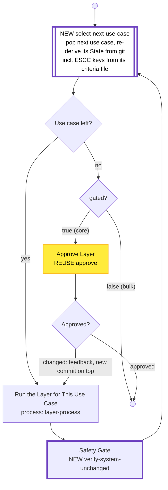
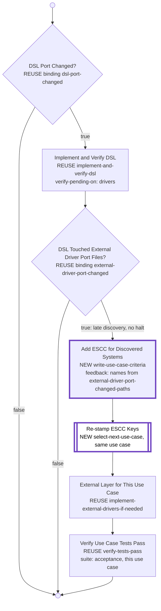
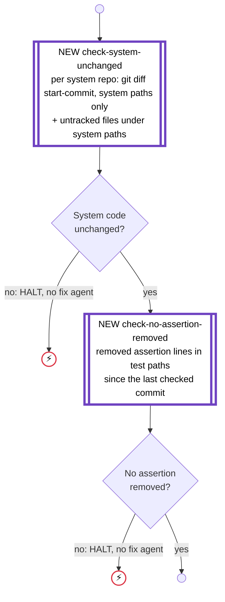
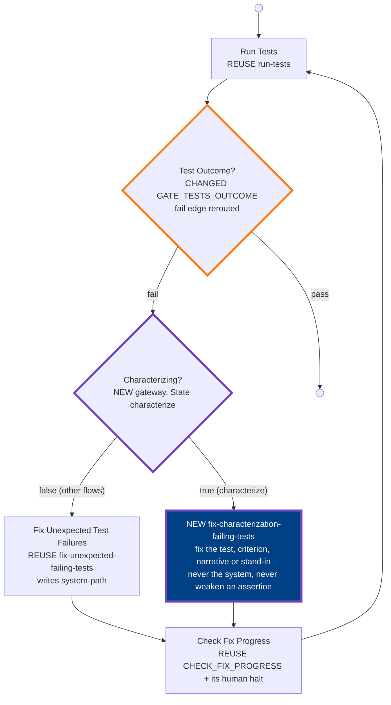
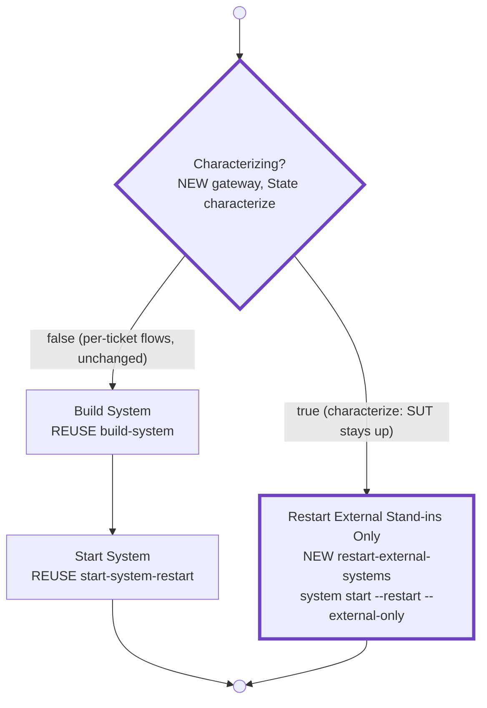
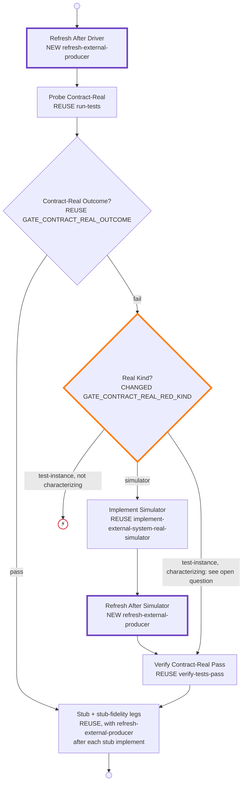

# 2026-11-10 11:30 — Legacy baseline: bulk process (implementation)

> 🤖 **Picked up by agent** — `Valentina_Desk` at `2026-11-10T13:51:53Z`

## TL;DR

**Why:** The published article "Acceptance test coverage with AI" (`substack/articles/published/2026-11-06-PAID-ATDD-acceptance-test-coverage-with-ai.md`) describes a legacy on-ramp, but gh-optivem only has the per-ticket `cover-system-behavior` (`task/legacy-coverage`). It writes passing tests for given criteria, but generates no diagram, narratives or criteria, and starts the system again on each ticket, which is too slow for a whole-system baseline.
**End result:** a separate, one-off **bulk baseline** process that baselines a whole legacy system layer by layer, external systems included (contract tests, external drivers, simulators and stubs), with the system under test started once and a guarantee that no system code changes. `cover-system-behavior` stays unchanged for later ad-hoc gaps.

## ▶ Next executable step (resume here)

Step 3, part 2b: close the runtime gaps the wiring left (list below), then Step 4 transition tests. Wiring and agents are done (commit `5ddc36f4` agents, then the wiring commit after it). All existing tests pass, but these gaps fail only at runtime; no test catches them. All are covered by existing decisions; no new design questions.

Runtime gaps (fix in this order; mainly `process-flow.yaml` + `internal/atdd/process/actions/use_case_loop.go`):

1. Per-use-case State not re-derived in bulk (Decision "Per-use-case State"): `select-next-use-case` stamps only `use-case-id` + ESCC keys, so in the bulk DSL/adapter layers `test-names`, `dsl-port-changed`, `system-driver-port-changed` hold the previous use case's values. Re-derive from git: tests tagged `UC-NNN`, port changes from that use case's commits.
2. `acceptance-criteria` / `scenario-criteria` never stamped for a use case, so the AT layer's strict `${acceptance-criteria}` fails. Stamp them from the use case file in `select-next-use-case`.
3. `remove-wip-gate` at the end sees only the last use case's `test-names`; it must cover every use case's tagged tests.
4. Empty `other-use-cases` (system with only the core use case) hard-errors in `select-next-use-case`; it must give `use-case-left=false`.
5. Stand-in check edge case: if the fixer's output fails validation and the nested fix re-snapshots, earlier stand-in edits are missed and no restart happens.
6. Test that every agent's required node params (`use-case-id`, `discovered-external-port-paths`, `verify-failure-output`) are supplied along each call path (with Step 4).

Left for part 3 (entry point), not part 2b:
- Commit messages use `#${ticket-id} ${issue-title}` and the resume probe is keyed by ticket; the `characterize` entry point must seed these (or a preset).
- `characterize` is not in the driver's `topProcesses` (phase banners) or the diagram's `processOrder`.
- Declined layer/diagram re-runs get no feedback text (`approve` collects none); redo loops are capped by `max-visits: 3`. Accept as v1 or add feedback capture.

Wiring judgment calls (accepted, for the record): the `characterize` binding treats unset as false; new param binding `gated` (strict); new binding `stand-ins-changed` + action `check-stand-ins-changed` (restart only when the fixer touched a stub/simulator); new action `record-use-case-criteria`; new config key `use-cases-path` (default `docs/use-cases`); fixer category `test-agent`; the test-instance contract-real verify is a new node; the `channels.go` adapter-channel unroll also covers `characterize-adapter-layer`; 2 new commit-after-verify invariant exceptions in `invariants.go`.

### Part 1 handoff (done 2026-11-10)

- Runner: `gh optivem system start --restart --external-only` (`internal/build/runner/standins.go`, `SystemOptions.ExternalOnly` / `StandInPaths` / `StandInBaseDir`, `SelectStandInServices`; `--external-only` without `--restart`, no stand-in paths, or zero matched services → hard error). Not yet run against real Docker.
- Actions (`internal/atdd/process/actions/characterize_safety.go`, `use_case_loop.go`, registered in `register.go`):
  - `record-start-commits` → `system-start-commits` (JSON `[{repo, commit, paths}]`, keyed by repo slug), `stand-in-paths`, `assertion-checked-commit`; kept on resume; fails hard on microservices/unset, empty paths, stand-in/system overlap.
  - `check-system-unchanged` → `system-unchanged` (bool, binding `system-unchanged`), `system-changed-files`.
  - `check-no-assertion-removed` → `no-assertion-removed` (bool, binding `no-assertion-removed`), `removed-assertions`; advances `assertion-checked-commit` on pass. A removed line re-added verbatim in the same diff counts as a move.
  - `select-next-use-case` (params `use-cases`, `layer-process`) → `use-case-id`, `use-case-left` (bool, binding `use-case-left`), `use-case-cursors`, plus the ESCC keys (`ticket-has-escc`, `escc-systems`, `external-system-contract-criteria`) from the use case file's ESCC section (`intake.ExtractSection` + `intake.ParseSections`; no file yet → `ticket-has-escc=false`).
  - `restamp-current-use-case`: same-use-case mode, for the DSL layer's RESTAMP node (service tasks can't carry params).
  - Shared helper `stampESCC` extracted from `parse-ticket` (behaviour unchanged).

## Decisions (user, 2026-11-10)
- **Vendor contract test fails during characterize (user, 2026-11-10):** route the red to `verify-tests-pass` (suite `contract-real`), so the characterization fixer handles it, with the existing human halt when it makes no progress. The per-ticket flow keeps `CONTRACT_REAL_UPSTREAM_GAP_HALT`.

- **Two paths.** A separate **bulk baseline** process (one-off, whole system) plus the existing ad-hoc per-ticket `cover-system-behavior` (unchanged). The bulk flow is its own entry point, **not** a kickoff mode; kickoff stays greenfield-only (nothing in `internal/kickoff/`, which `1121` also waits on).
- **System started once.** In the baseline the system is never modified, so the system is started once at the start and stopped once at the end; the flow does not loop `cover-system-behavior` (which brings Docker up each time). Inner writing/fixing nodes are reused via a "system already up" param, or the start is hoisted to the caller.
- **Layer by layer, in bulk.** Across all use cases: all DSL, then all drivers, etc. — not use case by use case. The **core use case goes first**, through every layer, to establish the architecture.
- **Hand-holding (Q8).** Human approve gates after each layer for the **core use case only**. Bulk layers run unattended. (Be careful with the core use case.)
- **Entry point name:** top-level `gh optivem characterize` (user's choice; beside `kickoff`, separate from it).
- **Core use case choice:** the agent proposes it from the generated use case diagram (with reasons); the human confirms or changes it at the first gate.
- **Deleting criteria at the end:** automatic, as its own commit (revertable with git; `gh optivem spec generate` regenerates readable criteria from tagged tests). Rationale: criteria left behind drift out of date; same as the existing AC policy.
- **Tickets are user stories.** The bulk baseline does not use tickets; the per-ticket path (story with criteria) is for later gaps only.
- **System-code safety gate (Q9, Q8) — mandatory, 100% guarantee.** Two lines: (1) the existing per-agent scope check (`validate-outputs-and-scopes`, snapshot/diff, per-phase allowed paths) with baseline-flow agent scopes that exclude `system-path`; (2) a new **hard** check, `git diff <start-commit> -- <system paths>`, run after each layer's commit and at the end; any non-empty diff HALTS the flow (no fix-agent routing). The start commit is recorded in the flow state at start and kept across resumes. Reason: the existing check is soft (a violation routes to a `fix-scope-diff` agent), per-dispatch only, covers only scoped writing agents, and may not see changes an agent commits itself (verify in Step 1). This is not conditional on what `green-when-complete` already does. Also guard "never weaken an assertion" (assertion-removal diff check).
- **Design review answers (2026-11-10).** All recommendations accepted except the external-systems part:
  - Per-use-case State: `select-next-use-case` re-derives it from git (tests tagged `UC-NNN`, port changes from that use case's commits, ESCC from its criteria file).
  - Use case loop: runtime loop (`select-next-use-case` + gateway), not a load-time unroll.
  - Skipped gates: `VALIDATE_CHANNELS_REGISTERED`, `GATE_DSL_PORT_CHANGED`, `GATE_SYSTEM_DRIVER_PORTS_CHANGED` move into the AT / DSL / adapter layer wrappers. **Overridden:** `EXTERNAL_DRIVER_PORT_CHANGED_HALT` is not kept; a late external-port change routes into the external layer (see 2b).
  - Fixer selection: State flag `characterize` (preset `false` on `main`, `true` on `characterize`), one new gateway per verify process.
  - Commits: one per (layer, use case); safety gate after each.
  - Assertion check: per-language regex over removed lines in test paths since the last checked commit; any hit halts.
  - `apply-ac-policy`: the criteria layer appends each criterion id to `merged-criteria`.
  - System on HALT: left running (confirmed).
  - Declined core layer: redo it with the feedback, as a new commit on top (confirmed).
- **External systems are IN SCOPE for v1** (user overrode the recommendation). The baseline also characterizes external systems: contract tests (CT), external driver ports/adapters, simulators and stubs, via the existing ESCC / contract path.

## Source (article steps)

1. Generate the use case diagram (source code wins over the docs). Human confirms it and picks the core use case.
2. Core use case: narrative + business rules + Gherkin acceptance criteria.
3. Acceptance test architecture.
4. The core use case's tests pass against the existing system. They are characterization tests: on failure, fix the test, criterion and narrative, never the system, and never weaken an assertion.
5. Repeat for the other use cases, one commit per layer (bulk).
6. Delete the criteria.

## Step 1 findings

All lines in `internal/atdd/process/process-flow.yaml` unless noted.

- **Start/stop (Q1).** No ATDD process ever stops the system (no `system stop` / `runner.Down` in `internal/atdd`). In the cover path the system is started by:
  - `write-and-verify-acceptance-test-code` → `START_SYSTEM` (`start-system`, :1389-1391), reached via `write-acceptance-tests-and-dsl` (:1204).
  - `implement-test-layer` → `START_SYSTEM` (`start-system`, :2192-2194), used by `implement-and-verify-dsl` (:1448) and `implement-and-verify-system-driver-adapters` (:1471).
  - ESCC branch only: `implement-external-drivers-if-needed` (:1136, gate `ticket-has-escc`) → `implement-and-verify-external-system-driver-adapters-contract-tests` (:1533) → `build-system` + `start-system-restart` (:1681-1843).
  - `start-system` runs `gh optivem system start` (:3485-3505). `runner.Up` skips when any health URL is up (`internal/build/runner/system.go:135-140`). So a plain start on a running system is a cheap health probe, not a Docker restart. Only `start-system-restart` (`--restart`, :3507) recreates containers.
- **Q2 recommendation: hoist the start to the caller, no param.** The inner starts are already idempotent no-ops on a running system, and the engine has no per-param defaulting (:3457-3459), so a "system already up" param would need a new gateway in 3 processes and a pinned value at every other caller. The bulk flow adds one start + one stop. The "started once" test (Step 4) asserts no `build-system` / `start-system-restart` dispatch, a single cold start, and only `restart-external-systems` recreates (see "External systems" below).
- **System code paths (Q3).** Not language-specific; read from `gh-optivem.yaml`.
  - Resolver: `projectconfig.Config.SystemSurfacePaths(channel)` (`internal/kernel/projectconfig/config.go:719-760`). Monolith → `[system.path]`. Multitier → `[system.backend.path, system.frontend.path]` for channel `""` (api → backend, ui → frontend). Microservices / unset → `ok=false`.
  - `system.path` is empty on multitier by construction. `ResolveLayerPaths` skips it there (`internal/atdd/phase_scopes.go:37-50`, `MonolithOnlyPathKeys`). `AddSystemSurfaceScope` appends the tier paths instead (`internal/atdd/process/actions/scope.go:285-318`).
  - Also system code: `system.db-migration-path` (default `system/db/migrations`, `internal/kernel/projectconfig/paths_defaults.go:17`; `scope.go:238`).
  - Multirepo: system tiers can live in other repos (`internal/config/optivemyaml/optivemyaml.go:215-240`). A `git diff` in the test repo will not see them. **Decided (user, 2026-11-10):** the gate records a start commit per system repo and diffs each one against it. Microservices (`ok=false`) fails hard.
- **Fix loop can write system code (Q4): yes.** There is no `phase-scopes.yaml`; scopes are inline `read:`/`write:` on each node.
  - `verify-tests-pass` → `fix-unexpected-failing-tests` (:2280) has `write: [... system-path ...]` (:3092).
  - `verify-tests-fail` → `fix-unexpected-passing-tests` (:2403) has `system-path` too (:3067).
  - On multitier, `AddSystemSurfaceScope` with channel `""` widens this to both tiers.
  - The scope check is also soft: `execute-agent` routes violations to `fix-scope-diff` or the scope-exception branch (:3744-3800).
  - The bulk flow needs fixer nodes without `system-path`.
- **Snapshot vs agent commits (Q5): no.** `snapshotWorkingTree` (`outputs.go:337`) stores SHA-256 hashes of `git status --porcelain` paths only. No HEAD is recorded (`internal/atdd/process/actions/worktree.go:22-101`). `modifiedPathsSinceFingerprint` (`worktree.go:115-137`) diffs that against the current dirty set. If an agent edits a clean file and commits it, the file is clean again and never shows up. This confirms the need for the hard `git diff <start-commit>` gate.
- **Contradicts the plan:** "brings Docker up each time" is overstated. Without ESCC, each cover run only runs idempotent `start-system` probes. The real cost is the per-ticket loop, not repeated Docker restarts. The decision (start once, hoist) still holds.

### External systems findings (2026-11-10)

- **What the contract path writes.** Per external system (load-time unroll, `UnrollExternalSystems`, `internal/engine/statemachine/channels.go:225`), `implement-and-verify-external-system-driver-adapters-contract-tests` (:1533) runs: `write-contract-tests` (ct-test, dsl-port, dsl-core; :2531-2532), `write-stub-fidelity-tests`, DSL, `implement-external-system-driver-adapters` (external-system-driver-adapter, testkit side; :2938-2939), then `reconcile-external-contract-producer` (:1668), which may run `implement-external-system-real-simulator` (writes `external-system-simulator`, :3048-3049) and `implement-external-system-stubs` (writes `external-system-stub`, :3006-3007).
- **Rebuild/restart today recreates the system under test.** `reconcile-external-contract-producer` runs `build-system` + `start-system-restart` four times (:1679/1684, :1727/1732, :1779/1784, :1836/1841). `runner.Build` builds every compose service (`internal/build/runner/system.go:107-119`). `--restart` force-recreates **every non-persistent service** (`up -d --build --force-recreate --no-deps <all but postgres>`, `system.go:239-265`), so the SUT container is recreated too. There is no per-service option today (`system_commands.go:90`).
- **A stub/simulator change needs only its own container recreated.** In shop the SUT and the stand-ins are separate compose services: `system` builds from `system/monolith/java`, `external-system-simulators` builds from `external-systems/simulators`, `external-system-stubs` is WireMock with `external-systems/stubs` bind-mounted locally and `COPY`-baked in the pipeline (`shop/docker/java/monolith/docker-compose.local.real.yml:5-9,91-93`, `docker-compose.local.stub.yml:91-96`, `shop/external-systems/stubs/Dockerfile:2`). The SUT image does not contain stub or simulator code, and `--no-deps` leaves dependents running. So `up -d --build --force-recreate --no-deps <stand-in services>` picks up the change (the runner's own comment: force-recreate "reloads WireMock's mounted mappings", `system.go:261-263`) without touching the SUT. External driver adapters and contract tests are testkit code: no container change at all.
- **Stand-in paths are not system paths.** The registry declares `stub.path` / `simulator.path` per system (`internal/kernel/projectconfig/config.go:445-470`, resolved by `ExternalRegistryPaths`, :500); shop uses `external-systems/stubs` and `external-systems/simulators`, outside `system/` (`shop/gh-optivem-monolith-java.yaml:37-45`). `SystemSurfacePaths` + `db-migration-path` do not include them.
- **Tickets feed the ESCC keys; the baseline must feed them itself.** `parse-ticket` stamps `ticket-has-escc`, `escc-systems`, `external-system-contract-criteria` from the `## External System Contract Criteria` section via `intake.Parse` (`internal/atdd/process/actions/tracker.go:114-130`). With `ticket-has-escc` true, `touchedExternalSystemNames` takes `escc-systems` as authoritative and ignores port-change paths (`actions/external.go:63-75`).
- **Order today: external first.** `implement-external-drivers-if-needed` runs before the AT step "so stubs are in place before acceptance tests run" (:1127-1128, :1188-1189), and the cover-path `verify-pending-on` values leave external ports out because they are already built (:1226-1229, :1262-1265; `internal/atdd/process/gates/bindings.go:614-630`).

## Step 2: flow design

Design only. Nothing in `process-flow.yaml` or Go changed yet.

**Colour key.** Fill and shape follow the legend in `docs/process-diagram.md` (`serviceNode` white, `agentNode` dark blue, `humanNode` yellow, `errorEndNode` red border, call activities unfilled). The legend has no marker for new or changed nodes, so this design adds an overlay, plus a text tag in each label:

- `newNode`: thick purple border, label tag `NEW`.
- `changedNode`: thick orange border, label tag `CHANGED`.
- No overlay, label tag `REUSE <process-flow.yaml id>`: reused as is.

The overlay overrides the TDD-stage border. It is for this plan only; the generated diagrams keep the legend as is.

**Shape of the design.**

- `characterize` (NEW): the top-level flow behind `gh optivem characterize`.
- `characterize-layer` (NEW): one layer over a list of use cases. Called 5 times for the core use case (gated) and 5 times for the rest (unattended). This gives "layer by layer, in bulk".
- Layer wrappers (NEW): `write-use-case-criteria`, `characterize-at-layer`, `characterize-dsl-layer`, `characterize-adapter-layer`; the external layer is REUSE `implement-external-drivers-if-needed`.
- `verify-system-unchanged` (NEW): the hard safety gate, called after every commit and at the end.
- `refresh-external-producer` (NEW) inside CHANGED `reconcile-external-contract-producer`: restarts only the stand-ins when characterizing.
- `verify-tests-pass` / `verify-tests-fail` (CHANGED): the characterization fix loop.

**Layer order per use case:** criteria (incl. ESCC) → external → acceptance tests → DSL → system driver adapters. The external layer sits **before** the AT layer, not after the adapter layer, because the AT layer runs against the stub stack and its green-when-complete prediction assumes the stubs already exist (evidence above). The core use case goes through all five first.

**Restart rule (precise).** While `characterize == true`, the system under test is started once (by `characterize`) and never rebuilt or recreated. Any external-layer step that changes a producer-side stand-in (simulator or stub) is followed by `restart-external-systems` = `gh optivem system start --restart --external-only`, which runs `up -d --build --force-recreate --no-deps` on the stand-in services only, then health-waits. The stand-in services are found deterministically from `docker compose config --format json`: every service whose build context or bind-mount source resolves under a registry `stub.path` / `simulator.path`. Zero matches fails hard (never a silent no-op). With `characterize == false`, `refresh-external-producer` runs `build-system` + `start-system-restart` exactly as today.

### 2a. `characterize` (top level)

```mermaid
flowchart TD
    C_START(( ))
    RECORD[["NEW record-start-commits<br/>start commit per system repo<br/>+ resolve system paths and stand-in paths"]]
    GW_SURFACE{"System paths resolved<br/>and disjoint from stand-in paths?"}
    HALT_SURFACE((⚡))
    START_SYS["Start System Once<br/>REUSE start-system"]
    DIAGRAM["NEW legacy-use-case-diagram-writer<br/>diagram from source code<br/>+ proposed core use case + reasons"]
    COMMIT_DIAGRAM["Commit Diagram<br/>REUSE commit"]
    CONFIRM_CORE["Confirm Diagram + Core Use Case<br/>REUSE approve"]
    GW_CORE{"Approved?"}

    subgraph CORE["Core use case: every layer, human gate after each"]
        CORE_CRIT["Criteria + ESCC layer, gated<br/>NEW characterize-layer"]
        CORE_EXT["External layer, gated<br/>NEW characterize-layer"]
        CORE_AT["Acceptance test layer, gated<br/>NEW characterize-layer"]
        CORE_DSL["DSL layer, gated<br/>NEW characterize-layer"]
        CORE_ADP["Driver adapter layer, gated<br/>NEW characterize-layer"]
        CORE_CRIT --> CORE_EXT --> CORE_AT --> CORE_DSL --> CORE_ADP
    end

    subgraph BULK["Remaining use cases: same layers, unattended"]
        BULK_CRIT["Criteria + ESCC layer<br/>NEW characterize-layer"]
        BULK_EXT["External layer<br/>NEW characterize-layer"]
        BULK_AT["Acceptance test layer<br/>NEW characterize-layer"]
        BULK_DSL["DSL layer<br/>NEW characterize-layer"]
        BULK_ADP["Driver adapter layer<br/>NEW characterize-layer"]
        BULK_CRIT --> BULK_EXT --> BULK_AT --> BULK_DSL --> BULK_ADP
    end

    REMOVE_WIP[["Remove WIP Gate<br/>REUSE action remove-wip-gate"]]
    COMMIT_WIP["Commit WIP Gate Removal<br/>REUSE commit"]
    FINAL_GATE["Final Safety Gate<br/>NEW verify-system-unchanged"]
    STOP_SYS["Stop System<br/>NEW stop-system"]
    DELETE_AC[["Delete Criteria<br/>REUSE action apply-ac-policy"]]
    COMMIT_AC["Commit Criteria Deletion<br/>REUSE commit"]
    C_END(( ))

    C_START --> RECORD --> GW_SURFACE
    GW_SURFACE -- "no: microservices, ok=false, or overlap" --> HALT_SURFACE
    GW_SURFACE -- yes --> START_SYS --> DIAGRAM --> COMMIT_DIAGRAM --> CONFIRM_CORE --> GW_CORE
    GW_CORE -- "changed: feedback" --> DIAGRAM
    GW_CORE -- approved --> CORE_CRIT
    CORE_ADP --> BULK_CRIT
    BULK_ADP --> REMOVE_WIP --> COMMIT_WIP --> FINAL_GATE --> STOP_SYS --> DELETE_AC --> COMMIT_AC --> C_END

    classDef serviceNode fill:#ffffff,stroke:#000000,stroke-width:1px,color:#000000
    classDef agentNode fill:#004085,stroke:#002752,stroke-width:2px,color:#ffffff
    classDef humanNode fill:#ffeb3b,stroke:#fbc02d,stroke-width:2px,color:#000000
    classDef errorEndNode fill:#ffffff,stroke:#dc3545,stroke-width:2px,color:#000000
    classDef newNode stroke:#6f42c1,stroke-width:4px
    classDef changedNode stroke:#fd7e14,stroke-width:4px

    class RECORD,REMOVE_WIP,DELETE_AC serviceNode
    class DIAGRAM agentNode
    class CONFIRM_CORE humanNode
    class HALT_SURFACE errorEndNode
    class RECORD,DIAGRAM,CORE_CRIT,CORE_EXT,CORE_AT,CORE_DSL,CORE_ADP,BULK_CRIT,BULK_EXT,BULK_AT,BULK_DSL,BULK_ADP,FINAL_GATE,STOP_SYS newNode
```

- `record-start-commits` also resolves the stand-in paths (`ExternalRegistryPaths`) and halts if any overlaps a system path, so a stub write can never be excused as "system" and a system write can never be excused as "stub".
- `apply-ac-policy` reads `merged-criteria` from State; the criteria layer appends every criterion id it wrote.
- A project with no `external-systems:` registry has no external clones: the external layer is a no-op (`ticket-has-escc` false for every use case).

### 2b. `characterize-layer` (one layer over a list of use cases)

Params: `layer-process` (which wrapper runs the layer), `use-cases` (core only, or the rest), `gated` (`true` for the core use case only).

`layer-process` per layer:

- Criteria: NEW `write-use-case-criteria` = NEW agent `legacy-use-case-writer` (narrative + business rules + Gherkin `UC-NNN.M` criteria, from source code; plus an `## External System Contract Criteria` section in `escc-format.md` for every external system the use case's code calls) + REUSE `commit`. `select-next-use-case` parses that file with `intake.Parse` and stamps `ticket-has-escc`, `escc-systems`, `external-system-contract-criteria`, as `parse-ticket` does.
- External: REUSE `implement-external-drivers-if-needed` (validate registered → one unrolled clone per registered system, each self-guarded). Inside it, CHANGED `reconcile-external-contract-producer` (see 2e).
- Acceptance tests: NEW `characterize-at-layer` = REUSE `write-and-verify-acceptance-test-code` (`task-name: write-acceptance-tests`, `expected-test-result: success`, `verify-mode: green-when-complete`, `verify-pending-on: dsl`) + REUSE action `validate-channels-registered`.
- DSL: NEW `characterize-dsl-layer` (drawn below).
- Driver adapters: NEW `characterize-adapter-layer` = REUSE gateway binding `system-driver-port-changed` → REUSE `implement-and-verify-system-driver-adapters` (`verify-pending-on: none`). Channel unroll stays as is.

`characterize-dsl-layer` (replaces `EXTERNAL_DRIVER_PORT_CHANGED_HALT` with a route into the external layer):

- A late external-port change means the criteria layer missed an external call. The route fixes the criteria first (they are the source of truth), then runs the external layer, then verifies the use case's ATs green (the adapter layer may be skipped if no system-driver port changed, so it cannot be relied on for the green check).
- The DSL layer pins `verify-pending-on: drivers` (cover pins `system-drivers`), so a late external change correctly expects the AT red at this step.

### 2c. `verify-system-unchanged` (hard safety gate)

- System paths = `cfg.SystemSurfacePaths("")` + `system.db-migration-path`, resolved once by `record-start-commits`. **Stand-in paths (`stub.path`, `simulator.path`) are excluded**: they are test doubles the baseline may write. The SUT's own outbound client code to external systems lives under the system paths and stays protected. A vendor test instance is not in any repo, so there is nothing to diff.
- `git diff <start-commit>` (no `HEAD`) compares the working tree, so it sees committed and uncommitted edits. It does not see new untracked files, so the gate also runs `git status --porcelain -- <system paths>`.
- Test paths for the assertion check include `ct-test` (contract tests), so a weakened contract assertion halts too.
- Both checks are error ends: no `fix-scope-diff`, no scope-exception branch.

### 2d. Characterization fix loop (CHANGED `verify-tests-pass`; `verify-tests-fail` mirrors it)

- NEW `fix-characterization-failing-tests` / `fix-characterization-passing-tests`: one NEW agent, `characterization-test-fixer`. Write scope: test paths (at-test, ct-test, DSL, system and external driver adapters), the use-cases dir, and `external-system-stub` / `external-system-simulator`. No `system-path`, no tier paths from `AddSystemSurfaceScope`, no `system.db-migration-path`.
- The same loop serves the contract-suite verifies inside `reconcile-external-contract-producer`. If the fixer edits a stand-in, the loop's next `RUN_TESTS` would run against a stale container, so `fix-characterization-*` ends with NEW `restart-external-systems` when its diff touches a stand-in path (cheap; SUT untouched; not drawn).
- `verify-tests-fail` gets the same gateway in front of `fix-unexpected-passing-tests`.
- `characterize` sets `characterize: true` in `preset-state`; `main` presets `false`.

### 2e. External producer refresh (CHANGED `reconcile-external-contract-producer`)

Each of the four `BUILD_SYSTEM_AFTER_*` + `START_SYSTEM_AFTER_*` pairs (:1679/1684, :1727/1732, :1779/1784, :1836/1841) becomes one call to NEW `refresh-external-producer`:

Where it sits in the reconcile leg (only the changed parts are new; the rest is REUSE):

- At `REFRESH_1` (after the driver adapter) nothing container-side changed in characterize; the external-only restart is redundant but kept so there is one rule and the four sites stay uniform (cost: one stand-in recreate).
- `START_SYSTEM_BEFORE_STUB_PROBE` (plain `start-system`) stays: a no-op probe on the running stack.
- The `test-instance` edge depends on the open question; drawn with the recommended answer.

### Node table

| Node | Reuse (`process-flow.yaml` id) or new |
|---|---|
| Record start commits + resolve system and stand-in paths, overlap check | NEW action `record-start-commits` |
| Start system once | REUSE `start-system` |
| Use case diagram + proposed core use case | NEW agent `legacy-use-case-diagram-writer` (variant of kickoff `use-case-diagram-writer`; reads source, not a prototype) |
| Confirm diagram + core use case, approve each core layer | REUSE `approve` |
| Commit diagram, criteria, WIP removal, criteria deletion | REUSE `commit` |
| Layer over use cases | NEW `characterize-layer` + NEW action `select-next-use-case` (stamps ESCC keys via REUSE `intake.Parse`) |
| Criteria + ESCC layer | NEW `write-use-case-criteria` + NEW agent `legacy-use-case-writer` (variant of kickoff `use-case-writer`; also writes ESCC sections) |
| External layer (CT, external DSL, external driver adapters, simulator, stubs) | REUSE `implement-external-drivers-if-needed` → REUSE `implement-and-verify-external-system-driver-adapters-contract-tests` (unrolled per system) |
| External producer reconcile | CHANGED `reconcile-external-contract-producer` (4 build+restart pairs → `refresh-external-producer`; `GATE_CONTRACT_REAL_RED_KIND` test-instance edge) |
| External producer refresh | NEW `refresh-external-producer` (gateway on `characterize`) + NEW `restart-external-systems` (`gh optivem system start --restart --external-only` via REUSE `execute-command`) |
| Runner support for external-only restart | CHANGED `internal/build/runner/system.go` (`SystemOptions.ExternalOnly`, stand-in service selection from compose config) + CHANGED `system_commands.go` (flag) |
| Acceptance test layer | NEW `characterize-at-layer` = REUSE `write-and-verify-acceptance-test-code` + REUSE action `validate-channels-registered` |
| DSL layer | NEW `characterize-dsl-layer` = REUSE `implement-and-verify-dsl` + REUSE bindings `dsl-port-changed`, `external-driver-port-changed`; late discovery → `write-use-case-criteria` + `select-next-use-case` + REUSE `implement-external-drivers-if-needed` + REUSE `verify-tests-pass` |
| Driver adapter layer | NEW `characterize-adapter-layer` = REUSE binding `system-driver-port-changed` + REUSE `implement-and-verify-system-driver-adapters` |
| Per-layer test run + commit | REUSE `implement-test-layer` (inner `START_SYSTEM` = no-op probe) |
| Safety gate | NEW `verify-system-unchanged` + NEW actions `check-system-unchanged`, `check-no-assertion-removed` |
| Fix loop | CHANGED `verify-tests-pass`, `verify-tests-fail` (new gateway); NEW `fix-characterization-failing-tests`, `fix-characterization-passing-tests`, agent `characterization-test-fixer` |
| Remove WIP gate | REUSE action `remove-wip-gate` |
| Stop system | NEW `stop-system` (`gh optivem system stop` via REUSE `execute-command`) |
| Delete criteria | REUSE action `apply-ac-policy` |
| Entry point | NEW `gh optivem characterize` command |
| No longer reached | `EXTERNAL_DRIVER_PORT_CHANGED_HALT` (lives in `write-acceptance-tests-and-dsl`, which `characterize` does not call; unchanged for per-ticket flows) |

## Steps

- [ ] Step 3: Implement in `internal/atdd/process/process-flow.yaml` (+ Go actions for the safety gate, use case loop and entry point, + runner `--external-only`). Entry point is separate from kickoff and from the per-ticket flow. Resumable: state is in git, one commit per (layer, use case), so a failure resumes at that layer.
- [ ] Step 4: Tests: process transitions test (incl. the late-discovery route and both `refresh-external-producer` branches), "system started once" invariant (no `build-system` / `start-system-restart` in characterize). (Unit tests for the safety-gate actions and runner `--external-only` were done in part 1.)
- [ ] Step 5: Docs: `docs/bpmn-process-design.md`, README/CLI reference for the new entry point and `system start --external-only`.

Edits `process-flow.yaml`: never run in parallel with another plan editing it. Diagrams under `docs/process-diagram*` are regenerated by CI; don't regenerate locally.

## Out of scope

- Parallel per-use-case test runs (possible later; tests are cheap against a running system).
- Narrowing test runs after refactors (see `plans/20261110-1125-consider-narrow-test-runs-after-refactor.md`).
- Multi-stack SUT DNS caching after a stand-in recreate (SUT may hold stale connections to a recreated container; revisit only if a rehearsal shows it).
